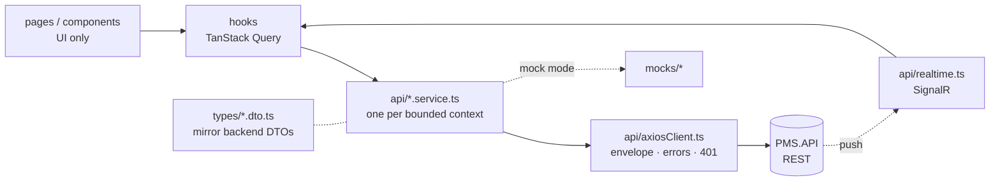

<div align="center">

# XXIV Parking — Web App

**One React app for every seat in the parking lot: the driver, the gate, the manager and the head office.**

Live 3D lot map · bookings & deposits · gate POS · approvals · revenue dashboards · AI assistant

[Backend repo](https://github.com/PhatNTSE182807/PMS-BACKEND)

</div>

---

## Four apps in one

| Area | Route | Who | Screens |
| --- | --- | --- | --- |
| **Public** | `/` | Everyone | Home with live lots and prices · sign in / register (form or Google) · password reset · AI chat assistant |
| **Customer** | `/me` | User | Dashboard with the 3D lot map · book a bay or park a motorbike now · bookings · active sessions with in-app payment · wallet · vehicles & registration papers · profile · directions to the lot |
| **Staff** | `/staff` | Staff | Gate dashboard (check-in / check-out lanes, camera plate reads, barrier) · checkout POS · cash drawer · exceptions & lost tickets · vehicle verification · work schedule · payroll |
| **Management** | `/management` | Manager | Lot console · reservations & booked-bay cases · approval queue · pricing rules, drafts and history · Staff accounts · work schedules · payroll |
| **Admin** | `/admin` | Admin | Dashboard · lots & 3D building templates · Manager and customer accounts · revenue report · live capacity · pricing history · payroll · parking simulation |

### Highlights

- **3D garage in the browser** — three.js with instanced meshes and on-demand rendering; bays, walk-ins, lane cameras and barriers update live.
- **Real-time consoles** — SignalR pushes slot changes, gate requests, cash requests and notifications straight into React Query caches.
- **Gate built for speed** — the barrier unlocks only when the Staff plate matches the plate on record; camera reads fill the field automatically.
- **Works without a backend** — every service has a mock twin speaking the real API envelope, switchable per service.
- **Payments end to end** — wallet, VNPay and MoMo return pages, signed QR tickets and exit passes.
- **Light and dark themes**, responsive layouts, lazy-loaded consoles so drivers never download the admin bundle.

---

## Architecture



| Folder | Layer | Rule |
| --- | --- | --- |
| `src/pages`, `src/components` | Presentation | UI only; never calls HTTP directly |
| `src/hooks` | Application | React Query hooks: caching, loading, errors, invalidation |
| `src/api` | Infrastructure | One service per bounded context, the HTTP client, SignalR connections, query keys |
| `src/types` | Contracts | DTOs that mirror the backend exactly |
| `src/mocks` | Infrastructure | Deterministic mock backends |
| `src/lib`, `src/config` | Shared | Domain rules, formatters, env and service paths |
| `src/components/customer/garage` | 3D | The three.js lot model |

---

## Tech stack

| Area | Choice |
| --- | --- |
| Core | React 19 · TypeScript · Vite 7 |
| Routing & data | React Router 7 · TanStack React Query 5 · Axios |
| Real-time | `@microsoft/signalr` |
| UI | Tailwind CSS 4 · Radix UI · lucide-react · sonner toasts · Recharts |
| Forms | react-hook-form · zod |
| 3D & maps | three.js · Mapbox GL |
| Extras | QR codes (`qrcode`) · Google Identity |

---

## Quick start

**Requirements:** Node.js 20.19+ or 22.12+, npm. The [backend](https://github.com/PhatNTSE182807/PMS-BACKEND) running locally, or mock mode.

```bash
git clone https://github.com/PhatNTSE182807/PMS-FRONTEND.git
cd PMS-FRONTEND
npm install
cp .env.example .env.local     # then adjust, see below
npm run dev                    # http://localhost:5173
```

| Script | What it does |
| --- | --- |
| `npm run dev` | Vite dev server with hot reload |
| `npm run lint` | ESLint |
| `npm run typecheck` | `tsc -b` |
| `npm run build` | Type-check, then production build in `dist/` |
| `npm run preview` | Serve the production build |
| `node --test tests/parking` | Unit tests for lot rules and services |

### Configuration

| Variable | Purpose |
| --- | --- |
| `VITE_API_BASE_URL` | Root of the backend REST API |
| `VITE_USE_MOCK_DATA` | `true` serves **every** service from in-browser mock data |
| `VITE_MOCK_SERVICES` | Comma-separated services to mock even when the flag above is off |
| `VITE_GOOGLE_CLIENT_ID` | Google Sign-In client (must match the backend) |
| `VITE_MAPBOX_ACCESS_TOKEN` | Directions map; empty = Google Maps link only |
| `VITE_ANPR_SERVICE_URL` | Plate reader service for the gate cameras |

Demo accounts come from the backend seed.

---

## Deployment

A single-page app with browser-history routes: the host must fall back to `index.html` for unknown
paths. `vercel.json` already does this for Vercel. CI (GitLab and GitHub Actions) lints and builds every push.

---

## Contributing

- Branch from `develop` as `features/<feature-name>`; use the same name in the backend repo when a feature touches both.
- Keep `src/types/*.dto.ts` in step with the backend on the same branch.
- Conventional Commits in English. `npm run lint && npm run build` pass → merge into `develop`.

<div align="center">

Built by **Team 03 · HCM26 CPL .NET 07** — FPT Software Academy OJT

</div>
