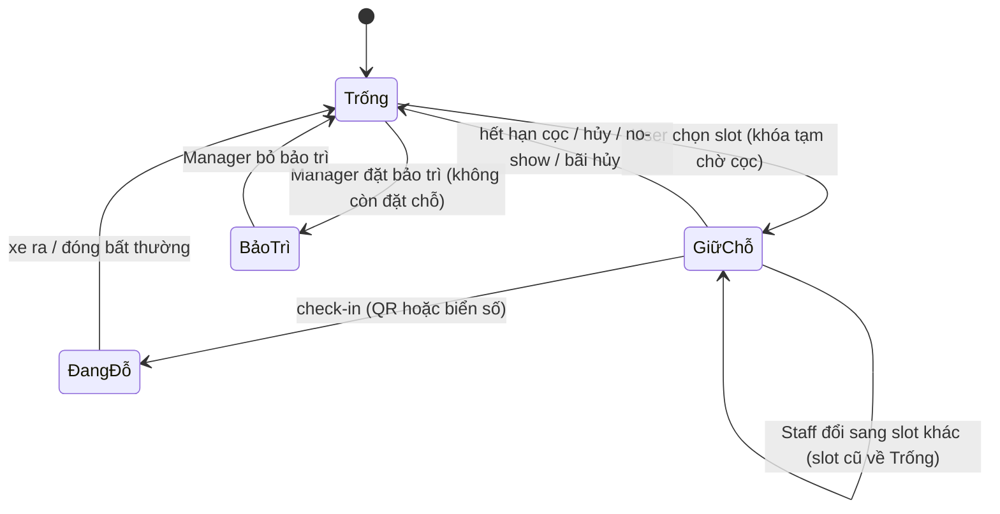
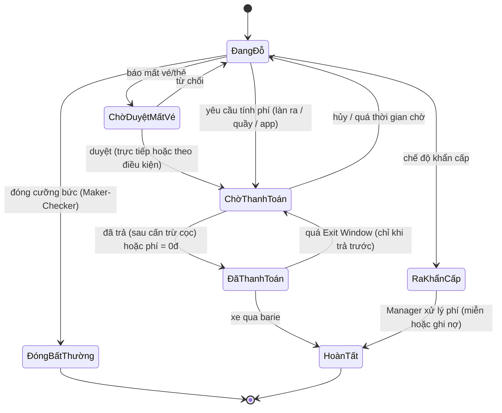
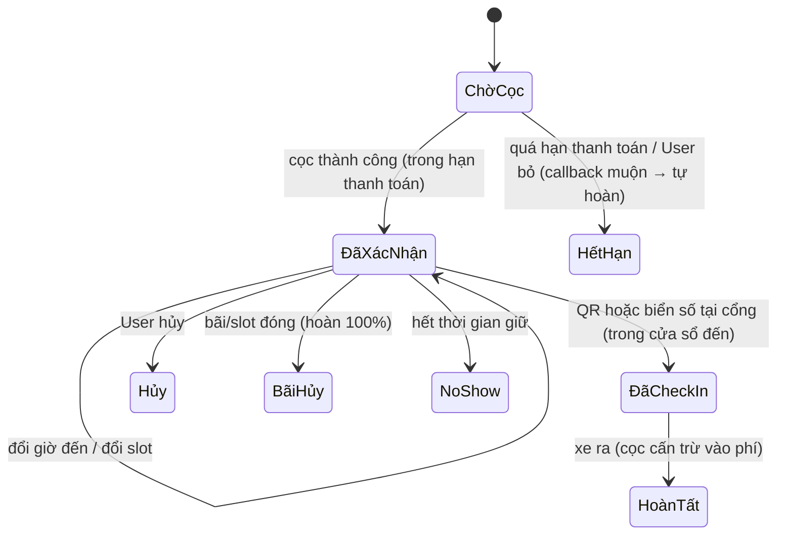
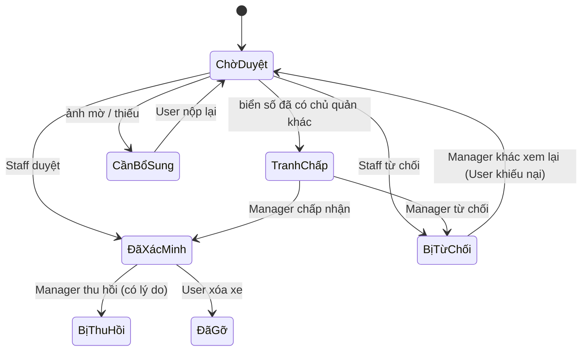
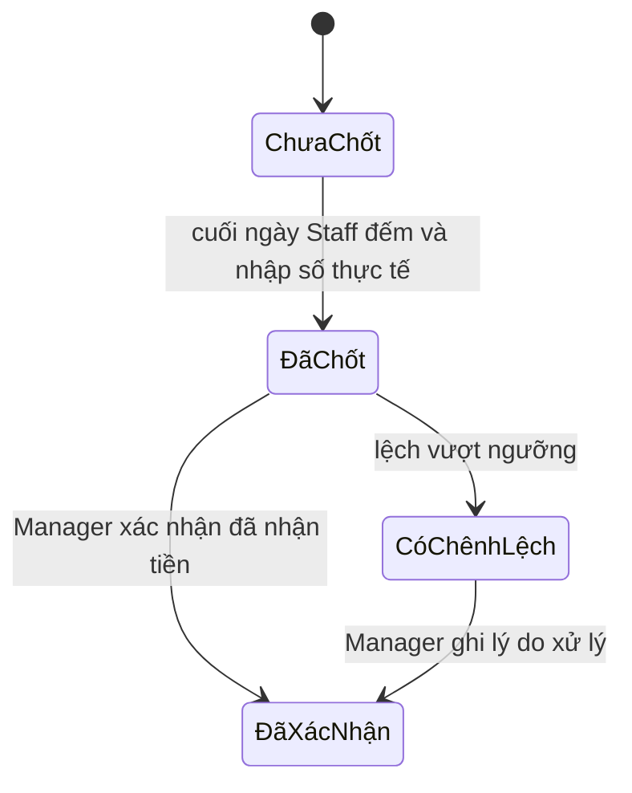

# SRS v1.4 – Hệ thống Quản lý Nhiều Bãi Đỗ Xe

> Bản Markdown chuyển từ `SRS_v1.4_He_thong_Quan_ly_Nhieu_Bai_Do_Xe.docx` để tra cứu nhanh theo mã FR/BR/UC/NFR. Bản .docx là bản gốc; khi SRS đổi, chuyển lại file này.

Oct 17, 2026

## 1. Giới thiệu

SRS v1.4 mô tả hệ thống quản lý nhiều bãi đỗ xe với 5 actor (Admin, Manager, Staff, User, Guest). So với v1.3, bản này sửa các mâu thuẫn trong luồng chính (đặt chỗ, Zone Counter, Exit Window, máy trạng thái session), bổ sung toàn bộ luồng ngoại lệ, thêm chốt tiền mặt cuối ngày theo Staff, kiểm kê tồn bãi, xác minh phương tiện bằng cà vẹt, chế độ khẩn cấp và bảng quy tắc nghiệp vụ (BR).

### 1.1 Mục đích

Tự động hóa chuỗi vận hành: xe vào/ra, tính phí, quản lý chỗ đỗ, đặt chỗ, thanh toán, đối soát tiền mặt và online, báo cáo; đồng thời cung cấp sơ đồ bãi 3D được render hoàn toàn ở Frontend.

### 1.2 Phạm vi hệ thống

- Web Admin / Dashboard: dành cho Admin và Manager (quản trị, cấu hình, duyệt, báo cáo, Layout Editor 3D).
- App / POS Staff: dành cho Staff tại cổng/quầy (xử lý xe, thu tiền, chốt tiền cuối ngày, sự cố, xác minh phương tiện).
- App / Web Khách hàng: dành cho User và Guest (xem bãi, xem slot trên 3D, đặt chỗ, thanh toán, đăng ký và xác minh xe).
- Thiết bị ngoại vi: camera ANPR, barie, cảm biến vòng từ (loop) tại làn, đầu đọc thẻ/QR, máy in vé, bảng LED, giao tiếp qua IoT Edge Service.
Các hạng mục ngoài phạm vi nằm ở mục 2.5.

### 1.3 Thuật ngữ và viết tắt

| Thuật ngữ | Ý nghĩa |
| --- | --- |
| ANPR / LPR | Nhận diện biển số tự động |
| Parking Lot / Zone / Slot | Bãi xe / Khu vực (tầng, dãy) / Vị trí chỗ đỗ cụ thể |
| Zone đếm | Khu vực có điểm vào/ra kiểm soát được, dùng để đếm xe vãng lai. Mặc định là cặp (bãi, loại xe) |
| Slot đặt chỗ | Slot được chỉ định cố định (có biển báo) chỉ dành cho xe đặt chỗ |
| Lane (làn) | Một làn xe tại cổng; mỗi làn gắn một hoặc nhiều loại xe và một chiều (vào/ra) |
| Session | Một lượt gửi xe, từ lúc vào đến lúc ra |
| Reservation | Đặt chỗ trước theo giờ đến dự kiến, gắn với một slot đặt chỗ và một xe |
| Cửa sổ đến | Khoảng thời gian được phép check-in của đặt chỗ: từ (giờ đến − thời gian đến sớm) đến (giờ đến + thời gian giữ) |
| Zone Counter | Bộ đếm số chỗ trống của một zone đếm, dùng cho xe vãng lai |
| Exit Window | Khoảng thời gian được phép ra sau khi trả trước ở quầy/kiosk hoặc qua app |
| Exit Pass | Mã QR có chữ ký do app sinh sau khi trả trước, Edge Service kiểm tra được khi offline |
| Chốt tiền cuối ngày | Cuối ngày làm việc, Staff đếm và nộp toàn bộ tiền mặt đã thu trong ngày. Không chia ca: mỗi Staff chốt một lần cho mỗi bãi mỗi ngày |
| Session “ma” | Session còn mở trên hệ thống nhưng xe đã không còn trong bãi |
| Maker-Checker | Nguyên tắc người đề xuất và người duyệt phải là hai người khác nhau |
| Duyệt theo điều kiện | Staff được tự hoàn tất một nghiệp vụ cần duyệt khi thỏa đủ điều kiện cấu hình sẵn; Manager hậu kiểm |
| Edge Service | Dịch vụ chạy tại bãi, nhận sự kiện thiết bị và hoạt động khi mất mạng |
| 3D Renderer | Thành phần Frontend dựng mô hình 3D bằng WebGL (Three.js hoặc Babylon.js) |
| Layout 3D | Dữ liệu bố cục bãi (tầng, zone, vị trí và hướng slot, model GLB) do Backend lưu và cung cấp |
| GLB / glTF | Định dạng mô hình 3D nạp vào Renderer |
| Cà vẹt | Giấy chứng nhận đăng ký xe |

## 2. Mô tả tổng quan

Hệ thống gồm một Backend API tập trung, IoT Edge Service cấp bãi (dùng chung cho mọi cổng của bãi qua mạng nội bộ) và các Frontend (Web Admin, POS Staff, App/Web khách hàng). Phần 3D render hoàn toàn ở Frontend; Backend chỉ cung cấp Layout 3D và trạng thái slot qua REST và WebSocket.

### 2.1 Danh sách Actor

| # | Actor | Có tài khoản | Vai trò |
| --- | --- | --- | --- |
| A1 | Admin | Có (nội bộ) | Quản trị hệ thống: tài khoản Manager, bãi xe, phân quyền (RBAC), cấu hình chung, thiết bị, Payment Gateway, Audit Log, sao lưu. Là người duyệt cuối cùng khi bãi không còn Manager khác để duyệt. Không tham gia vận hành hằng ngày. |
| A2 | Manager | Có (nội bộ) | Vận hành các bãi được giao: zone, slot, bảng giá, Staff, duyệt mất vé/hoàn tiền/miễn phí/đóng session/điều chỉnh counter, xác nhận chốt tiền cuối ngày, xử lý tranh chấp phương tiện, đối soát, báo cáo, Layout Editor 3D. |
| A3 | Staff | Có (nội bộ) | Trực cổng/quầy: xử lý xe thủ công khi thiết bị lỗi, xác minh cảnh báo, mất vé, thu tiền và chốt tiền cuối ngày, ghi nhận sự cố, kiểm kê tồn bãi; Staff có quyền “Xác minh phương tiện” duyệt hồ sơ cà vẹt. |
| A4 | User | Có (công khai) | Khách có tài khoản: đăng ký và xác minh xe, đặt chỗ trên 3D, theo dõi xe đang đỗ, thanh toán, xem lịch sử. |
| A5 | Guest | Không | Khách vãng lai: xem bãi, giá, slot; gửi xe bằng vé QR/thẻ; thanh toán tại làn ra, quầy hoặc QR động. |

Guest không phải một role trong cơ sở dữ liệu. Hệ thống chỉ có 4 role: Admin, Manager, Staff, User. Các quyền chi tiết (ví dụ “Xác minh phương tiện”, “Duyệt hoàn tiền”) được tách nhỏ trong RBAC.

### 2.2 Hệ thống và giao diện bên ngoài

| # | Tên | Loại | Mô tả |
| --- | --- | --- | --- |
| E1 | Payment Gateway | Hệ thống ngoài | VNPay, MoMo, VietQR, thẻ; trả kết quả qua callback/webhook; hỗ trợ API hoàn tiền. |
| E2 | 3D Renderer | Giao diện Frontend | Engine WebGL trên trình duyệt/mobile, nhận Layout 3D và trạng thái slot để dựng và cập nhật mô hình. |
| E3 | Thiết bị IoT | Hệ thống ngoài | Camera ANPR, barie, cảm biến loop, đầu đọc thẻ/QR, máy in vé, bảng LED. |
| E4 | Notification Service | Hệ thống ngoài | Gửi link đặt lại mật khẩu, biên lai, nhắc lịch, cảnh báo, yêu cầu duyệt qua Push/SMS/Email. |

### 2.3 Nguyên tắc thiết kế

- Slot theo hai chế độ, tách bạch vật lý. Xe đặt chỗ được theo dõi theo slot cụ thể và chỉ đỗ ở các slot đặt chỗ được chỉ định cố định, có biển báo (ưu tiên khu riêng). Xe vãng lai không gán slot, chỉ được tính vào Zone Counter của zone đếm. Sức chứa vãng lai của một zone = tổng slot hoạt động − slot đặt chỗ − slot bảo trì.
- Zone đếm phải xác định được tại điểm kiểm soát. Mặc định zone đếm là cặp (bãi, loại xe); mỗi làn cổng gắn loại xe. Muốn đếm theo từng tầng thì phải có thiết bị đếm ở đầu dốc mỗi tầng.
- Slot là dữ liệu nghiệp vụ gốc. Layout 3D chỉ lưu phần hiển thị và có phiên bản Nháp / Đã công bố.
- Đặt chỗ theo giờ đến, không theo khung giờ có giờ kết thúc; chỉ cho đặt trước tối đa N giờ (mặc định 2 giờ). Phí tính theo thời gian đỗ thực; tiền cọc được cấn trừ vào phí.
- Ba điểm thanh toán: làn ra (barie mở ngay khi trả xong), quầy/kiosk trong bãi và app. Exit Window chỉ áp dụng cho hai điểm sau.
- Maker-Checker cho hoàn tiền thủ công, miễn phí thủ công, duyệt mất vé, đóng session cưỡng bức, điều chỉnh Zone Counter và xem lại hồ sơ xe bị từ chối. Mọi yêu cầu duyệt có thời hạn và tự leo thang; một số nghiệp vụ được duyệt theo điều kiện để không làm khách chờ tại cổng.
- Hoàn tiền tự động theo chính sách (hủy đúng hạn, phần dư cọc, bãi hủy, callback muộn) không cần Maker-Checker nhưng phải ghi log và vào báo cáo.
- Tiền mặt được chốt theo Staff theo ngày. Staff làm nguyên ngày, không chia ca. Mọi giao dịch tiền mặt ghi lại Staff và POS đã thu; cuối ngày Staff chốt và nộp tiền, Manager xác nhận.
- Ủy quyền tạo tài khoản: Admin tạo Manager; Manager tạo Staff trong bãi mình phụ trách. Không có đăng ký công khai cho nhân sự.
- Offline là bắt buộc (khớp NFR-04). Edge Service đặt ở cấp bãi, các cổng chia sẻ dữ liệu qua mạng nội bộ; vé QR và Exit Pass tự chứa thông tin có chữ ký để kiểm tra được khi mất kết nối hoàn toàn.
- Quyền riêng tư: kênh real-time công khai không đẩy biển số. User chỉ thấy lịch sử theo biển số của xe đã xác minh và chỉ từ ngày được xác minh. Ảnh cà vẹt chỉ người có quyền xác minh được xem và bị xóa sau thời hạn cấu hình.
- Không xóa cứng dữ liệu nghiệp vụ: session, giao dịch, xe, tài khoản nhân sự chỉ khóa/gỡ; yêu cầu xóa tài khoản User được thực hiện bằng ẩn danh hóa.
### 2.4 Thay đổi so với v1.3

| Mục | Thay đổi |
| --- | --- |
| Đặt chỗ | Chuyển sang đặt theo giờ đến, giới hạn đặt trước, cửa sổ đến, thời hạn thanh toán cọc, cấn trừ cọc, đổi/hủy phía bãi, giới hạn số đặt chỗ, slot đặt chỗ chỉ định cố định (sửa FR-RSV-02, 03, 05, 06, FR-LOT-06; thêm FR-RSV-07 → 10, FR-OPS-19) |
| Zone Counter | Định nghĩa zone đếm theo (bãi, loại xe) và làn; kiểm kê tồn bãi, điều chỉnh counter có duyệt (sửa FR-LOT-03; thêm FR-LOT-07, FR-OPS-13) |
| Thanh toán | Ba điểm thanh toán, Exit Window chỉ cho trả trước, phí 0đ, thanh toán chờ/trùng, hoàn tiền tự động theo chính sách, chốt tiền cuối ngày theo Staff (sửa FR-PAY-07; thêm FR-PAY-08 → 11) |
| Session | Vẽ lại máy trạng thái: tách thiết bị lỗi khỏi mất vé, thêm từ chối mất vé, hủy thanh toán, đóng bất thường, ra khẩn cấp |
| Vào/ra | Xe không biển số, biển số trùng session mở, ANPR độ tin cậy thấp, quay đầu, xe quá hạn, Whitelist/Blacklist được định nghĩa (thêm FR-OPS-10 → 16) |
| Offline | Edge cấp bãi, vé QR có chữ ký, Exit Pass, hàng chờ xung đột (sửa FR-OPS-09; thêm FR-OPS-17) |
| Phương tiện | Đăng ký xe kèm cà vẹt, luồng xác minh, tranh chấp, thu hồi (thêm FR-CUS-04 → 06, FR-VER-01 → 06) |
| Bãi | Vòng đời bãi, xử lý khi đóng bãi/bảo trì slot (sửa FR-LOT-04; thêm FR-LOT-08) |
| Sự cố | Vòng đời sự cố, loại “khách báo hư hỏng/mất đồ”, chế độ khẩn cấp (sửa FR-OPS-08; thêm FR-OPS-18) |
| Quyền riêng tư | Cập nhật căn cứ pháp lý sang Luật BVDLCN 91/2025/QH15 và Nghị định 356/2025/NĐ-CP; đồng ý điều khoản, biển báo camera, xóa tài khoản (thêm FR-AUTH-09, 10) |
| Khác | Thêm FR-3D-09 (kênh 3D nội bộ), FR-PRC-06 (mô phỏng tính phí), FR-RPT-05 → 07, FR-SYS-07 (danh mục loại xe), FR-SYS-08 (hàng chờ duyệt) |
| Tạo tài khoản | Admin chỉ tạo Manager; Manager tạo Staff trong bãi mình (sửa FR-AUTH-04, 07, UC-09, ma trận quyền) |
| Xác thực | Tạm bỏ OTP và 2FA; mọi actor đăng nhập bằng email + mật khẩu hoặc Google; form tạo tài khoản gồm Họ tên, Email, Số điện thoại, Mật khẩu, Xác nhận mật khẩu (sửa FR-AUTH-01, 02, 04, 07, 08, UC-09, NFR-05; thêm FR-AUTH-11, 12, BR-28) |
| Tài liệu | Thêm bảng Business Rules (mục 5), ví dụ tính phí, UC-11 → UC-15, tiền/hậu điều kiện và luồng ngoại lệ cho UC; sửa ma trận quyền |
| Dữ liệu | Thêm VehicleType, Lane, VehicleDocument, VehicleVerificationLog, DailyCashClose, ZoneCounterAdjustment, InventoryCheck, ApprovalRequest, ConflictQueue; bổ sung trường cho Reservation, ParkingSession, Slot, Ticket/Card |

### 2.5 Ngoài phạm vi phiên bản này

- Đăng nhập bằng OTP (SĐT/email) và xác thực 2 yếu tố (2FA): tạm hoãn; hiện dùng email + mật khẩu hoặc Google.
- Vé tháng / thành viên (gói tuần, tháng, quý, năm, vé doanh nghiệp). Session đã có trường “loại lượt gửi” để mở rộng sau.
- Tích hợp Hóa đơn điện tử; hệ thống chỉ phát hành biên lai thanh toán.
- Ví nội bộ, Auto-Pay, tích điểm, đánh giá; quy trình khiếu nại/bồi thường đầy đủ (chỉ ghi nhận sự cố do khách báo).
- Quản lý Tenant đa chủ bãi, Public Open API, chia doanh thu cho đối tác.
- Chia ca làm việc (phân lịch ca, mở/đóng ca, bàn giao ca, quỹ đầu ca): Staff làm nguyên ngày. Chốt tiền cuối ngày vẫn nằm trong phạm vi.
- Cảm biến/camera theo dõi từng slot cho xe vãng lai.
- Phân tích dự báo bằng AI, bản đồ dẫn đường ngoài (Google Maps, Mapbox).
- Xác minh cà vẹt tự động bằng OCR hoặc tra cứu cơ sở dữ liệu đăng ký xe.
## 3. Yêu cầu chức năng

Có 101 yêu cầu chức năng chia theo 11 module. Mức ưu tiên: M = Must, S = Should, C = Could. Mã FR giữ ổn định so với v1.3; FR-OPS-06 (quản lý ca) đã bỏ và không đánh số lại. Các quy tắc chi tiết được tham chiếu tới bảng BR ở mục 5.

### 3.1 Tài khoản và phân quyền (FR-AUTH)

| ID | Mô tả yêu cầu | Actor | Ưu tiên |
| --- | --- | --- | --- |
| FR-AUTH-01 | User đăng ký bằng form (Họ tên, Email, Số điện thoại, Mật khẩu, Xác nhận mật khẩu) hoặc bằng Google (OAuth 2.0 / OpenID Connect). Đăng nhập bằng email + mật khẩu hoặc Google; email đăng nhập Google trùng với tài khoản đã đăng ký bằng form thì được liên kết vào cùng tài khoản. Đăng ký bằng Google thì bổ sung SĐT ở lần đầu (tùy chọn). Tài khoản tự đăng ký luôn có role User | User | M |
| FR-AUTH-02 | Nhân sự đăng nhập bằng email + mật khẩu hoặc bằng Google với đúng email của tài khoản nội bộ đã được tạo sẵn; email chưa được tạo tài khoản nội bộ không vào được POS/Web Admin | Admin, Manager, Staff | M |
| FR-AUTH-03 | Phân quyền RBAC theo 4 role kèm phạm vi bãi; quyền được tách nhỏ (duyệt mất vé, duyệt hoàn tiền, xác minh phương tiện, điều chỉnh counter, đóng session…) để thực hiện Maker-Checker | Admin | M |
| FR-AUTH-04 | Admin chỉ tạo tài khoản Manager bằng form (Họ tên, Email, Số điện thoại, Mật khẩu, Xác nhận mật khẩu) và gán phạm vi bãi; Admin không tạo Staff. Admin được khóa, đặt lại mật khẩu và thu hồi phiên của mọi tài khoản nội bộ. Tài khoản Admin đầu tiên được khởi tạo sẵn khi cài đặt hệ thống | Admin | M |
| FR-AUTH-05 | Ghi Audit Log mọi thao tác tạo, sửa, khóa, đổi vai trò, duyệt, từ chối, hoàn tiền, mở barie thủ công, điều chỉnh counter, đóng session, xem ảnh cà vẹt | Admin | M |
| FR-AUTH-06 | Truy cập chức năng công khai (xem bãi, giá, slot) không cần đăng nhập | Guest | M |
| FR-AUTH-07 | Manager tạo Staff bằng form (Họ tên, Email, Số điện thoại, Mật khẩu, Xác nhận mật khẩu), khóa và đặt lại mật khẩu cho Staff, chỉ trong bãi mình phụ trách; không được cấp role cao hơn Staff. Bãi chưa có Manager thì chưa tạo được Staff; Manager nghỉ việc thì Admin gán Manager mới để tiếp quản Staff của bãi. Backend kiểm tra role và phạm vi, không tin dữ liệu từ form | Manager | M |
| FR-AUTH-08 | Tài khoản nội bộ dùng được ngay sau khi tạo, đăng nhập bằng email + mật khẩu do người tạo đặt hoặc bằng Google cùng email; nhân sự nghỉ việc thì khóa, không xóa. Không được khóa Staff còn tiền mặt chưa chốt trong ngày | Admin, Manager | M |
| FR-AUTH-09 | Khi đăng ký, User phải đồng ý điều khoản xử lý dữ liệu cá nhân (biển số, ảnh vào/ra, ảnh giấy tờ); hệ thống lưu phiên bản điều khoản và thời điểm đồng ý | User | M |
| FR-AUTH-10 | User yêu cầu xóa tài khoản: hệ thống ẩn danh hóa thông tin cá nhân, gỡ xe, xóa ảnh giấy tờ, giữ lại session và giao dịch ở dạng ẩn danh. Không cho xóa khi còn session đang mở, đặt chỗ hiệu lực hoặc khoản hoàn tiền đang xử lý (BR-21) | User | S |
| FR-AUTH-11 | Kiểm tra form tạo tài khoản (BR-28): đủ 5 trường, email đúng định dạng và chưa tồn tại, SĐT đúng định dạng Việt Nam và chưa tồn tại, mật khẩu đạt quy tắc, Xác nhận mật khẩu trùng Mật khẩu. Kiểm tra ở cả Frontend và Backend | Hệ thống | M |
| FR-AUTH-12 | Quản lý mật khẩu: đổi mật khẩu trong hồ sơ (nhập mật khẩu cũ); quên mật khẩu qua link đặt lại gửi tới email (link dùng một lần, hết hạn sau 30 phút); tài khoản chỉ đăng nhập Google có thể tự đặt mật khẩu | User, Staff, Manager, Admin | M |

### 3.2 Bãi, khu vực và slot (FR-LOT)

| ID | Mô tả yêu cầu | Actor | Ưu tiên |
| --- | --- | --- | --- |
| FR-LOT-01 | CRUD bãi xe: tên, địa chỉ, tọa độ GPS, giờ hoạt động, hình ảnh. Sức chứa được tính từ tổng slot, không nhập tay | Admin | M |
| FR-LOT-02 | Thiết lập Zone/Tầng/Dãy, cấu hình slot theo loại xe (từ danh mục VehicleType), khai báo zone đếm và gắn làn cổng với loại xe | Manager | M |
| FR-LOT-03 | Slot đặt chỗ có 4 trạng thái: Trống, Giữ chỗ, Đang đỗ, Bảo trì (mục 4.2). Xe vãng lai không gán slot; Zone Counter của zone đếm được cập nhật khi cảm biến xác nhận xe đã qua barie | Manager, Staff, Hệ thống | M |
| FR-LOT-04 | Bật/tắt hoạt động bãi, đóng tạm thời, thông báo bảo trì. Khi đóng tạm: chặn xe vào và đặt chỗ mới, xe đang trong bãi vẫn ra được, đặt chỗ tương lai bị hủy phía bãi và hoàn 100% (FR-RSV-09) | Manager | M |
| FR-LOT-05 | Xem danh sách bãi, giá và số chỗ trống theo thời gian thực | Guest, User | M |
| FR-LOT-06 | Chỉ định cụ thể từng slot là slot đặt chỗ (cờ trên Slot, có biển báo thực tế). Chỉ đổi được cờ khi slot không có đặt chỗ hiệu lực | Manager | M |
| FR-LOT-07 | Điều chỉnh Zone Counter thủ công: Staff đề xuất kèm lý do và số liệu kiểm đếm, Manager khác duyệt (BR-15); mọi điều chỉnh vào báo cáo ngoại lệ | Staff, Manager | M |
| FR-LOT-08 | Vòng đời bãi: Đang thiết lập → Hoạt động → Tạm đóng → Ngừng hoạt động. Bãi Đang thiết lập không hiển thị công khai; chỉ chuyển sang Hoạt động khi đã có zone, slot, làn, bảng giá, chính sách đặt chỗ và ít nhất một Manager | Admin, Manager | S |

### 3.3 Trực quan hóa 3D (FR-3D)

3D Renderer (E2) chạy hoàn toàn trên Frontend (WebGL). Backend chỉ cung cấp Layout 3D và trạng thái qua REST/WebSocket.

| ID | Mô tả yêu cầu | Actor | Ưu tiên |
| --- | --- | --- | --- |
| FR-3D-01 | Hiển thị sơ đồ bãi 3D (tầng, zone, slot) trên web và mobile, dựng từ Layout 3D đã công bố | Tất cả actor | M |
| FR-3D-02 | Slot đặt chỗ tô màu theo trạng thái; slot vãng lai không hiển thị “Trống” mà tô theo mức lấp đầy của zone đếm chứa nó; tự cập nhật qua WebSocket | Guest, User, Staff, Manager | M |
| FR-3D-03 | Tương tác: xoay, zoom, pan, chuyển tầng; chạm/click slot hoặc zone để xem loại xe, trạng thái (slot vãng lai hiển thị “Khu vãng lai – còn N chỗ”), giá | Guest, User, Staff, Manager | M |
| FR-3D-04 | Chọn slot đặt chỗ đang Trống, đúng loại xe của User, để đặt chỗ | User | M |
| FR-3D-05 | Layout Editor: đặt vị trí, hướng, loại slot, tầng; lưu bản Nháp, xem trước, rồi Công bố thì client mới nhận. Manager chỉ sửa bãi mình phụ trách. Layout không tạo hay xóa slot nghiệp vụ | Manager, Admin | S |
| FR-3D-06 | Fallback sơ đồ 2D khi thiết bị không hỗ trợ WebGL hoặc hiệu năng thấp; có Level of Detail | Guest, User, Staff | S |
| FR-3D-07 | Đánh dấu vị trí xe đang đỗ và gợi ý đường đi tới slot (chỉ với xe đặt chỗ) | User | C |
| FR-3D-08 | Kênh dữ liệu 3D công khai chỉ gồm trạng thái slot và số chỗ trống theo zone đếm, không chứa biển số; có giới hạn tần suất truy cập | Hệ thống | M |
| FR-3D-09 | Kênh 3D nội bộ cho Staff/Manager hiển thị thêm slot đặt chỗ đang bị chiếm sai và session quá hạn | Staff, Manager | C |

### 3.4 Xe vào/ra và vận hành cổng (FR-OPS)

| ID | Mô tả yêu cầu | Actor | Ưu tiên |
| --- | --- | --- | --- |
| FR-OPS-01 | Check-in: xác định loại xe theo làn, đọc biển số (ANPR hoặc nhập tay), chụp ảnh, kiểm tra Blacklist/Whitelist, biển số trùng, Zone Counter. Guest nhận vé QR (có chữ ký) hoặc thẻ; xe đặt chỗ check-in bằng QR hoặc biển số đã xác minh trong cửa sổ đến; mở barie; session chỉ có hiệu lực khi cảm biến xác nhận xe đã qua | Staff, Guest, User, E3 | M |
| FR-OPS-02 | Check-out: nhận diện vé/thẻ/biển số, đối chiếu ảnh vào – ra; nếu đã trả trước và còn Exit Window, hoặc phí = 0đ, thì mở barie; nếu chưa thì tính phí (cấn trừ cọc nếu có) và thu tại làn | Staff, Guest, User, E3 | M |
| FR-OPS-03 | Check-in/out thủ công khi thiết bị sự cố, bắt buộc ghi lý do. Không cần duyệt; lượt vào/ra được gắn cờ “thủ công” và vào báo cáo ngoại lệ | Staff | M |
| FR-OPS-04 | Đối chiếu ảnh và biển số vào – ra, chặn barie khi sai lệch để Staff xác minh; kết quả: cho qua (ghi lý do), chuyển sang luồng mất vé, hoặc từ chối | Staff, E3 | M |
| FR-OPS-05 | Xử lý mất vé/mất thẻ: Staff xác minh chủ xe và tạo hồ sơ với phí phạt cấu hình; duyệt theo điều kiện (BR-13) hoặc gửi Manager duyệt qua push, có thời hạn và leo thang (BR-14). Từ chối thì xe ở lại bãi. Thẻ bị mất được khóa ngay | Staff, Manager | M |
| FR-OPS-07 | Quản lý Blacklist/Whitelist biển số theo định nghĩa ở BR-16, BR-17: mỗi mục có lý do, phạm vi (bãi hoặc toàn chuỗi), ngày hết hạn; Blacklist toàn chuỗi do Admin quản lý | Admin, Manager, Staff | S |
| FR-OPS-08 | Quản lý sự cố theo vòng đời Mở → Đang xử lý → Đã đóng, có người phụ trách, ảnh đính kèm, liên kết session. Loại sự cố: xe hư hỏng, kẹt barie, đỗ quá hạn, slot đặt chỗ bị chiếm, khách báo hư hỏng/mất đồ, khác. Ảnh vào/ra của session liên quan không bị xóa khi sự cố chưa đóng | Staff, Manager | S |
| FR-OPS-09 | Offline: Edge Service cấp bãi lưu session đang mở, đặt chỗ, Blacklist/Whitelist, bảng giá (kèm phiên bản sắp hiệu lực) và kết quả thanh toán; các cổng dùng chung qua mạng nội bộ. Xếp hàng sự kiện, đồng bộ với khóa chống trùng khi có mạng. Khi offline: thu tiền mặt, chấp nhận Exit Pass có chữ ký; vé QR tự chứa mã bãi, giờ vào, làn, chữ ký để cổng nào cũng tính được phí | Staff, E3 | M |
| FR-OPS-10 | Xe không biển số (xe đạp, xe đạp điện…): bỏ qua ANPR và luật trùng biển số; session dựa trên vé/thẻ và ảnh xe; check-out bắt buộc Staff đối chiếu ảnh | Staff, Guest, E3 | M |
| FR-OPS-11 | Biển số đã có session đang mở trong bãi: chặn barie, cảnh báo Staff. Staff chọn: (a) session cũ là session “ma” → đề xuất đóng bất thường (FR-OPS-12) rồi tạo session mới; (b) nghi biển số giả → từ chối và tạo sự cố | Staff, E3 | M |
| FR-OPS-12 | Đóng session bất thường (session “ma”, lỗi đồng bộ): Staff đề xuất kèm lý do và bằng chứng, Manager khác duyệt; phí của session được ghi nợ hoặc miễn theo quyết định duyệt | Staff, Manager | M |
| FR-OPS-13 | Kiểm kê tồn bãi: Staff kiểm đếm thực tế theo zone (khuyến nghị cuối ngày), nhập số xe và biển số; hệ thống so với session đang mở, liệt kê session “ma” và xe không có session, đề xuất điều chỉnh Zone Counter (FR-LOT-07) | Staff, Manager | M |
| FR-OPS-14 | ANPR độ tin cậy dưới ngưỡng (BR-18): tại cổng vào, Staff xác nhận hoặc sửa biển số trước khi mở barie; tại cổng ra, chặn barie và đối chiếu ảnh | Staff, E3 | M |
| FR-OPS-15 | Zone đếm hết chỗ: chặn xe vãng lai, LED báo “Hết chỗ”; vẫn cho xe đặt chỗ và Whitelist vào; Staff được mở cho vào với lý do (BR-19) | Staff, E3 | M |
| FR-OPS-16 | Xe quá hạn: session đỗ quá ngưỡng (BR-20) thì cảnh báo Staff/Manager và gửi thông báo nếu xe thuộc User; quá ngưỡng xe bỏ quên thì tạo sự cố và xử lý theo quy trình nội bộ | Hệ thống, Staff, Manager | S |
| FR-OPS-17 | Hàng chờ xung đột đồng bộ: các xung đột sau khi Edge đồng bộ (cùng biển số hai session, thanh toán trùng, session không khớp) được đưa vào hàng chờ cho Manager xử lý, không tự giải quyết chỉ bằng thời điểm sự kiện | Manager | M |
| FR-OPS-18 | Chế độ khẩn cấp (PCCC, sơ tán): Manager hoặc Staff được ủy quyền bật/tắt; mở toàn bộ barie, dừng thu phí, gắn trạng thái “Ra khẩn cấp” cho các xe ra trong thời gian đó; sau sự kiện Manager quyết định miễn phí hoặc ghi nợ | Manager, Staff | M |
| FR-OPS-19 | Đổi slot cho xe đặt chỗ khi slot đã hẹn bị chiếm hoặc hỏng: Staff chọn slot đặt chỗ Trống khác cùng loại, slot cũ ghi nhận sự cố; áp dụng ưu đãi bù theo BR-08 | Staff | M |

### 3.5 Bảng giá và tính phí (FR-PRC)

| ID | Mô tả yêu cầu | Actor | Ưu tiên |
| --- | --- | --- | --- |
| FR-PRC-01 | Cấu hình bảng giá theo bãi / loại xe; giá theo zone chỉ áp dụng cho slot đặt chỗ (xe vãng lai không xác định được zone) | Manager | M |
| FR-PRC-02 | Mô hình tính phí: theo lượt, theo giờ, block thời gian, ngày/đêm, trần/ngày | Manager | M |
| FR-PRC-03 | Thời gian miễn phí ban đầu, phụ phí qua đêm, phí quá Exit Window, phạt mất vé (gồm tiền thẻ nếu mất thẻ) | Manager | M |
| FR-PRC-04 | Lưu lịch sử thay đổi giá và ngày bắt đầu áp dụng; session ghi lại phiên bản giá đã áp; bảng giá mới được đẩy xuống Edge trước ngày hiệu lực | Manager | M |
| FR-PRC-05 | Giá linh hoạt theo giờ cao điểm/ngày lễ (Dynamic Pricing) và mã giảm giá | Manager | C |
| FR-PRC-06 | Màn hình mô phỏng tính phí: nhập loại xe, giờ vào, giờ ra để xem phí và chi tiết từng block trước khi kích hoạt bảng giá | Manager | S |

### 3.6 Đặt chỗ trước (FR-RSV)

| ID | Mô tả yêu cầu | Actor | Ưu tiên |
| --- | --- | --- | --- |
| FR-RSV-01 | Tìm bãi, so sánh giá và chỗ trống; xem trước trên mô hình 3D | User, Guest (chỉ xem) | M |
| FR-RSV-02 | Đặt chỗ theo giờ đến dự kiến, chọn xe và slot đặt chỗ trên 3D; giờ đến không quá N giờ kể từ lúc đặt (BR-01). Slot chuyển Giữ chỗ ngay và được khóa trong thời hạn thanh toán cọc; cọc thành công thì đặt chỗ Đã xác nhận. Hai User chọn cùng slot thì người giữ được trước thắng, người sau nhận thông báo slot không còn | User, E1 | M |
| FR-RSV-03 | User đổi giờ đến (vẫn trong giới hạn BR-01) hoặc đổi slot trước hạn đổi; hủy đặt chỗ và được hoàn cọc theo BR-04 | User | S |
| FR-RSV-04 | Sinh mã QR đặt chỗ; check-in bằng QR hoặc bằng biển số đã xác minh trong cửa sổ đến (BR-02); QR và biển số không khớp thì Staff xác minh | User, Staff | M |
| FR-RSV-05 | Hết thời gian giữ mà chưa check-in: đặt chỗ chuyển No-show, slot về Trống, cọc bị giữ theo BR-05; xe đến sau đó được xử lý như xe vãng lai | Hệ thống | M |
| FR-RSV-06 | Cấu hình chính sách đặt chỗ theo bãi: loại xe được đặt, thời gian đặt trước tối đa, thời hạn thanh toán cọc, thời gian đến sớm, thời gian giữ, mức cọc theo loại xe, hạn hủy được hoàn cọc, số đặt chỗ tối đa mỗi tài khoản | Manager | M |
| FR-RSV-07 | Cấn trừ cọc: khi check-out, tiền cọc được trừ vào phí gửi xe; phí nhỏ hơn cọc thì xử lý phần dư theo BR-03 | Hệ thống | M |
| FR-RSV-08 | Callback cọc đến sau khi đặt chỗ đã Hết hạn: hệ thống tự hoàn tiền qua E1 và thông báo cho User | Hệ thống, E1 | M |
| FR-RSV-09 | Hủy phía bãi khi bãi đóng tạm hoặc slot cần bảo trì: Manager chọn đổi sang slot khác (nếu còn) hoặc hủy; hủy thì hoàn 100% cọc và thông báo | Manager, Hệ thống | M |
| FR-RSV-10 | Nhắc lịch qua E4: trước giờ đến và trước khi hết thời gian giữ | Hệ thống, E4 | S |

### 3.7 Thanh toán và biên lai (FR-PAY)

| ID | Mô tả yêu cầu | Actor | Ưu tiên |
| --- | --- | --- | --- |
| FR-PAY-01 | Thu tiền mặt tại làn ra/quầy; mỗi giao dịch tiền mặt ghi lại Staff và POS đã thu | Staff, Guest | M |
| FR-PAY-02 | Thanh toán online: VietQR động, ví điện tử, thẻ ngân hàng qua Payment Gateway | User, E1 | M |
| FR-PAY-03 | Thanh toán QR động tại làn ra/quầy cho khách không có tài khoản | Guest, Staff, E1 | M |
| FR-PAY-04 | Hoàn tiền thủ công, điều chỉnh giao dịch, hủy bill, miễn phí thủ công: Staff hoặc Manager đề xuất, Manager khác duyệt; Manager là người đề xuất mà bãi không còn Manager khác thì Admin duyệt. Giao dịch tài chính không được sửa, chỉ tạo PaymentAdjustment (“hủy bill” là một loại PaymentAdjustment) | Staff, Manager, Admin | M |
| FR-PAY-05 | Đối soát hằng ngày với Payment Gateway, xử lý giao dịch sai lệch | Manager, E1 | M |
| FR-PAY-06 | Phát hành biên lai điện tử gửi qua E4 cho User; Guest có thể nhập SĐT/email để nhận, không bắt buộc | User, Guest, E4 | S |
| FR-PAY-07 | Exit Window: chỉ áp dụng khi trả trước ở quầy/kiosk hoặc qua app. Sau khi trả, xe được ra trong N phút (mặc định 15); quá hạn thì tính lại theo BR-10. Kết quả thanh toán online được đồng bộ xuống Edge để barie mở trong ≤ 3 giây; app sinh Exit Pass có chữ ký để dùng khi cổng offline | Hệ thống | M |
| FR-PAY-08 | Thanh toán chờ: QR động đã quét nhưng chưa có callback sau thời gian chờ (BR-11) thì Staff chọn đợi tiếp, kiểm tra trạng thái giao dịch với E1, hoặc thu tiền mặt; nếu sau đó callback thành công thì giao dịch trùng được hoàn tự động | Staff, E1 | M |
| FR-PAY-09 | Phát hiện thanh toán trùng cho cùng một session (QR + tiền mặt, app + làn ra): giữ giao dịch đầu, hoàn giao dịch sau theo kênh gốc (tiền mặt hoàn tại chỗ và trừ vào tiền mặt trong ngày của Staff) | Hệ thống, Staff | M |
| FR-PAY-10 | Hoàn tiền tự động theo chính sách (hủy đúng hạn, phần dư cọc, bãi hủy, callback muộn, thanh toán trùng): không cần Maker-Checker, ghi log; hoàn thất bại thì vào hàng chờ cho Manager xử lý. Guest thanh toán online được hoàn qua API hoàn tiền của E1 về nguồn gốc | Hệ thống, E1, Manager | M |
| FR-PAY-11 | Chốt tiền cuối ngày: hệ thống tự cộng tiền mặt mỗi Staff đã thu trong ngày (gồm giao dịch lúc offline sau khi đồng bộ); cuối ngày Staff nhập số tiền đếm thực tế và chốt, hệ thống tính chênh lệch; Manager xác nhận đã nhận tiền; chênh lệch vượt ngưỡng (BR-12) phải ghi lý do. Không chia ca, không mở/đóng ca, không quỹ đầu ca | Staff, Manager | M |

### 3.8 Ứng dụng khách hàng (FR-CUS)

| ID | Mô tả yêu cầu | Actor | Ưu tiên |
| --- | --- | --- | --- |
| FR-CUS-01 | Quản lý hồ sơ cá nhân và danh sách phương tiện | User | M |
| FR-CUS-02 | Tra cứu lịch sử gửi xe, ảnh vào/ra và chi tiết thanh toán: gồm các lượt do User đặt chỗ/thanh toán, và các lượt theo biển số của xe đã xác minh tính từ ngày xác minh (BR-23) | User | M |
| FR-CUS-03 | Theo dõi xe đang đỗ (kể cả khi không đặt chỗ, nếu xe đã xác minh): thời gian đã đỗ, phí tạm tính, thanh toán trước và nhận Exit Pass | User | S |
| FR-CUS-04 | Đăng ký xe: nhập biển số, loại xe, quan hệ với xe (chính chủ / xe gia đình / xe công ty / mua lại chưa sang tên), upload ảnh 2 mặt cà vẹt, đồng ý xử lý ảnh giấy tờ | User | M |
| FR-CUS-05 | Xem trạng thái xác minh xe, lý do từ chối, nộp lại hồ sơ (tối đa N lần, BR-24), gửi khiếu nại khi bị từ chối | User | M |
| FR-CUS-06 | Gỡ xe khỏi tài khoản; không gỡ được khi xe có session đang mở hoặc đặt chỗ hiệu lực | User | S |

### 3.9 Xác minh phương tiện (FR-VER)

| ID | Mô tả yêu cầu | Actor | Ưu tiên |
| --- | --- | --- | --- |
| FR-VER-01 | Kiểm tra tự động khi nộp hồ sơ: định dạng biển số, chất lượng ảnh, biển số đã có chủ quản đã xác minh (→ Tranh chấp), biển số trong Blacklist (→ gắn cảnh báo cho người duyệt) | Hệ thống | M |
| FR-VER-02 | Hàng chờ xác minh toàn chuỗi cho Staff có quyền “Xác minh phương tiện”, sắp theo thời gian nộp, có thời hạn duyệt (BR-25) | Staff | M |
| FR-VER-03 | Duyệt theo checklist: biển số khớp, loại xe/nhãn hiệu/màu khớp, ảnh là giấy tờ gốc, tên chủ xe khớp hoặc quan hệ khai báo hợp lý. Quyết định: Duyệt / Yêu cầu bổ sung / Từ chối (lý do chọn từ danh mục). Người duyệt không được duyệt xe của chính mình | Staff | M |
| FR-VER-04 | Đối chiếu tại bãi ở lượt gửi đầu tiên sau khi được duyệt: ANPR và Staff kiểm tra xe thực tế khớp hồ sơ; không khớp thì tạo đề xuất thu hồi | Staff, E3 | S |
| FR-VER-05 | Manager xử lý tranh chấp biển số, xem lại hồ sơ bị từ chối khi User khiếu nại (người xem lại khác người đã từ chối), thu hồi xác minh có lý do và thông báo | Manager | M |
| FR-VER-06 | Ảnh cà vẹt lưu ở storage riêng, chỉ người có quyền xác minh xem được, mỗi lần xem ghi Audit Log; tự xóa sau N ngày kể từ khi có quyết định cuối (BR-26). Manager kiểm tra ngẫu nhiên hồ sơ đã duyệt | Hệ thống, Manager | M |

### 3.10 Báo cáo (FR-RPT)

| ID | Mô tả yêu cầu | Actor | Ưu tiên |
| --- | --- | --- | --- |
| FR-RPT-01 | Dashboard tổng quan đa bãi: lượt xe, doanh thu, tỷ lệ lấp đầy | Admin, Manager | M |
| FR-RPT-02 | Báo cáo doanh thu theo ngày/tuần/tháng, bãi, loại xe, phương thức thanh toán | Manager | M |
| FR-RPT-03 | Báo cáo ngoại lệ: xe quá hạn, mở barie thủ công, lượt vào/ra thủ công, hủy bill, miễn phí thủ công, lệch biển số, đóng session bất thường, điều chỉnh Zone Counter, ra khẩn cấp, mất vé (duyệt theo điều kiện và duyệt trực tiếp) | Manager | S |
| FR-RPT-04 | Xuất báo cáo Excel/PDF | Manager | S |
| FR-RPT-05 | Báo cáo chốt tiền cuối ngày: tiền mặt đã thu và chênh lệch theo Staff, theo ngày | Manager | M |
| FR-RPT-06 | Báo cáo đặt chỗ: số đặt chỗ, tỷ lệ no-show, hủy, hủy phía bãi, slot bị chiếm, tiền cọc giữ lại và đã hoàn | Manager | S |
| FR-RPT-07 | Báo cáo xác minh phương tiện: số hồ sơ, tỷ lệ duyệt/từ chối, thời gian duyệt trung bình theo người duyệt, số tranh chấp và thu hồi | Manager, Admin | C |

### 3.11 Nhân sự, thiết bị và cấu hình hệ thống (FR-SYS)

| ID | Mô tả yêu cầu | Actor | Ưu tiên |
| --- | --- | --- | --- |
| FR-SYS-01 | Quản lý nhân viên, gán bãi/cổng/POS và các quyền chi tiết (không có phân lịch ca) | Manager | M |
| FR-SYS-02 | Cấu hình tham số chung: tiền tệ, múi giờ, mẫu vé in, Exit Window, thời hạn lưu ảnh vào/ra, thời hạn lưu ảnh giấy tờ, ngưỡng ANPR mặc định, thời hạn duyệt và cấp leo thang. Cấu hình theo bãi (nếu có) ghi đè cấu hình chung | Admin | M |
| FR-SYS-03 | Quản lý danh mục thiết bị, làn và loại xe của làn; giám sát Online/Offline; cảnh báo lỗi; cảnh báo Manager khi Edge mất kết nối quá ngưỡng | Admin, Manager | M |
| FR-SYS-04 | Quản lý cấu hình Payment Gateway, API Keys, Webhooks | Admin | M |
| FR-SYS-05 | Sao lưu và khôi phục dữ liệu | Admin | M |
| FR-SYS-06 | Gửi thông báo Push/SMS/Email: xác nhận đặt chỗ, nhắc lịch, biên lai, kết quả xác minh xe, yêu cầu duyệt, cảnh báo thiết bị/bãi đầy/xe quá hạn | Hệ thống, E4 | S |
| FR-SYS-07 | Danh mục loại xe (VehicleType): tên, có biển số hay không, cho phép đặt chỗ hay không | Admin | M |
| FR-SYS-08 | Hàng chờ duyệt chung: mọi yêu cầu cần duyệt (mất vé, hoàn tiền, miễn phí, đóng session, điều chỉnh counter, khiếu nại xác minh) có người đề xuất, hạn duyệt, cấp leo thang và trạng thái | Manager, Admin | M |

## 4. Luồng nghiệp vụ

Mỗi actor có một luồng chính và các luồng ngoại lệ đi kèm. Năm máy trạng thái ở mục 4.3 là quy tắc chung mọi luồng phải tuân theo; không được chuyển trạng thái ngoài các mũi tên đã vẽ.

### 4.1 Luồng chính theo actor

Guest (không tài khoản)

- Xem danh sách bãi, giá, số chỗ trống và mô hình 3D; không thấy biển số.
- Vào làn đúng loại xe: ANPR đọc biển số (xe không biển số thì bỏ qua), hệ thống kiểm tra Blacklist, biển số trùng và Zone Counter, tạo session, phát vé QR có chữ ký hoặc thẻ, mở barie. Khi cảm biến xác nhận xe đã qua, Zone Counter giảm 1.
- Khi ra, Guest chọn một trong hai:
  - Trả tại làn ra: quét vé, màn hình hiện phí, trả tiền mặt hoặc QR động; trả xong barie mở ngay.
  - Trả trước ở quầy/kiosk: quét vé, trả tiền; có Exit Window (mặc định 15 phút) để lái xe ra; quá hạn thì tính lại.
- Phí bằng 0đ (trong thời gian miễn phí, ví dụ xe vào rồi quay đầu) thì barie mở không cần thanh toán.
- Mất vé: chuyển sang luồng mất vé (4.2.4).
User (có tài khoản)

- Đăng ký bằng form hoặc Google, đồng ý điều khoản, thêm xe kèm ảnh cà vẹt; theo dõi kết quả xác minh (4.2.6).
- Mở mô hình 3D, chọn slot đặt chỗ Trống đúng loại xe và giờ đến (trong giới hạn đặt trước); slot chuyển Giữ chỗ và User có thời hạn thanh toán cọc.
- Thanh toán cọc qua Payment Gateway; callback thành công thì đặt chỗ Đã xác nhận và User nhận mã QR.
- Nhận nhắc lịch; đến cổng trong cửa sổ đến, check-in bằng QR hoặc bằng biển số (nếu xe đã xác minh); vào đúng slot đã giữ.
- Trong lúc đỗ, xem thời gian và phí tạm tính, có thể trả trước qua app (phí sau khi cấn trừ cọc), nhận Exit Pass và ra trong Exit Window. Hoặc trả tại làn ra như Guest.
- Không đến trong thời gian giữ thì đặt chỗ thành No-show, cọc bị giữ; đến muộn hơn nữa thì vào như xe vãng lai. Hủy trước hạn thì hoàn cọc theo chính sách.
- User có xe đã xác minh mà không đặt chỗ: vào như vãng lai, hệ thống nhận ra biển số và gắn session vào tài khoản để User theo dõi và trả qua app.
Staff

- Đầu ngày: đăng nhập, chọn bãi/cổng/POS làm việc.
- Tại cổng: giám sát; khi thiết bị lỗi thì check-in/out thủ công và ghi lý do.
- Xử lý cảnh báo: Blacklist, lệch biển số, ANPR độ tin cậy thấp, biển số trùng session mở, zone hết chỗ, QR không khớp biển số; mọi quyết định ghi log.
- Mất vé: tra biển số và ảnh, xác minh giấy tờ, tạo hồ sơ; đủ điều kiện thì tự hoàn tất, không thì gửi Manager duyệt.
- Thu tiền mặt hoặc hiện QR động; xử lý thanh toán chờ và thanh toán trùng.
- Đổi slot cho khách đặt chỗ khi slot bị chiếm; ghi nhận sự cố kèm ảnh.
- Kiểm kê tồn bãi theo lịch; đề xuất đóng session “ma” và điều chỉnh Zone Counter.
- Nếu có quyền “Xác minh phương tiện”: duyệt hàng chờ hồ sơ cà vẹt.
- Cuối ngày: đếm tiền, chốt tiền mặt trong ngày, nộp tiền cho Manager.
Manager

- Thiết lập zone, zone đếm, slot đặt chỗ, làn, bảng giá (có ngày hiệu lực, dùng màn hình mô phỏng tính phí), chính sách đặt chỗ.
- Tạo, khóa Staff trong bãi mình; gán cổng, POS và quyền chi tiết.
- Xử lý hàng chờ duyệt: mất vé, hoàn tiền, miễn phí, đóng session bất thường, điều chỉnh counter; không tự duyệt đề xuất của mình.
- Xác nhận chốt tiền cuối ngày của từng Staff và xử lý chênh lệch.
- Đối soát hằng ngày với Payment Gateway; xử lý hàng chờ xung đột đồng bộ và hoàn tiền thất bại.
- Xử lý tranh chấp biển số, khiếu nại xác minh, thu hồi xác minh; kiểm tra ngẫu nhiên hồ sơ đã duyệt.
- Xem dashboard, báo cáo doanh thu, ngoại lệ, chốt tiền, đặt chỗ; xuất Excel/PDF.
- Dùng Layout Editor: lưu bản Nháp, xem trước, Công bố.
- Quản lý Blacklist/Whitelist cấp bãi, theo dõi thiết bị, đóng tạm bãi, bật chế độ khẩn cấp khi cần.
Admin

- Tạo bãi xe (trạng thái Đang thiết lập), tạo tài khoản Manager và gán phạm vi bãi (Admin không tạo Staff); chuyển bãi sang Hoạt động khi đủ điều kiện.
- Cấu hình hệ thống, danh mục loại xe, Payment Gateway, API key, webhook.
- Quản lý thiết bị, theo dõi online/offline và cảnh báo lỗi.
- Quản lý Blacklist toàn chuỗi; là người duyệt cuối khi bãi không có Manager khác.
- Xem Audit Log, sao lưu và khôi phục dữ liệu.
### 4.2 Luồng ngoại lệ

#### 4.2.1 Xe vào

| Tình huống | Xử lý |
| --- | --- |
| ANPR độ tin cậy dưới ngưỡng | Barie chưa mở; Staff xác nhận hoặc sửa biển số trên POS rồi mới tạo session (FR-OPS-14) |
| Xe không biển số | Bỏ qua ANPR; tạo session theo vé/thẻ, chụp ảnh xe (FR-OPS-10) |
| Biển số đã có session đang mở | Chặn barie; Staff xác định session “ma” (đề xuất đóng bất thường rồi tạo session mới) hay biển số giả (từ chối, tạo sự cố) (FR-OPS-11) |
| Xe Blacklist | Chặn barie; Staff xem lý do Blacklist và quyết định cho vào hoặc từ chối; ghi log |
| Zone đếm hết chỗ | Chặn xe vãng lai, LED báo “Hết chỗ”; xe đặt chỗ và Whitelist vẫn vào; Staff được mở cho vào kèm lý do (FR-OPS-15) |
| Barie mở nhưng xe không qua (quay đầu) | Sau thời gian chờ không có tín hiệu cảm biến, session bị hủy, Zone Counter không đổi |
| Đặt chỗ: QR không khớp biển số | Chặn; Staff xác minh. Nếu User đổi xe hợp lệ (xe cùng tài khoản, cùng loại) thì cập nhật xe của đặt chỗ, ngược lại từ chối check-in theo đặt chỗ |
| Đặt chỗ: điện thoại hết pin / không quét được QR | Check-in bằng biển số nếu xe đã xác minh; nếu chưa xác minh thì Staff tra đặt chỗ theo email/SĐT và đối chiếu biển số |
| Đặt chỗ: đến sớm hơn cửa sổ đến | Không check-in theo đặt chỗ; khách chọn chờ hoặc vào như vãng lai (đặt chỗ vẫn giữ) |
| Đặt chỗ: đến sau khi đã No-show | Vào như xe vãng lai nếu zone còn chỗ |
| Đặt chỗ: slot đã hẹn bị xe khác chiếm | Staff đổi sang slot đặt chỗ Trống khác cùng loại, ghi sự cố “slot đặt chỗ bị chiếm”, áp dụng ưu đãi bù (BR-08); không còn slot thì cho vào khu vãng lai, hoàn 100% cọc |

#### 4.2.2 Xe ra và thanh toán

| Tình huống | Xử lý |
| --- | --- |
| Khách hủy thanh toán / lùi xe lại vào bãi | Session từ Chờ thanh toán về Đang đỗ; lần tính phí sau tính lại từ đầu |
| Phí bằng 0đ | Bỏ qua bước thanh toán, mở barie (BR-09) |
| QR động đã quét, callback chưa về | Theo FR-PAY-08: đợi, kiểm tra trạng thái với E1, hoặc thu tiền mặt; giao dịch trùng phát sinh sau đó được hoàn tự động |
| Khách trả hai lần | Giữ giao dịch đầu, hoàn giao dịch sau (FR-PAY-09) |
| Quá Exit Window | Session về Chờ thanh toán, tính lại theo BR-10 |
| Lệch ảnh/biển số vào – ra | Chặn barie; Staff cho qua có lý do, chuyển sang luồng mất vé, hoặc từ chối và tạo sự cố |
| Xe đỗ quá ngưỡng | Cảnh báo; quá ngưỡng xe bỏ quên thì tạo sự cố (FR-OPS-16) |
| Xe ra mà không thu được phí (mở barie khẩn cấp, thiết bị lỗi) | Session được đóng với khoản phí chưa thu ghi vào báo cáo ngoại lệ; Manager quyết định miễn hoặc ghi nợ |

#### 4.2.3 Offline

| Tình huống | Xử lý |
| --- | --- |
| Mất Internet, mạng nội bộ còn | Edge cấp bãi tiếp tục phục vụ mọi cổng với dữ liệu chung; thu tiền mặt; đồng bộ khi có mạng |
| Mất kết nối giữa cổng và Edge | Cổng đọc vé QR tự chứa (mã bãi, giờ vào, làn, chữ ký) để tính phí; thẻ không đọc được thông tin thì Staff xử lý thủ công |
| User đã trả qua app, cổng offline | Quét Exit Pass có chữ ký; Edge kiểm tra chữ ký, thời hạn và session rồi mở barie |
| Đặt chỗ tạo trong lúc Edge offline | Edge chưa có dữ liệu; Staff kiểm tra đặt chỗ trên app của khách rồi check-in thủ công |
| Xung đột khi đồng bộ | Đưa vào hàng chờ xung đột cho Manager (FR-OPS-17) |
| Offline quá thời gian tối đa | Cảnh báo Manager; Edge vẫn chạy nhưng gắn cờ dữ liệu cũ, bảng giá và Blacklist có thể không mới nhất |

#### 4.2.4 Mất vé/thẻ

- Khách báo mất; Staff tra biển số và ảnh lúc vào, kiểm tra cà vẹt và giấy tờ tùy thân.
- Nếu đủ điều kiện duyệt theo điều kiện (BR-13): Staff tạo hồ sơ, thu phí gửi xe + phí phạt (+ tiền thẻ), cho xe ra; Manager hậu kiểm trong 24 giờ.
- Nếu không đủ điều kiện: hồ sơ được gửi push cho các Manager của bãi; quá thời hạn thì leo thang (BR-14). Duyệt thì thu tiền và cho ra.
- Không chứng minh được là chủ xe hoặc bị từ chối: xe ở lại bãi, session về Đang đỗ; khách quay lại với giấy tờ đầy đủ.
- Thẻ bị mất được khóa ngay khi tạo hồ sơ; thẻ tìm lại được thì Staff mở khóa.
#### 4.2.5 Đặt chỗ

| Tình huống | Xử lý |
| --- | --- |
| Hai User chọn cùng slot | Người giữ được trước thắng; người sau nhận thông báo slot không còn |
| User bỏ dở thanh toán cọc | Hết thời hạn thanh toán cọc thì đặt chỗ Hết hạn, slot về Trống |
| Callback cọc đến muộn | Tự hoàn tiền (FR-RSV-08) |
| User đổi giờ đến / đổi slot | Cho phép trước hạn đổi, giờ đến mới vẫn trong giới hạn đặt trước; ghi lịch sử thay đổi |
| Bãi đóng tạm / slot cần bảo trì | Manager đổi slot khác hoặc hủy phía bãi, hoàn 100% cọc, thông báo (FR-RSV-09) |
| Vượt số đặt chỗ tối đa mỗi tài khoản | Từ chối đặt mới |
| Loại xe không khớp loại slot | Không cho chọn slot trên 3D |

#### 4.2.6 Xác minh phương tiện

- User nộp hồ sơ xe (FR-CUS-04); hệ thống kiểm tra tự động (FR-VER-01).
- Hồ sơ vào hàng chờ toàn chuỗi; Staff có quyền “Xác minh phương tiện” duyệt theo checklist (FR-VER-03) trong thời hạn duyệt.
- Kết quả gửi cho User qua E4. Cần bổ sung thì User nộp lại; bị từ chối thì User được khiếu nại, một Manager khác người từ chối xem lại.
- Biển số đã có chủ quản đã xác minh: hồ sơ vào trạng thái Tranh chấp; Manager liên hệ hai bên, yêu cầu giấy tờ bổ sung và quyết định.
- Lượt gửi đầu tiên sau khi được duyệt: ANPR và Staff đối chiếu xe thực tế (FR-VER-04).
- Chủ xe thật báo hoặc phát hiện gian lận: Manager thu hồi xác minh, thông báo User, các quyền theo biển số bị tắt ngay.
- Ảnh cà vẹt tự xóa sau thời hạn cấu hình; chỉ giữ kết quả và log.
Quyền của User theo trạng thái xe:

| Quyền | Chưa xác minh (Chờ duyệt, Cần bổ sung, Bị từ chối, Tranh chấp) | Đã xác minh |
| --- | --- | --- |
| Gửi xe như khách vãng lai | Có | Có |
| Đặt chỗ, check-in bằng QR | Có | Có |
| Check-in tự động bằng biển số | Không | Có |
| Xem lượt gửi theo biển số, ảnh vào/ra | Không (chỉ lượt do mình đặt chỗ/thanh toán) | Có, từ ngày xác minh |
| Theo dõi và trả qua app lượt gửi không đặt chỗ | Không | Có |

#### 4.2.7 Tiền mặt và kiểm kê

- Staff làm nguyên ngày, không chia ca. Mỗi giao dịch tiền mặt ghi lại Staff và POS đã thu; giao dịch lúc offline được tính vào ngày của Staff sau khi đồng bộ.
- Cuối ngày: hệ thống hiển thị tổng tiền mặt Staff đã thu trong ngày; Staff đếm tiền, nhập số thực tế và chốt. Sau khi chốt, giao dịch tiền mặt mới của Staff đó trong ngày (nếu có) được ghi thành một lần chốt bổ sung.
- Lệch trong ngưỡng: Manager xác nhận đã nhận tiền. Lệch vượt ngưỡng: Manager phải ghi lý do và cách xử lý trước khi xác nhận. Staff chưa chốt trước giờ cấu hình thì Manager nhận cảnh báo.
- Kiểm kê tồn bãi: Staff nhập số xe đếm được theo zone và biển số xe đặt chỗ; hệ thống lập danh sách session “ma” và xe không có session; Staff đề xuất đóng bất thường và điều chỉnh Zone Counter; Manager khác duyệt.
#### 4.2.8 Khẩn cấp và đóng bãi

- Bật chế độ khẩn cấp: toàn bộ barie mở, LED hiển thị thông báo, dừng thu phí; xe ra trong thời gian này có trạng thái “Ra khẩn cấp”.
- Tắt chế độ khẩn cấp: Manager rà danh sách “Ra khẩn cấp”, chọn miễn phí hoặc ghi nợ; kiểm kê tồn bãi để đặt lại Zone Counter.
- Đóng tạm bãi: chặn xe vào và đặt chỗ mới, xe trong bãi vẫn ra; đặt chỗ tương lai bị hủy phía bãi; 3D và danh sách bãi hiển thị “Tạm đóng”.
### 4.3 Máy trạng thái

#### 4.3.1 Slot đặt chỗ

*Máy trạng thái slot đặt chỗ (chép từ sơ đồ trong bản .docx)*

Chỉ slot đặt chỗ có máy trạng thái; slot vãng lai chỉ được tính qua Zone Counter. Không được đặt Bảo trì cho slot còn đặt chỗ hiệu lực; phải đổi slot hoặc hủy phía bãi trước.

#### 4.3.2 Session

*Máy trạng thái session (chép từ sơ đồ trong bản .docx)*

“Thiết bị lỗi” không phải trạng thái mà là cờ “thủ công” kèm lý do trên lượt vào/ra. “Chờ thanh toán” được kích hoạt bởi yêu cầu tính phí tại bất kỳ điểm thanh toán nào. Exit Window chỉ áp dụng khi trả trước. “Đóng bất thường” và “Ra khẩn cấp” là trạng thái kết thúc có ghi chú xử lý phí.

#### 4.3.3 Đặt chỗ

*Máy trạng thái đặt chỗ (chép từ sơ đồ trong bản .docx)*

#### 4.3.4 Xác minh phương tiện

*Máy trạng thái xác minh phương tiện (chép từ sơ đồ trong bản .docx)*

#### 4.3.5 Chốt tiền cuối ngày

*Máy trạng thái chốt tiền cuối ngày (chép từ sơ đồ trong bản .docx)*

## 5. Quy tắc nghiệp vụ (Business Rules)

Các giá trị mặc định dưới đây cấu hình được; nhóm cần xác nhận lại ở mục 12.

| ID | Quy tắc | Mặc định |
| --- | --- | --- |
| BR-01 | Giờ đến của đặt chỗ phải cách thời điểm đặt không quá N giờ; chỉ loại xe được bật “cho phép đặt chỗ” mới đặt được | N = 2 giờ; chỉ ô tô |
| BR-02 | Cửa sổ đến = [giờ đến − thời gian đến sớm, giờ đến + thời gian giữ]; ngoài cửa sổ không check-in theo đặt chỗ | Đến sớm 15 phút, giữ 15 phút |
| BR-03 | Cọc được cấn trừ vào phí gửi xe khi check-out. Phí nhỏ hơn cọc thì phần dư được hoàn tự động qua E1 | Hoàn phần dư |
| BR-04 | Hủy trước giờ đến ít nhất H phút: hoàn 100% cọc; hủy sau mốc đó: không hoàn | H = 30 phút |
| BR-05 | No-show: giữ toàn bộ cọc | 100% cọc |
| BR-06 | Mức cọc là số tiền cố định theo loại xe; thời hạn thanh toán cọc tính từ lúc chọn slot | Ô tô 30.000đ; 10 phút |
| BR-07 | Số đặt chỗ hiệu lực tối đa: mỗi tài khoản và mỗi xe | 2 / tài khoản, 1 / xe |
| BR-08 | Slot đặt chỗ bị chiếm khi khách đến đúng hẹn: đổi slot và miễn phí giờ đầu; không còn slot đặt chỗ thì vào khu vãng lai và hoàn 100% cọc | Miễn giờ đầu |
| BR-09 | Phí bằng 0đ (thời gian miễn phí, Whitelist miễn phí) thì không tạo giao dịch thanh toán; session ghi lý do 0đ | – |
| BR-10 | Quá Exit Window: tính lại phí cho toàn bộ thời gian từ giờ vào tới thời điểm ra mới, trừ số đã trả, cộng phí quá Exit Window | Exit Window 15 phút |
| BR-11 | Thời gian chờ callback QR động trước khi Staff được chuyển phương án | 60 giây |
| BR-12 | Ngưỡng chênh lệch khi chốt tiền cuối ngày phải ghi lý do xử lý; giờ chốt muộn nhất trước khi cảnh báo Manager | 20.000đ; 23:00 |
| BR-13 | Mất vé được duyệt theo điều kiện khi: ảnh lúc vào khớp xe thực tế, cà vẹt và giấy tờ tùy thân khớp, thu đúng mức phạt chuẩn, không miễn giảm. Manager hậu kiểm trong 24 giờ | – |
| BR-14 | Thời hạn duyệt và leo thang: hết hạn ở cấp Manager của bãi thì chuyển Admin. Người đề xuất không được duyệt đề xuất của mình | Mất vé 10 phút; hoàn tiền/miễn phí 24 giờ |
| BR-15 | Đóng session bất thường và điều chỉnh Zone Counter phải có lý do, bằng chứng (kết quả kiểm kê hoặc ảnh) và Manager khác người đề xuất duyệt | – |
| BR-16 | Whitelist: biển số được miễn phí và tự mở barie (xe công vụ, xe cấp cứu, xe nội bộ); bắt buộc lý do, ngày hết hạn, phạm vi bãi | – |
| BR-17 | Blacklist: biển số bị chặn tại cổng để Staff xác minh (nợ phí, gây rối, công an thông báo); bắt buộc lý do, ngày hết hạn; phạm vi bãi do Manager, phạm vi toàn chuỗi do Admin | – |
| BR-18 | Ngưỡng độ tin cậy ANPR, cấu hình theo camera | 85% |
| BR-19 | Zone đếm hết chỗ: chặn xe vãng lai; Staff được cho vào với lý do (counter có thể lệch) | Chặn |
| BR-20 | Ngưỡng xe quá hạn và xe bỏ quên | Quá hạn 24 giờ; bỏ quên 7 ngày |
| BR-21 | Không xóa cứng dữ liệu nghiệp vụ; xóa tài khoản User bằng ẩn danh hóa | – |
| BR-22 | Phiên bản giá áp cho session là phiên bản có hiệu lực tại giờ vào; trần/ngày tính theo ngày lịch; phí được làm tròn lên bội số 1.000đ; thời gian miễn phí chỉ áp dụng khi tổng thời gian đỗ không vượt quá nó | – |
| BR-23 | User chỉ thấy lượt gửi theo biển số của xe đã xác minh, kể từ ngày xác minh. Nhiều tài khoản cùng xác minh một biển số thì mỗi tài khoản chỉ thấy lượt do mình đặt chỗ/thanh toán, trừ tài khoản chủ quản | – |
| BR-24 | Số lần nộp lại hồ sơ xe tối đa trước khi phải khiếu nại | 3 lần |
| BR-25 | Thời hạn duyệt hồ sơ xe | 24 giờ |
| BR-26 | Thời hạn lưu ảnh cà vẹt sau quyết định cuối; thời hạn lưu ảnh vào/ra (ảnh của session có sự cố/mất vé/tranh chấp giữ đến khi đóng hồ sơ) | Cà vẹt 30 ngày; ảnh vào/ra 90 ngày |
| BR-27 | Thời gian tối đa Edge chạy offline trước khi cảnh báo dữ liệu cũ; thời gian mất kết nối trước khi báo Manager | 24 giờ; 5 phút |
| BR-28 | Form tạo tài khoản: Họ tên 2–100 ký tự; Email đúng định dạng, duy nhất; SĐT Việt Nam 10 số bắt đầu bằng 0, duy nhất; Mật khẩu tối thiểu 8 ký tự, có chữ hoa, chữ thường và số; Xác nhận mật khẩu phải trùng | – |

Ví dụ tính phí (ô tô; miễn phí nếu ra trong 15 phút đầu, quá 15 phút thì tính từ phút đầu tiên; 20.000đ/giờ, block 1 giờ, làm tròn lên; trần 150.000đ/ngày lịch; phí quá Exit Window 10.000đ):

| # | Tình huống | Phí |
| --- | --- | --- |
| 1 | Vào 08:00, ra 08:10 | 0đ (trong thời gian miễn phí, BR-09) |
| 2 | Vào 08:00, trả tại làn ra 10:20 | 3 block × 20.000 = 60.000đ |
| 3 | Đặt chỗ, cọc 30.000đ; vào 08:00, ra 10:20 | 60.000 − 30.000 = 30.000đ phải trả |
| 4 | Đặt chỗ, cọc 30.000đ; vào 08:00, ra 08:40 | Phí 20.000đ; hoàn 10.000đ phần dư cọc (BR-03) |
| 5 | Vào 08:00, trả qua app 10:00 (40.000đ), ra 10:20 (quá Exit Window 15 phút) | Tính lại tới 10:20 = 60.000đ; trừ 40.000đ đã trả; cộng 10.000đ phí quá Exit Window → trả thêm 30.000đ |
| 6 | Vào 20:00 hôm trước, ra 10:00 hôm sau | Ngày 1: 4 block = 80.000đ; ngày 2: 10 block = 200.000đ → trần 150.000đ; tổng 230.000đ |

## 6. Use case chính

Có 15 use case; thêm UC-11 → UC-15 so với v1.3. Mỗi UC ghi tiền điều kiện, hậu điều kiện, luồng chính và luồng ngoại lệ (tham chiếu mục 4.2).

| UC | Tên | Actor chính | Tiền điều kiện | Luồng chính | Luồng ngoại lệ | Hậu điều kiện |
| --- | --- | --- | --- | --- | --- | --- |
| UC-01 | Xe vào bãi | Staff, Guest, User, E3 | Bãi Hoạt động; làn hoạt động | Xe vào làn → ANPR → kiểm tra Blacklist/Whitelist, biển số trùng, đặt chỗ, Zone Counter → tạo session, phát vé/thẻ → mở barie → cảm biến xác nhận xe qua → cập nhật slot hoặc Zone Counter | 4.2.1 | Session Đang đỗ; counter/slot cập nhật |
| UC-02 | Xe ra bãi | Staff, Guest, User, E3 | Có session Đang đỗ hoặc Đã thanh toán | Quét vé/thẻ/biển số → đối chiếu ảnh → đã trả trước và còn Exit Window, hoặc 0đ → mở barie; nếu chưa → tính phí (cấn trừ cọc) → thanh toán → mở barie → đóng session, trả slot hoặc tăng counter | 4.2.2, 4.2.3 | Session Hoàn tất; giao dịch ghi nhận |
| UC-03 | Xem sơ đồ bãi 3D | Guest, User | Bãi có Layout đã công bố | Chọn bãi → tải Layout 3D → E2 dựng mô hình → nhận trạng thái qua WebSocket → xoay/zoom/chọn slot | Không hỗ trợ WebGL → 2D | – |
| UC-04 | Đặt chỗ trước qua 3D | User, E1 | User đăng nhập; có xe đúng loại; chưa vượt số đặt chỗ tối đa | Chọn bãi → chọn slot đặt chỗ Trống và giờ đến → slot Giữ chỗ → cọc qua E1 trong hạn → Đã xác nhận, nhận QR | 4.2.5 | Đặt chỗ Đã xác nhận hoặc Hết hạn |
| UC-05 | Xử lý mất vé | Staff, Manager | Session Đang đỗ | Báo mất → tra biển số/ảnh → xác minh chủ xe → tạo hồ sơ, khóa thẻ → duyệt theo điều kiện hoặc Manager duyệt → thu tiền → cho xe ra | 4.2.4 bước 3–5 | Session Hoàn tất hoặc Đang đỗ (bị từ chối) |
| UC-06 | Thiết lập bảng giá | Manager | Bãi thuộc phạm vi Manager | Chọn bãi/loại xe → cấu hình quy tắc → mô phỏng tính phí → đặt ngày hiệu lực → lưu, giá cũ vào lịch sử → đẩy xuống Edge | Ngày hiệu lực trong quá khứ → từ chối | Phiên bản giá mới chờ hiệu lực |
| UC-07 | Thiết kế Layout 3D | Manager, Admin | Đã có zone và slot | Mở Layout Editor → đặt tầng/zone/slot → lưu Nháp → xem trước → Công bố | Slot trong Layout không tồn tại trong nghiệp vụ → báo lỗi | Layout mới đẩy tới client |
| UC-08 | Xem báo cáo chuỗi | Admin, Manager | – | Chọn khoảng thời gian, bộ lọc bãi → xem Dashboard → xuất Excel/PDF | – | – |
| UC-09 | Tạo tài khoản nhân sự | Admin, Manager | Người tạo có quyền với bãi | Admin tạo Manager và gán bãi; Manager tạo Staff trong bãi mình và gán cổng/POS/quyền; nhập Họ tên, Email, Số điện thoại, Mật khẩu, Xác nhận mật khẩu → backend kiểm tra form, role và phạm vi → tạo tài khoản → nhân sự đăng nhập bằng email + mật khẩu hoặc Google → ghi Audit Log | Vượt phạm vi/role, email/SĐT đã tồn tại, mật khẩu không hợp lệ → từ chối | Tài khoản hoạt động |
| UC-10 | Hoàn tiền / miễn phí thủ công | Staff, Manager, Admin | Có giao dịch hoặc session liên quan | Tạo phiếu kèm lý do → vào hàng chờ duyệt → Manager khác (hoặc Admin) duyệt → tạo PaymentAdjustment → hoàn qua E1 hoặc tiền mặt → ghi Audit Log | Hoàn qua E1 thất bại → hàng chờ Manager | Có PaymentAdjustment |
| UC-11 | Xác minh phương tiện | User, Staff, Manager | User đăng nhập, đã đồng ý điều khoản | Nộp hồ sơ → kiểm tra tự động → Staff duyệt theo checklist → thông báo → đối chiếu tại bãi lần đầu | 4.2.6 bước 3–4, 6 | Xe Đã xác minh / Cần bổ sung / Bị từ chối / Tranh chấp |
| UC-12 | Chốt tiền cuối ngày | Staff, Manager | Staff có thu tiền mặt trong ngày | Hệ thống cộng tiền mặt Staff đã thu trong ngày → Staff đếm, nhập số thực tế → chốt và nộp tiền → Manager xác nhận | Lệch vượt ngưỡng → ghi lý do; quá giờ chưa chốt → cảnh báo Manager | Ngày của Staff Đã xác nhận |
| UC-13 | Kiểm kê tồn bãi | Staff, Manager | Bãi Hoạt động | Kiểm đếm theo zone → nhập kết quả → hệ thống so sánh → đề xuất đóng session “ma”, điều chỉnh counter → Manager khác duyệt | Không duyệt → giữ nguyên, tạo sự cố | Counter và session khớp thực tế |
| UC-14 | Đổi slot cho khách đặt chỗ | Staff | Đặt chỗ Đã xác nhận, khách đã tới | Xác nhận slot bị chiếm/hỏng → chọn slot đặt chỗ Trống cùng loại → cập nhật đặt chỗ → ghi sự cố → áp dụng BR-08 | Không còn slot → vào khu vãng lai, hoàn cọc | Đặt chỗ Đã check-in ở slot mới |
| UC-15 | Chế độ khẩn cấp | Manager, Staff | Người thao tác có quyền | Bật chế độ → mở toàn bộ barie, dừng thu phí → tắt chế độ → rà “Ra khẩn cấp”, chọn miễn hoặc ghi nợ → kiểm kê | – | Các session liên quan được đóng có ghi chú |

## 7. Yêu cầu phi chức năng

Mốc quan trọng nhất là một lượt xe vào/ra xử lý trong 3 giây kể cả khi thanh toán online, và cổng vẫn hoạt động khi mất mạng.

| ID | Phân loại | Nội dung yêu cầu |
| --- | --- | --- |
| NFR-01 | Hiệu năng | Xử lý một lượt xe vào/ra (ANPR đến mở barie) ≤ 3 giây; với xe đã thanh toán online, thời gian tính từ lúc Edge Service nhận kết quả đồng bộ. |
| NFR-02 | Hiệu năng | Dashboard báo cáo 12 tháng của 50 bãi tải ≤ 3 giây. |
| NFR-03 | Mở rộng | Hỗ trợ tối thiểu 100 bãi, 10.000 lượt xe/ngày/bãi (mở rộng ngang). |
| NFR-04 | Sẵn sàng | Uptime Cloud ≥ 99,5%; cổng vẫn vào/ra được khi mất mạng theo FR-OPS-09. |
| NFR-05 | Bảo mật | TLS toàn bộ kết nối; mật khẩu băm bằng PasswordHasher của ASP.NET Identity, khóa tạm tài khoản sau 5 lần đăng nhập sai; đăng nhập Google OAuth 2.0/OIDC, Backend kiểm tra ID token (chữ ký, audience, hạn) trước khi cấp phiên; RBAC; tuân thủ OWASP Top 10. |
| NFR-06 | Bảo mật | Không lưu thông tin thẻ ngân hàng; tuân thủ PCI-DSS thông qua Payment Gateway. |
| NFR-07 | Quyền riêng tư | Tuân thủ Luật Bảo vệ dữ liệu cá nhân số 91/2025/QH15 và Nghị định 356/2025/NĐ-CP (thay thế Nghị định 13/2023/NĐ-CP từ 01/01/2026): lưu ý đồng ý của User (FR-AUTH-09), biển báo có camera tại cổng, lưu ảnh/biển số/giấy tờ theo thời hạn cấu hình (BR-26), yêu cầu xóa tài khoản (FR-AUTH-10); dữ liệu công khai không chứa biển số (FR-3D-08). |
| NFR-08 | Toàn vẹn | Giao dịch tài chính bất biến, mọi chỉnh sửa có Audit Trail; điều chỉnh bằng giao dịch mới. |
| NFR-09 | Sao lưu | RPO ≤ 15 phút, RTO ≤ 2 giờ. |
| NFR-10 | Usability | POS Staff tối giản, tối đa 3 chạm cho một lượt check-in/out, tối ưu màn hình cảm ứng. |
| NFR-11 | Tương thích | Chrome, Edge, Safari bản mới; Android 9+ và iOS 15+. |
| NFR-12 | Tích hợp | Giao tiếp thiết bị qua REST API, MQTT, WebSockets, SDK nhà cung cấp. |
| NFR-13 | Vận hành | Centralized Logging, Metrics real-time, CI/CD, tách môi trường Dev/Staging/Prod, tài liệu OpenAPI. |
| NFR-14 | Nhất quán | Đồng bộ Edge Service dùng khóa chống trùng; hai cổng không thể cùng mở hai session đang hoạt động cho cùng một biển số trong một bãi; vi phạm xử lý theo FR-OPS-11 và FR-OPS-17. |
| NFR-15 | Nhất quán | Giữ slot khi đặt chỗ là thao tác nguyên tử (khóa lạc quan hoặc khóa dòng); không bao giờ có hai đặt chỗ hiệu lực trên cùng một slot. |
| NFR-16 | Bảo mật | Vé QR và Exit Pass được ký (HMAC hoặc chữ ký số) bằng khóa của bãi; Edge kiểm tra chữ ký và thời hạn khi offline. |
| NFR-17 | Đồng bộ thời gian | Edge Service và thiết bị đồng bộ NTP; lệch giờ quá 5 giây thì cảnh báo. |
| NFR-3D-01 | Hiệu năng 3D | Duy trì ≥ 30 FPS trên thiết bị tầm trung với bãi tối đa 500 slot; có Level of Detail và instancing cho slot. |
| NFR-3D-02 | Hiệu năng 3D | Tải và hiển thị mô hình lần đầu ≤ 5 giây (mạng 4G); GLB ≤ 10 MB/bãi, nén Draco/KTX2, có cache. |
| NFR-3D-03 | Real-time | Cập nhật trạng thái slot và Zone Counter lên mô hình 3D ≤ 2 giây kể từ khi thay đổi. |
| NFR-3D-04 | Tương thích 3D | Yêu cầu WebGL 2; tự động fallback 2D nếu không hỗ trợ (FR-3D-06); hỗ trợ chuột, chạm và đa điểm. |

## 8. Mô hình dữ liệu sơ bộ

Cơ sở dữ liệu dùng SQL Server và ASP.NET Identity có sẵn (dbo.Users, AspNetRoles, AspNetUserRoles, …): các bảng mới tham chiếu tới dbo.Users, không tạo lại bảng Identity. Role trong Identity là toàn hệ thống, nên phạm vi bãi của Manager/Staff được lưu ở bảng UserParkingLot.

| Nhóm | Thực thể | Ghi chú chính |
| --- | --- | --- |
| Danh mục | VehicleType | Tên, có biển số hay không, cho phép đặt chỗ hay không |
| Bãi | ParkingLot, Zone, Slot | ParkingLot có trạng thái vòng đời; Zone có cờ “là zone đếm” hoặc thuộc một zone đếm; Slot có VehicleType, cờ slot đặt chỗ, trạng thái |
| Bãi | ZoneCounter, ZoneCounterAdjustment, InventoryCheck | Adjustment lưu số cũ, số mới, lý do, người đề xuất, người duyệt; InventoryCheck lưu kết quả kiểm đếm và chênh lệch |
| 3D | Layout3D, Slot3DMeta | Layout có phiên bản Nháp/Đã công bố; Slot3DMeta chỉ lưu tọa độ, hướng, tầng, model GLB và trỏ tới Slot |
| Thiết bị | Gate, Lane, Device | Lane thuộc Gate, có chiều vào/ra và các VehicleType; Device gắn Lane, lưu online/offline và heartbeat cuối |
| Người dùng | Users (Identity), AspNetUserLogins, UserParkingLot, ConsentRecord | Users dùng sẵn các cột của Identity (UserName, Email, PhoneNumber, PasswordHash) và thêm FullName; đăng nhập Google lưu ở AspNetUserLogins (provider Google); ConsentRecord lưu phiên bản điều khoản và thời điểm đồng ý |
| Phương tiện | Vehicle, VehicleDocument, VehicleVerificationLog | Vehicle: biển số, VehicleType, quan hệ với xe, trạng thái xác minh, cờ chủ quản, VerifiedBy, VerifiedAt, RejectReason; VehicleDocument: ảnh, thời điểm upload, thời điểm xóa; Log lưu từng quyết định |
| Vận hành | ParkingSession, Ticket/Card, SessionImage | Session: loại lượt gửi (vãng lai / đặt chỗ; dự phòng vé tháng), VehicleType, Lane vào/ra, cờ thủ công kèm lý do, ReservationId, UserId (nullable), PricingRule version, trạng thái, thời điểm hết Exit Window, cờ lệch biển số, ghi chú đóng bất thường; Ticket/Card có trạng thái Trong kho / Đang phát / Mất / Hỏng |
| Vận hành | LostTicketCase, Incident, PlateList, ConflictQueue | LostTicketCase có cách duyệt (theo điều kiện / trực tiếp) và kết quả; Incident có loại, trạng thái, người phụ trách; PlateList có loại, lý do, phạm vi, ngày hết hạn |
| Duyệt | ApprovalRequest | Loại yêu cầu, đối tượng liên quan, người đề xuất, người duyệt, hạn duyệt, cấp leo thang, trạng thái |
| Đặt chỗ | Reservation, ReservationPolicy, ReservationChangeLog | Reservation: Slot, Vehicle, giờ đến, thời điểm hết hạn thanh toán cọc, thời điểm hết thời gian giữ, tiền cọc, mã QR, trạng thái, lý do hủy; ReservationPolicy theo bãi và loại xe |
| Giá | PricingRule | Có phiên bản, ngày hiệu lực và lịch sử thay đổi |
| Tài chính | Payment, PaymentAdjustment, Receipt, Reconciliation, DailyCashClose | Payment tiền mặt ghi Staff và POS đã thu; PaymentAdjustment có loại (hoàn tiền, miễn phí, hủy bill, điều chỉnh, hoàn tự động) kèm người đề xuất và người duyệt; DailyCashClose (Staff, bãi, ngày, lần chốt) lưu tổng theo hệ thống, số đếm thực tế, chênh lệch, người xác nhận, trạng thái |
| Hệ thống | Notification, AuditLog, SystemSetting | SystemSetting có cấp toàn hệ thống và cấp bãi (ghi đè); AuditLog không đặt khóa ngoại để tồn tại độc lập với dữ liệu gốc |

Không có thực thể Shift.

## 9. Giao diện bên ngoài

### 9.1 Tổng quan

| Phân loại | Chi tiết tích hợp |
| --- | --- |
| UI | Web Admin Dashboard (React/Vue/Angular); POS Staff (Android/Windows cảm ứng); App/Web khách hàng (Flutter/React Native hoặc web responsive). 3D Renderer nhúng trong các UI này. |
| Phần cứng | Camera ANPR/LPR, barie tự động, cảm biến loop tại làn, máy in vé nhiệt, đầu đọc RFID/QR, bảng LED. |
| Phần mềm | Payment Gateway (VNPay, MoMo, VietQR) có API hoàn tiền, SMS/Push/Email Gateway, Object Storage riêng cho ảnh giấy tờ. |

### 9.2 Giao diện 3D Renderer (E2)

| Thành phần | Mô tả |
| --- | --- |
| Vị trí chạy | Frontend (trình duyệt/WebView mobile), WebGL 2 qua Three.js hoặc Babylon.js; không render phía server. |
| Tài nguyên | Mô hình GLB (khung bãi, slot, xe mẫu) trên Storage/CDN; Layout 3D dạng JSON. |
| API dữ liệu | GET /lots/{id}/layout3d trả Layout 3D đã công bố và URL tài nguyên. GET /lots/{id}/slots trả trạng thái slot đặt chỗ và Zone Counter của các zone đếm. |
| Real-time | WebSocket/SSE kênh /lots/{id}/slots/stream đẩy sự kiện thay đổi; Renderer chỉ cập nhật phần thay đổi. Kênh công khai không chứa biển số và có giới hạn tần suất (FR-3D-08). Kênh nội bộ /lots/{id}/ops/stream cho Staff/Manager (FR-3D-09). |
| Sự kiện từ Renderer | onSlotSelect(slotId) để Frontend mở chi tiết/đặt chỗ (chỉ slot đặt chỗ đúng loại xe). Layout Editor gọi PUT /lots/{id}/layout3d để lưu bản Nháp và POST /lots/{id}/layout3d/publish để công bố. |
| Phân quyền | Guest/User/Staff chỉ xem và chọn slot; Manager (bãi mình) và Admin được dùng Layout Editor. |

### 9.3 Giao diện Edge Service (E3)

| Thành phần | Mô tả |
| --- | --- |
| Vai trò | Chạy ở cấp bãi (một máy chủ nhỏ tại bãi), phục vụ mọi cổng qua mạng nội bộ; nhận sự kiện từ camera, cảm biến, đầu đọc, barie; quyết định mở barie cục bộ. |
| Dữ liệu lưu cục bộ | Session đang mở, đặt chỗ (kèm QR), xe đã xác minh của bãi, Blacklist/Whitelist, bảng giá hiện hành và sắp hiệu lực, kết quả thanh toán đã đồng bộ, khóa công khai để kiểm tra vé QR và Exit Pass. |
| Đồng bộ | Xếp hàng sự kiện khi mất mạng; gửi lại với khóa chống trùng khi có mạng; xung đột được đưa vào ConflictQueue cho Manager (FR-OPS-17). |
| Giao thức | REST, MQTT, WebSocket hoặc SDK nhà cung cấp thiết bị (NFR-12). |

## 10. Lộ trình triển khai

Ba giai đoạn, mỗi giai đoạn có điều kiện nghiệm thu trước khi sang giai đoạn sau.

- Phase 1 – MVP, vận hành ổn định 1–3 bãi
  - Danh mục loại xe, làn; bãi/zone/zone đếm/slot, Zone Counter, vòng đời bãi; tài khoản Admin → Manager → Staff, RBAC, Audit Log, hàng chờ duyệt.
  - Check-in/out thủ công trên POS + vé QR/thẻ; xe không biển số; biển số trùng; bảng giá cơ bản + mô phỏng tính phí; thanh toán tiền mặt và chốt tiền cuối ngày; mất vé có duyệt theo điều kiện và Maker-Checker.
  - Kiểm kê tồn bãi, điều chỉnh counter, đóng session bất thường; chế độ khẩn cấp.
  - Sơ đồ 2D và 3D chỉ đọc (FR-3D-01, 02, 03, 06); báo cáo doanh thu, chốt tiền và ngoại lệ cơ bản.
  - Nghiệm thu: một bãi chạy trọn một ngày, sau kiểm kê cuối ngày Zone Counter khớp thực tế; tổng chốt tiền cuối ngày của các Staff khớp báo cáo doanh thu tiền mặt; 6 ví dụ tính phí ở mục 5 cho kết quả đúng.
- Phase 2 – Tự động hóa, đặt chỗ và xác minh xe
  - Edge Service cấp bãi, ANPR, cảm biến loop, barie tự động, offline (FR-OPS-09), vé QR và Exit Pass có chữ ký, hàng chờ xung đột, Blacklist/Whitelist.
  - App/Web User: đăng ký, đồng ý điều khoản, đăng ký và xác minh xe, đặt chỗ chọn slot trên 3D, cọc và cấn trừ cọc, QR/biển số check-in, đổi/hủy, lịch sử.
  - Thanh toán online, Exit Window, thanh toán chờ/trùng, hoàn tiền tự động, đối soát, biên lai, thông báo.
  - Nghiệm thu: xe vào/ra ≤ 3 giây; cổng chạy được khi rút mạng và đồng bộ đúng khi có lại; không có hai đặt chỗ trên cùng slot khi chạy thử đồng thời.
- Phase 3 – Tối ưu
  - Layout Editor 3D có bản Nháp/Công bố, kênh 3D nội bộ, tối ưu hiệu năng (LOD, nén tài nguyên).
  - Dynamic Pricing, mã giảm giá, đánh dấu vị trí xe và gợi ý đường đi (FR-3D-07).
  - Báo cáo đặt chỗ, xác minh, dashboard phân tích nâng cao.
  - Nghiệm thu: bãi 500 slot đạt ≥ 30 FPS trên thiết bị tầm trung.
## 11. Ma trận phân quyền Actor – Module

● = thao tác đầy đủ · ○ = xem hoặc quyền giới hạn · trống = không có quyền. Manager và Staff chỉ thao tác trong bãi được gán (riêng quyền xác minh phương tiện là toàn chuỗi); người đề xuất không được tự duyệt đề xuất của mình.

| Module | Admin | Manager | Staff | User | Guest |
| --- | --- | --- | --- | --- | --- |
| Tài khoản & Phân quyền | ● | ○ (tạo/khóa Staff) |  | ● (hồ sơ mình) |  |
| Bãi xe / Khu vực / Slot | ● | ● | ○ (kiểm kê, đề xuất điều chỉnh counter) | ○ | ○ |
| Sơ đồ 3D | ● (Editor) | ● (Editor) | ○ | ● (chọn slot) | ○ |
| Xe vào / ra & Vận hành cổng |  | ○ (khẩn cấp, đóng bãi) | ● | ● | ● |
| Blacklist / Whitelist | ● (toàn chuỗi) | ● (bãi mình) | ○ (xem, xử lý cảnh báo) |  |  |
| Sự cố |  | ● | ● |  |  |
| Bảng giá & Tính phí | ○ | ● | ○ | ○ | ○ |
| Đặt chỗ trước |  | ● (chính sách, hủy phía bãi) | ○ (xác thực, đổi slot) | ● | ○ (chỉ xem) |
| Thanh toán & Biên lai |  | ● | ● | ● | ● |
| Chốt tiền cuối ngày |  | ● (xác nhận) | ● (chốt tiền của mình) |  |  |
| Đề xuất mất vé / hoàn tiền / miễn phí / đóng session |  | ● | ● |  |  |
| Duyệt các đề xuất trên | ● (cấp cuối) | ● |  |  |  |
| Phương tiện & Xác minh |  | ● (tranh chấp, khiếu nại, thu hồi) | ● (nếu có quyền xác minh) | ● (xe của mình) |  |
| Báo cáo & Phân tích | ○ | ● |  |  |  |
| Nhân sự & Gán bãi/cổng | ○ (tạo Manager, gán bãi) | ● (tạo Staff, gán cổng/POS) | ○ |  |  |
| Cấu hình & Thiết bị | ● | ○ |  |  |  |

## 12. Câu hỏi mở và nhật ký thay đổi

Các câu hỏi của v1.3 đã có đề xuất chốt và được đưa vào bảng BR (mục 5). Còn 6 câu cần nhóm xác nhận; câu 1 chặn việc viết script database.

- Kiểu cột Id của dbo.Users. ASP.NET Core Identity mặc định là nvarchar(450); nếu dùng IdentityUser<Guid> thì là uniqueidentifier. Kiểm tra bằng: SELECT DATA_TYPE, CHARACTER_MAXIMUM_LENGTH FROM INFORMATION_SCHEMA.COLUMNS WHERE TABLE_SCHEMA = ‘dbo’ AND TABLE_NAME = ‘Users’ AND COLUMN_NAME = ‘Id’.
- Xác nhận các giá trị mặc định trong bảng BR (cọc, thời gian giữ, ngưỡng, thời hạn lưu ảnh).
- Chỉ cho ô tô đặt chỗ, hay cả xe máy?
- User chưa xác minh xe có được đặt chỗ không? (Bản này đang cho phép, kèm cọc.)
- Một biển số có cho nhiều tài khoản cùng xác minh không (xe gia đình), hay chỉ một tài khoản chủ quản mời thành viên?
- Có triển khai camera đếm xe ở đầu dốc từng tầng để Zone Counter theo tầng không, hay giữ zone đếm theo (bãi, loại xe)?

| Phiên bản | Ngày | Thay đổi |
| --- | --- | --- |
| 1.4 | 2026-10-17 | Đặt chỗ theo giờ đến và cấn trừ cọc; zone đếm theo (bãi, loại xe) và làn; Exit Window chỉ cho trả trước; vẽ lại 3 máy trạng thái, thêm máy trạng thái xác minh xe và chốt tiền cuối ngày; tạm bỏ OTP/2FA, đăng nhập bằng email + mật khẩu hoặc Google, form tạo tài khoản 5 trường; Admin chỉ tạo Manager, Manager tạo Staff; thêm luồng ngoại lệ cho vào/ra, thanh toán, offline, mất vé, đặt chỗ; chốt tiền mặt cuối ngày theo Staff (không chia ca), kiểm kê tồn bãi, điều chỉnh counter, đóng session bất thường; xác minh phương tiện bằng cà vẹt; chế độ khẩn cấp, vòng đời bãi và sự cố; bảng Business Rules và ví dụ tính phí; UC-11 → UC-15; cập nhật căn cứ pháp lý quyền riêng tư; sửa ma trận quyền và mô hình dữ liệu |
| 1.3 | 2026-10-11 | Bỏ quản lý ca; thêm mô hình slot hai chế độ, Exit Window, Maker-Checker, ủy quyền tạo tài khoản, chính sách đặt chỗ, Layout Nháp/Công bố; nâng offline lên Must; bổ sung luồng theo actor và UC-09, UC-10 |
| 1.2 | 2026-10-07 | Thu gọn còn 5 actor, thêm 3D Renderer phía Frontend |
| 1.1 | 2026-10-07 | Bỏ chuyển ca và phân ca khỏi bản 1.0 |
| 1.0 | 2026-10-07 | Bản nháp đầu tiên, 13 actor |

