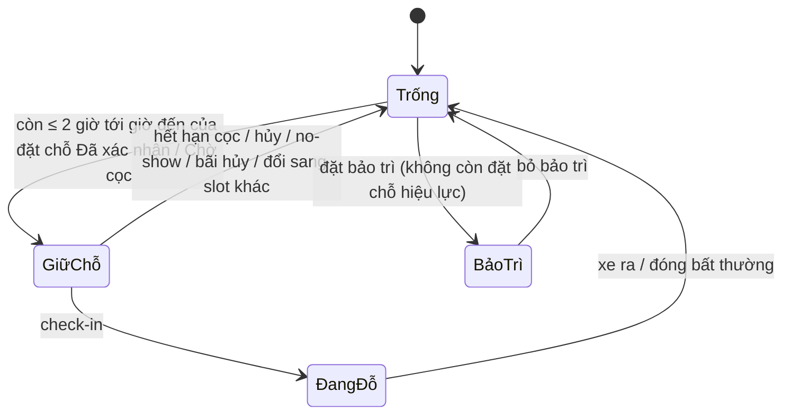
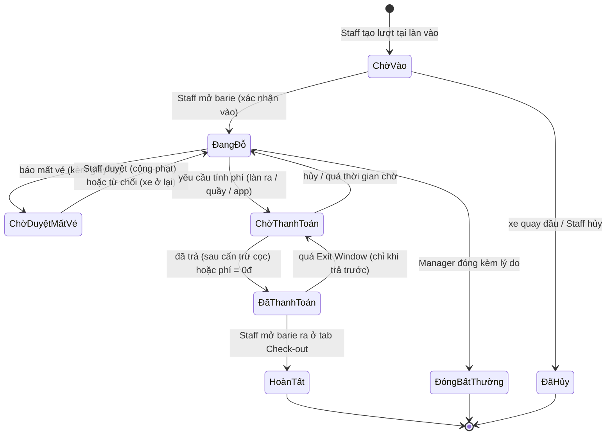
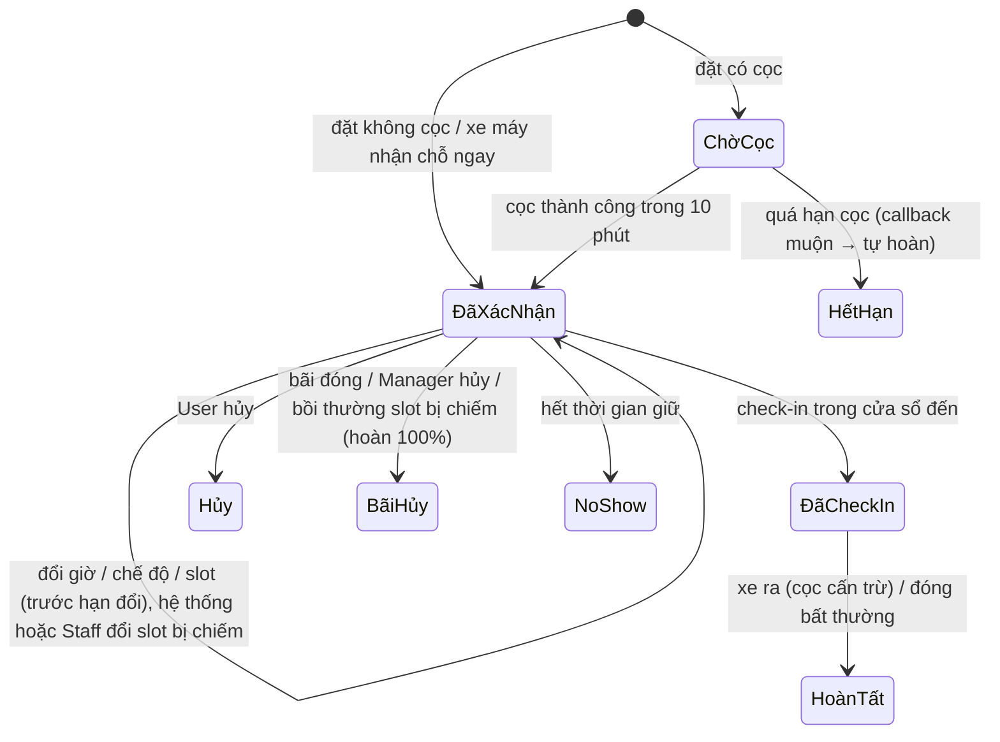
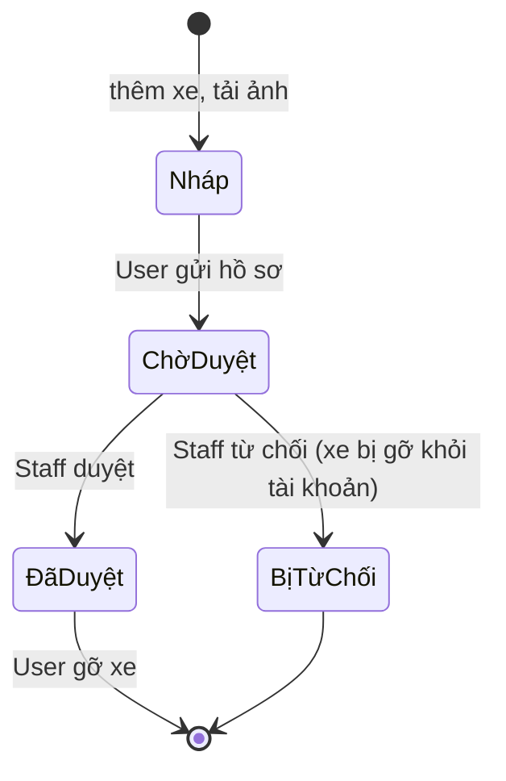
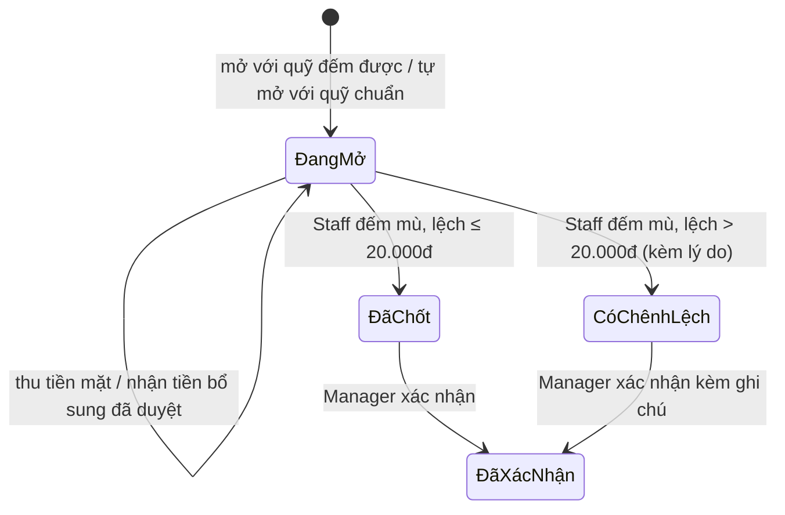
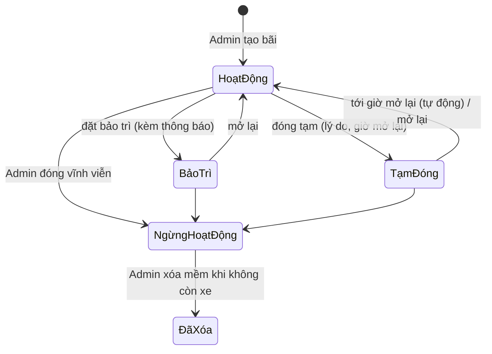
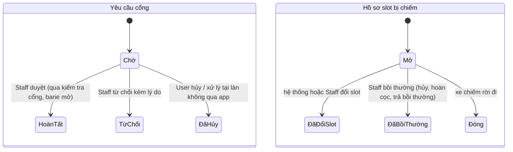

# SRS v1.5 – Hệ thống Quản lý Nhiều Bãi Đỗ Xe

> Bản 1.5 được viết lại từ SRS v1.4 (`SRS_v1.4.md`) sau khi đối chiếu với mã nguồn của hai repo (Backend .NET 9 và Frontend React) tới ngày 2026-11-08. Bản này mô tả hệ thống **như nhóm đã quyết định và đã xây dựng**; các quyết định của nhóm khác với v1.4 được ghi ở mục 2.4. Từ v1.5, file Markdown này là bản gốc (không còn bản .docx tương ứng).
>
> Mã yêu cầu (FR/BR/UC/NFR) giữ nguyên so với v1.4 để tra cứu; mã bị bỏ ghi rõ “(bỏ ở v1.5)” và không đánh số lại. Mức độ triển khai của từng module nằm ở Phụ lục A.

Nov 8, 2026

## 1. Giới thiệu

SRS v1.5 mô tả hệ thống quản lý chuỗi bãi đỗ xe XXIV Parking với 5 actor (Admin, Manager, Staff, User, Guest). So với v1.4, bản này cập nhật theo các quyết định của nhóm trong quá trình xây dựng: đặt chỗ tới 30 ngày với cọc tùy chọn và hai chế độ đặt; xe máy nhận chỗ ngay không cần đặt trước; bỏ thời gian miễn phí; ví XXIV; ngăn kéo tiền mặt theo mệnh giá thay cho chốt tiền cuối ngày đơn giản; Staff tự quyết mọi ca mất vé; xác minh xe chỉ còn Duyệt/Từ chối với biển số duy nhất toàn hệ thống; cổng không còn bước cảm biến; yêu cầu cổng từ app; hồ sơ slot đặt bị chiếm có bồi thường; bản đồ chỉ đường; mô phỏng vận hành cho Admin; và trợ lý hỏi đáp AI cho khách hàng (đang làm).

### 1.1 Mục đích

Tự động hóa chuỗi vận hành: xe vào/ra, tính phí, quản lý chỗ đỗ, đặt chỗ, thanh toán (tiền mặt, cổng thanh toán, ví), quản lý tiền mặt tại quầy, báo cáo; đồng thời cung cấp sơ đồ bãi 3D được render hoàn toàn ở Frontend.

### 1.2 Phạm vi hệ thống

- Web Admin: dành cho Admin (bãi xe, tài khoản Manager và khách hàng, báo cáo doanh thu toàn chuỗi, hiệu suất bãi, mô phỏng vận hành).
- Web Manager (Console): dành cho Manager (bãi mình phụ trách: bảng giá, Staff, đặt chỗ, hàng chờ duyệt, chốt tiền, danh sách biển số, doanh thu).
- POS Staff: dành cho Staff tại cổng/quầy (bảng điều khiển cổng với camera làn 3D, thu tiền, ngăn kéo tiền mặt, ngoại lệ và mất vé, xác minh phương tiện).
- Web Khách hàng: dành cho User và Guest (xem bãi, giá, chỗ trống, mô hình 3D, chỉ đường; User đặt chỗ, thanh toán, ví, xe, lịch sử, thông báo; trợ lý hỏi đáp).
- Thiết bị ngoại vi: camera làn và dịch vụ đọc biển số (ANPR), barie. Trong phiên bản này camera làn được mô phỏng bằng cảnh 3D trên màn hình cổng; Staff thao tác mở barie trên POS.
Các hạng mục ngoài phạm vi nằm ở mục 2.5.

### 1.3 Thuật ngữ và viết tắt

| Thuật ngữ | Ý nghĩa |
| --- | --- |
| ANPR / LPR | Nhận diện biển số tự động; ở v1.5 là dịch vụ đọc biển số chạy cục bộ (mô hình YOLO) trả kết quả cho màn hình cổng |
| Parking Lot / Zone / Slot | Bãi xe / Khu vực (tầng, dãy) / Vị trí chỗ đỗ cụ thể |
| Zone đếm | Khu vực dùng để đếm xe vãng lai. Mặc định là cặp (bãi, loại xe) |
| Slot đặt chỗ | Slot được chỉ định cố định (có biển báo) dành cho xe đặt chỗ |
| Lane (làn) | Một làn xe tại cổng, có chiều vào hoặc ra |
| Session | Một lượt gửi xe, từ lúc vào đến lúc ra |
| Reservation | Đặt chỗ trước theo giờ đến, gắn với một slot đặt chỗ và một xe |
| Đặt theo giờ (PayAsYouGo) | Đặt chỗ chỉ có giờ đến; trả phí theo thời gian đỗ thực |
| Đặt theo lịch (Scheduled) | Đặt chỗ có cả giờ đến và giờ rời dự kiến (30 phút – 24 giờ) |
| Cửa sổ đến | Khoảng được phép check-in theo đặt chỗ: từ (giờ đến − 15 phút) đến (giờ đến + thời gian giữ) |
| Thời gian giữ | Thời gian slot còn được giữ sau giờ đến: 15 phút nếu không cọc, 30 phút nếu có cọc |
| Zone Counter | Bộ đếm số chỗ trống của một zone đếm, dùng cho xe vãng lai |
| Exit Window | Khoảng thời gian được phép ra sau khi trả trước ở quầy hoặc qua app (15 phút) |
| Exit Pass | Mã QR có chữ ký (HMAC) cấp cho mỗi xe đã check-in; làn ra quét để mở barie sau khi đã trả phí |
| Yêu cầu cổng (Gate Request) | Yêu cầu check-in hoặc check-out do khách gửi từ app, hoặc do hệ thống xếp cho xe đã trả phí; Staff xử lý tại làn |
| Hồ sơ slot đặt bị chiếm (Booked Bay Case) | Hồ sơ mở khi slot đặt chỗ của khách bị xe khác chiếm; kết thúc bằng đổi slot hoặc bồi thường |
| Ví XXIV | Ví nội bộ của User: nạp qua VNPay/MoMo, trả cọc và phí, nhận hoàn tiền và bồi thường, rút ra ngân hàng/MoMo |
| Ngăn kéo tiền mặt (Cash Drawer) | Tiền mặt một Staff giữ tại một bãi, theo dõi theo từng mệnh giá; mở bằng quỹ đầu, đóng bằng đếm mù |
| Quỹ chuẩn | Quỹ đầu mặc định của ngăn kéo: 10 tờ mỗi mệnh giá (8.880.000đ) |
| Đếm mù | Staff đếm và nhập số tờ thực tế mà không thấy số hệ thống tính trước |
| Session “ma” | Session còn mở trên hệ thống nhưng xe đã không còn trong bãi |
| Maker-Checker | Nguyên tắc người đề xuất và người duyệt phải là hai người khác nhau |
| Mô phỏng vận hành | Chế độ demo của Admin: thời gian tính phí và các hạn đặt chỗ chạy theo giây, có luồng xe vãng lai tự động |
| Cà vẹt | Giấy chứng nhận đăng ký xe (Vehicle Registration Certificate) |
| CCCD | Căn cước công dân (Citizen ID) |

## 2. Mô tả tổng quan

Hệ thống gồm một Backend API tập trung (ASP.NET Core, SQL Server, SignalR, Hangfire) và Frontend web (React) phục vụ cả bốn khu vực: khách hàng, Staff, Manager, Admin. Phần 3D render hoàn toàn ở Frontend (three.js); Backend cung cấp bố cục bãi, trạng thái slot và Zone Counter qua REST và SignalR. Dịch vụ đọc biển số chạy cục bộ cạnh màn hình cổng.

### 2.1 Danh sách Actor

| # | Actor | Có tài khoản | Vai trò |
| --- | --- | --- | --- |
| A1 | Admin | Có (nội bộ) | Quản trị chuỗi: tạo và cấu hình bãi (từ mẫu tòa nhà, vị trí bản đồ), chuyển trạng thái bãi, tạo tài khoản Manager và gán bãi, xem và khóa tài khoản khách hàng, báo cáo doanh thu toàn chuỗi và hiệu suất bãi, mô phỏng vận hành. Không tham gia vận hành hằng ngày. |
| A2 | Manager | Có (nội bộ) | Phụ trách một hoặc nhiều bãi (mỗi bãi đúng một Manager): bảng giá, tài khoản Staff, đặt chỗ của bãi (hủy phía bãi), xác nhận chốt ngăn kéo tiền mặt, duyệt yêu cầu bổ sung tiền mặt, Whitelist/Blacklist của bãi, đóng session bất thường, doanh thu và tình trạng lấp đầy. |
| A3 | Staff | Có (nội bộ) | Trực cổng/quầy tại một bãi: check-in/check-out (kể cả thủ công), xử lý yêu cầu cổng và cảnh báo, thu tiền mặt hoặc QR, quản lý ngăn kéo tiền mặt, quyết định mất vé, xử lý hồ sơ slot đặt bị chiếm, buộc check-out xe vãng lai; Staff có quyền “Xác minh phương tiện” duyệt hồ sơ xe toàn chuỗi. |
| A4 | User | Có (công khai) | Khách có tài khoản: đăng ký và xác minh xe, đặt chỗ trên 3D, nhận chỗ xe máy ngay, gửi yêu cầu check-in/check-out, theo dõi xe đang đỗ, thanh toán (ví, VNPay, MoMo), quản lý ví, xem lịch sử và biên lai, nhận thông báo, hỏi trợ lý. |
| A5 | Guest | Không | Khách vãng lai: xem bãi, giá, chỗ trống, mô hình 3D và chỉ đường; gửi xe bằng vé QR; thanh toán tại làn ra hoặc quầy (tiền mặt hoặc QR động); hỏi trợ lý. |

Guest không phải một role trong cơ sở dữ liệu. Hệ thống có 4 role: Admin, Manager, Staff, User. Phạm vi bãi của Manager và Staff lưu ở bảng UserLotAccess; quyền “Xác minh phương tiện” là toàn chuỗi.

### 2.2 Hệ thống và giao diện bên ngoài

| # | Tên | Loại | Mô tả |
| --- | --- | --- | --- |
| E1 | Payment Gateway | Hệ thống ngoài | VNPay và MoMo (môi trường sandbox): link/QR thanh toán, callback IPN, trang trả về, tra cứu trạng thái giao dịch. Dùng cho cọc, phí gửi xe, nạp ví và QR động tại làn. |
| E2 | 3D Renderer | Giao diện Frontend | three.js trên trình duyệt; dựng bãi từ mẫu tòa nhà và trạng thái slot, cập nhật qua SignalR. |
| E3 | Dịch vụ đọc biển số và camera làn | Thành phần cục bộ | Dịch vụ đọc biển số (YOLO) chạy cạnh màn hình cổng, đọc ảnh từ camera làn (ở v1.5 là cảnh 3D mô phỏng) và trả biển số cùng độ tin cậy. |
| E4 | Email (SMTP) | Hệ thống ngoài | Gửi link đặt lại mật khẩu. Các thông báo khác là thông báo trong app (chuông) đẩy qua SignalR. |
| E5 | Mapbox | Hệ thống ngoài | Bản đồ chỉ đường tới bãi (Directions, Geocoding) và chọn vị trí bãi; kèm link mở Google Maps không cần khóa. |
| E6 | Nhà cung cấp mô hình ngôn ngữ (LLM) và embedding | Hệ thống ngoài | Dùng cho trợ lý hỏi đáp AI (FR-SYS-10, đang triển khai). |

### 2.3 Nguyên tắc thiết kế

- Slot theo hai chế độ, tách bạch vật lý. Xe đặt chỗ đỗ ở slot đặt chỗ cố định có biển báo. Xe vãng lai không được gán slot khi đặt nhưng được Staff chọn slot trống tại làn vào (hoặc hệ thống chọn theo thứ tự cố định) để bản đồ hiển thị vị trí; sức chứa vãng lai của zone = slot hoạt động − slot đặt chỗ − slot bảo trì, theo dõi bằng Zone Counter.
- Mặc định zone đếm là cặp (bãi, loại xe). Hệ thống có ba loại xe: ô tô 4 chỗ, ô tô 7 chỗ, xe máy.
- Bãi được dựng từ một trong ba mẫu tòa nhà (zone, slot và mô hình 3D sinh cùng lúc); không có Layout Editor.
- Đặt chỗ theo giờ đến, tối đa 30 ngày trước; slot chỉ bị giữ từ 2 giờ trước giờ đến. Cọc là tùy chọn. Xe máy không đặt trước mà nhận chỗ ngay.
- Phí tính theo block từ lúc vào, không có thời gian miễn phí; cọc được cấn trừ vào phí.
- Ba điểm thanh toán: làn ra, quầy (POS) và app. Exit Window chỉ áp dụng cho quầy và app. Barie ra chỉ được mở ở tab Check-out của màn hình cổng.
- Maker-Checker áp dụng cho: xác nhận chốt ngăn kéo tiền mặt và yêu cầu bổ sung tiền mặt (Manager không duyệt yêu cầu của chính mình), duyệt hồ sơ xe (người duyệt không duyệt xe của mình). Mất vé do Staff tự quyết; đóng session bất thường do Manager thực hiện kèm lý do.
- Hoàn tiền tự động theo chính sách (hủy đúng hạn, phần dư cọc, bãi hủy, callback muộn, thanh toán trùng, bồi thường slot bị chiếm) không cần duyệt, được ghi giao dịch và đi vào ví XXIV của User.
- Tiền mặt được quản lý theo ngăn kéo của từng Staff tại từng bãi, theo mệnh giá; không chia ca, không có giờ chốt bắt buộc.
- Ủy quyền tạo tài khoản: Admin tạo Manager; Manager tạo Staff trong bãi mình. Không có đăng ký công khai cho nhân sự.
- Vé QR và Exit Pass có chữ ký (HMAC) để kiểm tra được độc lập với dữ liệu phiên.
- Quyền riêng tư: dữ liệu và kênh real-time công khai không chứa biển số. Một biển số chỉ thuộc một tài khoản trong toàn hệ thống. Ảnh giấy tờ chỉ người có quyền xác minh xem được và bị xóa sau thời hạn cấu hình.
- Không xóa cứng dữ liệu nghiệp vụ: session, giao dịch, xe, tài khoản nhân sự chỉ khóa/gỡ/ẩn danh hóa. Bãi chỉ xóa được khi đã Ngừng hoạt động và không còn xe.

### 2.4 Thay đổi so với v1.4

| Mục | Thay đổi (quyết định của nhóm, ngày) |
| --- | --- |
| Mật khẩu | 6+ ký tự, ít nhất 1 chữ hoa và 1 ký tự đặc biệt cho mọi tài khoản, thay quy tắc 8 ký tự hoa/thường/số của BR-28 (2026-10-19, xác nhận 2026-10-24) |
| Loại xe | Chỉ ô tô 4 chỗ (CAR_4), ô tô 7 chỗ (CAR_7), xe máy (MOTORBIKE); không xe đạp, xe đạp điện, trạm sạc (2026-10-25). Bỏ FR-OPS-10 phần xe đạp |
| Tính phí | Bỏ thời gian miễn phí: block đầu tính ngay khi vào (2026-10-25). Bảng giá sửa tại chỗ, có hiệu lực ngay; xe đang trong bãi giữ giá lúc vào; mọi khách nhận thông báo đổi giá (2026-11-04). Phụ phí qua đêm và quá hạn được lưu nhưng chưa áp dụng |
| Đặt chỗ | Đặt trước tối đa 30 ngày, slot chỉ bị giữ từ 2 giờ trước giờ đến; hai chế độ Đặt theo giờ / Đặt theo lịch; cọc tùy chọn: không cọc giữ 15 phút, có cọc giữ 30 phút (2026-10-23, 10-24) |
| Xe máy | Không đặt trước; chạm slot trống trên 3D để nhận chỗ ngay, không cọc, gửi yêu cầu check-in tới làn vào (2026-10-30) |
| Slot đặt bị chiếm | Hồ sơ slot đặt bị chiếm: hệ thống hoặc Staff đổi slot và miễn block đầu; không còn slot thì hủy đặt chỗ, hoàn 100% cọc và trả bồi thường vào ví (mặc định 100.000đ ô tô, 50.000đ xe máy) (2026-11-06, 11-07) |
| Cổng | Bỏ bước cảm biến vòng từ: Staff mở barie vào là session có hiệu lực (2026-11-04). Barie ra chỉ mở ở tab Check-out; mọi xe đã trả phí được xếp vào hàng chờ check-out (2026-11-04). Xe không biển số phải có lý do (2026-10-28). Buộc check-out xe vãng lai từ mô hình 3D (2026-11-07) |
| Yêu cầu cổng | Khách gửi yêu cầu check-in (đặt chỗ trong cửa sổ đến, xe máy) và check-out từ app; Staff duyệt hoặc từ chối có lý do (2026-10-21 → 11-04) |
| Mất vé | Staff tải ảnh CCCD và cà vẹt, tự duyệt hoặc từ chối; Manager không còn duyệt mất vé; duyệt thì phạt cộng vào hóa đơn khi ra, từ chối thì xe ở lại tới khi có giấy tờ mới; không nhận báo mất vé cho xe đặt chỗ (2026-11-03, 11-04). Thay BR-13, BR-14 phần mất vé |
| Tiền mặt | Ngăn kéo tiền mặt theo Staff và bãi, theo mệnh giá, quỹ chuẩn 8.880.000đ, đếm mù, lệch > 20.000đ phải ghi lý do, Manager xác nhận mọi lần chốt; không có giờ chốt muộn nhất, đóng ngăn kéo thì mở ngay ngăn kéo tiếp theo; yêu cầu bổ sung tiền mặt có Manager duyệt (2026-11-03 → 11-07). Thay BR-12 phần 23:00 |
| Ví XXIV | Ví nội bộ (v1.4 để ngoài phạm vi): nạp tối thiểu 10.000đ, tối đa 10.000.000đ/ngày, trả cọc và phí, nhận hoàn tiền, rút ra ngân hàng/MoMo (2026-10-23, 10-24) |
| Xác minh xe | Một ảnh mặt trước cà vẹt + một ảnh mặt trước CCCD; bỏ OCR; quyết định chỉ còn Duyệt/Từ chối; bị từ chối thì xe bị gỡ khỏi tài khoản, khách đăng ký lại; biển số duy nhất toàn hệ thống nên không còn Tranh chấp; xe đang chờ duyệt không đặt chỗ được (2026-10-23, 10-25) |
| Bãi xe | Admin tạo bãi từ ba mẫu tòa nhà, đặt vị trí bản đồ; mỗi bãi đúng một Manager; bãi chưa có Manager hiển thị Bảo trì và không nhận đặt chỗ; thêm trạng thái Ngừng hoạt động (bắt buộc trước khi xóa, chỉ xóa khi không còn xe) (2026-10-19, 10-28, 11-07) |
| Bản đồ chỉ đường | Bản đồ Mapbox chỉ đường từ vị trí khách tới bãi (v1.4 để ngoài phạm vi) (2026-11-06) |
| Báo cáo | Báo cáo doanh thu Admin theo ngày/tuần/tháng/năm, theo bãi, tách ô tô/xe máy, xuất CSV; doanh thu Manager theo phương thức; hiệu suất bãi; doanh thu hôm nay (2026-10-28 → 11-04) |
| Mô phỏng | Màn hình mô phỏng vận hành cho Admin (2026-10-29, 11-03 → 11-07) |
| Trợ lý AI | Thêm trợ lý hỏi đáp cho khách dùng RAG trên bộ kiến thức của hệ thống (2026-11-08, đang triển khai) |
| Đã bỏ | OCR cà vẹt, Layout Editor 3D (thay bằng mẫu), Tranh chấp biển số, khiếu nại và giới hạn nộp lại hồ sơ xe, duyệt mất vé theo điều kiện, cảnh báo chốt tiền quá giờ |

### 2.5 Ngoài phạm vi phiên bản này

- Đăng nhập bằng OTP (SĐT/email) và xác thực 2 yếu tố (2FA). Các endpoint OTP cũ còn trong mã nhưng không dùng.
- Vé tháng / thành viên, vé doanh nghiệp. Session có trường “loại lượt gửi” để mở rộng sau.
- Hóa đơn điện tử; hệ thống chỉ phát hành biên lai điện tử trong app.
- Auto-Pay, tích điểm, đánh giá, voucher; quy trình khiếu nại/bồi thường đầy đủ (ngoài bồi thường slot đặt bị chiếm).
- Quản lý Tenant đa chủ bãi, Public Open API, chia doanh thu cho đối tác.
- Chia ca làm việc (lịch ca, mở/đóng ca, bàn giao ca). Các bảng Shift* cũ chỉ còn để tương thích dữ liệu.
- Cảm biến/camera theo dõi từng slot; cảm biến vòng từ tại làn.
- Phân tích dự báo bằng AI (trợ lý hỏi đáp FR-SYS-10 thì trong phạm vi).
- Xác minh cà vẹt tự động bằng OCR hoặc tra cứu cơ sở dữ liệu đăng ký xe.
- Nhiều tài khoản cùng xác minh một biển số (xe gia đình) và tranh chấp biển số.
- Layout Editor 3D có bản Nháp/Công bố.
- Xe đạp, xe đạp điện, trạm sạc xe điện.

## 3. Yêu cầu chức năng

Mức ưu tiên: M = Must, S = Should, C = Could. Mã FR giữ ổn định so với v1.4; mã bị bỏ ghi “(bỏ ở v1.5)”. Mã mới của v1.5 được đánh số tiếp. Quy tắc chi tiết tham chiếu tới bảng BR ở mục 5.

### 3.1 Tài khoản và phân quyền (FR-AUTH)

| ID | Mô tả yêu cầu | Actor | Ưu tiên |
| --- | --- | --- | --- |
| FR-AUTH-01 | User đăng ký bằng form (Họ tên, Email, Số điện thoại, Mật khẩu, Xác nhận mật khẩu) hoặc bằng Google. Đăng nhập bằng email + mật khẩu hoặc Google; email Google trùng tài khoản đã có thì liên kết vào cùng tài khoản. Tài khoản tự đăng ký luôn có role User | User | M |
| FR-AUTH-02 | Nhân sự đăng nhập bằng email + mật khẩu hoặc Google với đúng email tài khoản nội bộ đã được tạo; mỗi role được đưa tới khu vực của mình (/admin, /management, /staff) | Admin, Manager, Staff | M |
| FR-AUTH-03 | Phân quyền theo 4 role kèm phạm vi bãi (UserLotAccess); Backend kiểm tra role và phạm vi ở mọi endpoint, không tin dữ liệu từ client | Hệ thống | M |
| FR-AUTH-04 | Admin tạo tài khoản Manager (form 5 trường), sửa, khóa/mở khóa và gán các bãi (mỗi bãi một Manager; gán bãi cho Manager mới thì Manager cũ mất bãi đó). Admin xem danh sách và khóa/mở khóa tài khoản khách hàng. Admin đầu tiên được khởi tạo sẵn | Admin | M |
| FR-AUTH-05 | Ghi Audit Log các thao tác quản trị và duyệt | Admin | S |
| FR-AUTH-06 | Truy cập chức năng công khai (xem bãi, giá, chỗ trống, 3D, chỉ đường, trợ lý) không cần đăng nhập | Guest | M |
| FR-AUTH-07 | Manager tạo Staff (form 5 trường), sửa, gán một bãi trong phạm vi của mình, khóa/mở khóa và nghỉ việc (khóa tài khoản, đánh dấu Terminated, không xóa); không cấp role cao hơn Staff | Manager | M |
| FR-AUTH-08 | Tài khoản nội bộ dùng được ngay sau khi tạo; nhân sự nghỉ việc thì khóa, không xóa | Admin, Manager | M |
| FR-AUTH-09 | Khi đăng ký, User phải tick đồng ý Điều khoản dịch vụ và Chính sách quyền riêng tư; hệ thống lưu phiên bản điều khoản và thời điểm đồng ý (v1.5 mới có bước tick ở Frontend, chưa lưu) | User | M |
| FR-AUTH-10 | User yêu cầu xóa tài khoản: ẩn danh hóa thông tin cá nhân, gỡ xe, xóa ảnh giấy tờ, giữ session và giao dịch ở dạng ẩn danh; không cho xóa khi còn session mở, đặt chỗ hiệu lực, số dư ví hoặc hoàn tiền đang xử lý | User | S |
| FR-AUTH-11 | Kiểm tra form tạo tài khoản (BR-28) ở cả Frontend và Backend; kiểm tra trùng email, SĐT ngay khi nhập | Hệ thống | M |
| FR-AUTH-12 | Đổi mật khẩu trong hồ sơ (nhập mật khẩu cũ); quên mật khẩu qua link gửi email (dùng một lần, hết hạn sau 30 phút); tài khoản chỉ đăng nhập Google có thể tự đặt mật khẩu | Tất cả role | M |
| FR-AUTH-13 | Hồ sơ cá nhân: họ tên, SĐT, số CCCD, ảnh đại diện; SĐT và số CCCD là duy nhất toàn hệ thống, kiểm tra trùng khi nhập | User | M |

### 3.2 Bãi, khu vực và slot (FR-LOT)

| ID | Mô tả yêu cầu | Actor | Ưu tiên |
| --- | --- | --- | --- |
| FR-LOT-01 | Admin tạo và sửa bãi: tên, mã, địa chỉ (quận, thành phố), SĐT, giờ hoạt động, vị trí bản đồ (chọn trên bản đồ, kéo ghim hoặc dán “lat, lng”). Sức chứa tính từ tổng slot | Admin | M |
| FR-LOT-02 | Admin dựng bãi từ một trong ba mẫu tòa nhà: zone theo tầng và loại xe, slot (gồm slot đặt chỗ), zone đếm và mô hình 3D được sinh cùng lúc; chỉ dựng được cho bãi chưa có zone | Admin | M |
| FR-LOT-03 | Slot đặt chỗ có 4 trạng thái: Trống, Giữ chỗ, Đang đỗ, Bảo trì (4.3.1). Zone Counter của zone đếm cập nhật khi xe vào/ra | Hệ thống | M |
| FR-LOT-04 | Chuyển trạng thái vận hành của bãi: Hoạt động, Bảo trì (kèm thông báo bảo trì), Tạm đóng (kèm lý do và giờ mở lại; tới giờ thì bãi tự mở lại). Khi Tạm đóng: chặn xe vào và đặt chỗ mới, xe trong bãi vẫn ra được, đặt chỗ tương lai bị hủy phía bãi và hoàn 100% cọc | Admin, Manager | M |
| FR-LOT-05 | Danh sách bãi công khai với địa chỉ, vị trí, giá, số chỗ trống/tổng theo thời gian thực | Guest, User | M |
| FR-LOT-06 | Slot đặt chỗ được chỉ định cố định trong mẫu tòa nhà | Hệ thống | M |
| FR-LOT-07 | Điều chỉnh Zone Counter thủ công có duyệt | Staff, Manager | S |
| FR-LOT-08 | Vòng đời bãi (4.3.6): Hoạt động, Bảo trì, Tạm đóng chuyển qua lại; Ngừng hoạt động là đóng vĩnh viễn, không tự mở lại. Bãi chưa có Manager tự hiển thị Bảo trì, chỉ xem, không nhận đặt chỗ. Chỉ xóa (mềm) được bãi Ngừng hoạt động và không còn xe | Admin | M |
| FR-LOT-09 | Mỗi bãi có đúng một Manager; Staff làm việc tại một bãi do Manager gán | Admin, Manager | M |
| FR-LOT-10 | Manager xem tình trạng lấp đầy trực tiếp của bãi mình (theo loại xe và zone) | Manager | M |

### 3.3 Trực quan hóa 3D (FR-3D)

3D Renderer chạy hoàn toàn trên Frontend (three.js). Backend cung cấp bố cục và trạng thái qua REST/SignalR.

| ID | Mô tả yêu cầu | Actor | Ưu tiên |
| --- | --- | --- | --- |
| FR-3D-01 | Hiển thị bãi 3D (tầng, zone, slot) dựng từ mẫu tòa nhà của bãi | Tất cả actor | M |
| FR-3D-02 | Slot đặt chỗ tô màu theo trạng thái; xe vãng lai được vẽ vào slot trống của zone theo thứ tự cố định (hoặc đúng slot Staff đã chọn); tự cập nhật qua SignalR | Tất cả actor | M |
| FR-3D-03 | Tương tác: xoay, zoom, pan, chuyển tầng; rê chuột hiện mã slot; chọn slot để xem loại xe, trạng thái, giá | Tất cả actor | M |
| FR-3D-04 | User chọn slot đặt chỗ Trống đúng loại xe để đặt (ô tô) hoặc chạm slot xe máy trống để nhận chỗ ngay | User | M |
| FR-3D-05 | Layout Editor (bỏ ở v1.5; thay bằng mẫu tòa nhà FR-LOT-02) | – | – |
| FR-3D-06 | Sơ đồ 2D theo tầng có Zone Counter trực tiếp | Guest, User, Staff | S |
| FR-3D-07 | Đánh dấu xe đang đỗ của User trên bản đồ | User | C |
| FR-3D-08 | Dữ liệu 3D công khai chỉ gồm trạng thái slot và chỗ trống, không chứa biển số; endpoint bố cục công khai có giới hạn tần suất | Hệ thống | M |
| FR-3D-09 | Mô hình 3D nội bộ cho Staff, Manager, Admin: vẽ xe thật theo loại xe và màu đăng ký; chọn xe để xem loại khách, biển số, thời gian đỗ, phí tạm tính; Staff buộc check-out xe vãng lai từ đây (FR-OPS-21) | Staff, Manager, Admin | M |
| FR-3D-10 | Slot đặt chỗ đang được giữ vẽ thân xe của chính xe đã đặt | Tất cả actor | C |

### 3.4 Xe vào/ra và vận hành cổng (FR-OPS)

| ID | Mô tả yêu cầu | Actor | Ưu tiên |
| --- | --- | --- | --- |
| FR-OPS-01 | Check-in tại tab Check-in của màn hình cổng: camera làn và dịch vụ đọc biển số đọc biển số (Staff xác nhận hoặc sửa), chọn loại xe, kiểm tra Whitelist/Blacklist, biển số đang có session mở, đặt chỗ, chỗ trống; Staff chọn slot cho xe vãng lai; mở barie vào là session chuyển Đang đỗ ngay (không có bước cảm biến) | Staff, E3 | M |
| FR-OPS-02 | Check-out tại tab Check-out: tìm session bằng biển số, vé QR, mã session hoặc Exit Pass; đối chiếu biển số vào – ra; đã trả và còn Exit Window thì mở barie; chưa trả thì tính phí (cấn trừ cọc) và thu tại làn. Chỉ tab Check-out có nút mở barie ra | Staff, E3 | M |
| FR-OPS-03 | Check-in/out thủ công khi thiết bị sự cố, bắt buộc ghi lý do; lượt được gắn cờ “thủ công” | Staff | M |
| FR-OPS-04 | Biển số đọc lúc ra khác lúc vào: chặn, Staff cho qua (bắt buộc lý do), chuyển sang mất vé hoặc từ chối | Staff, E3 | M |
| FR-OPS-05 | Mất vé: Staff mở hồ sơ từ danh sách xe trong bãi hoặc sau khi tra biển số, tải ảnh CCCD của người lái và cà vẹt (JPEG/PNG/PDF, tối đa 8 MB mỗi ảnh), rồi tự duyệt hoặc từ chối (từ chối phải ghi chú). Duyệt: phí phạt mất vé của bãi được cộng vào hóa đơn khi ra; từ chối: xe ở lại bãi tới khi giấy tờ mới được duyệt. Không nhận báo mất vé cho xe đặt chỗ | Staff | M |
| FR-OPS-07 | Whitelist/Blacklist biển số theo bãi: lý do, ngày hết hạn; Manager thêm/xóa, Staff xem | Manager, Staff | S |
| FR-OPS-08 | Quản lý sự cố có vòng đời | Staff, Manager | C |
| FR-OPS-09 | Offline: Edge Service cấp bãi | Staff, E3 | C |
| FR-OPS-10 | Xe không đọc được biển số: Staff cho vào thủ công kèm lý do (tối đa 500 ký tự) và loại xe của làn | Staff | M |
| FR-OPS-11 | Mỗi xe chỉ có một session mở; biển số đã có session mở thì chặn và cảnh báo Staff | Staff, Hệ thống | M |
| FR-OPS-12 | Đóng session bất thường (session “ma”): Manager của bãi đóng kèm lý do; slot/counter được trả lại, đặt chỗ liên quan chuyển Hoàn tất | Manager | M |
| FR-OPS-13 | Kiểm kê tồn bãi theo zone | Staff, Manager | C |
| FR-OPS-14 | Độ tin cậy đọc biển số dưới ngưỡng (BR-18): Staff xác nhận hoặc sửa biển số trước khi mở barie | Staff, E3 | M |
| FR-OPS-15 | Zone đếm hết chỗ: chặn xe vãng lai; xe đặt chỗ và Whitelist vẫn vào | Staff, Hệ thống | M |
| FR-OPS-16 | Xe đỗ quá 24 giờ được đánh dấu quá hạn, quá 7 ngày là xe bỏ quên (BR-20) | Hệ thống, Staff | S |
| FR-OPS-17 | Hàng chờ xung đột đồng bộ Edge | Manager | C |
| FR-OPS-18 | Chế độ khẩn cấp (mở toàn bộ barie, trạng thái Ra khẩn cấp) | Manager, Staff | C |
| FR-OPS-19 | Hồ sơ slot đặt bị chiếm: mở khi slot đặt chỗ của một đặt chỗ Đã xác nhận bị xe khác chiếm, khách được báo. Hệ thống tự đổi sang slot trống cùng loại nếu có; nếu không, Staff đổi slot (khách được miễn block đầu) hoặc bồi thường: hủy đặt chỗ, hoàn 100% cọc và trả khoản bồi thường của bảng giá vào ví. Xe chiếm rời đi thì hồ sơ đóng. Hệ thống không xếp xe vãng lai vào slot đặt chỗ hay slot đang được giữ | Staff, Hệ thống | M |
| FR-OPS-20 | Yêu cầu cổng: User gửi yêu cầu check-in (đặt chỗ trong cửa sổ đến, nhận chỗ xe máy) hoặc check-out (xe trên tài khoản) từ app; mọi xe đã trả phí (ở POS, app hoặc 0đ, kể cả xe vãng lai) được tự xếp yêu cầu check-out. Staff thấy yêu cầu ở tab tương ứng, duyệt (chạy đủ kiểm tra cổng rồi mở barie) hoặc từ chối kèm lý do hiển thị cho khách; User hủy được yêu cầu đang chờ | User, Staff | M |
| FR-OPS-21 | Buộc check-out xe vãng lai từ mô hình 3D: thu phí bằng tiền mặt vào ngăn kéo của Staff và xếp xe vào hàng chờ check-out | Staff | S |
| FR-OPS-22 | Camera làn trên màn hình cổng: mỗi tab Check-in/Check-out có bốn camera làn 3D; xe của làn dừng ở barie đóng và chỉ chạy qua khi Staff mở; camera theo một xe qua cả bốn góc và phát lại lúc vào khi xe ra | Staff | S |
| FR-OPS-23 | Lịch sử session của bãi cho Staff, mới nhất trước | Staff | M |

### 3.5 Bảng giá và tính phí (FR-PRC)

| ID | Mô tả yêu cầu | Actor | Ưu tiên |
| --- | --- | --- | --- |
| FR-PRC-01 | Mỗi bãi có một bảng giá cho mỗi loại xe, do Manager cấu hình; khách xem bảng giá công khai của bãi | Manager, Guest, User | M |
| FR-PRC-02 | Mô hình tính phí: Block (block đầu và block sau có thời lượng, giá riêng; “Theo giờ” là block 60 phút), Theo lượt (một lần mỗi ngày lịch), Ngày/Đêm (block tính theo giá của giờ bắt đầu block); trần mỗi ngày lịch | Manager | M |
| FR-PRC-03 | Bảng giá có phí phạt mất vé và khoản bồi thường slot đặt bị chiếm (mặc định 100.000đ ô tô, 50.000đ xe máy). Không có thời gian miễn phí. Phụ phí qua đêm và quá hạn được lưu nhưng chưa áp dụng khi tính phí | Manager | M |
| FR-PRC-04 | Lưu bảng giá sẽ sửa tại chỗ, tăng số phiên bản và chép giá cũ vào lịch sử; giá mới có hiệu lực ngay; xe đang trong bãi giữ giá lúc vào, xe vào sau trả giá mới (kể cả đặt chỗ trước khi đổi giá); mọi khách đang hoạt động nhận thông báo đổi giá | Manager | M |
| FR-PRC-05 | Giá theo giờ cao điểm/ngày lễ và mã giảm giá | Manager | C |
| FR-PRC-06 | Mô phỏng tính phí theo bảng giá đang hiệu lực (API) | Manager | C |

### 3.6 Đặt chỗ trước (FR-RSV)

| ID | Mô tả yêu cầu | Actor | Ưu tiên |
| --- | --- | --- | --- |
| FR-RSV-01 | Tìm bãi, so sánh giá và chỗ trống, xem 3D và chỉ đường | User, Guest (chỉ xem) | M |
| FR-RSV-02 | Đặt chỗ ô tô: chọn bãi, slot đặt chỗ trên 3D, xe (đã có trên tài khoản, không đang chờ duyệt), chế độ (Đặt theo giờ hoặc Đặt theo lịch có giờ rời 30 phút – 24 giờ), giờ đến (trong tương lai, tối đa 30 ngày) và có cọc hay không. Không cọc: Đã xác nhận ngay. Có cọc: Chờ cọc, phải trả trong 10 phút. Slot chỉ chuyển Giữ chỗ từ 2 giờ trước giờ đến; một slot không có hai đặt chỗ chồng thời gian. Hai User chọn cùng slot thì người giữ được trước thắng | User, E1 | M |
| FR-RSV-03 | Đổi giờ đến, giờ rời, chế độ hoặc slot của đặt chỗ Đã xác nhận trước hạn đổi (30 phút trước giờ đến), có ghi lịch sử thay đổi; hủy đặt chỗ và được hoàn cọc theo BR-04 | User | M |
| FR-RSV-04 | Mã QR đặt chỗ (có chữ ký) cấp khi đặt chỗ Đã xác nhận; check-in trong cửa sổ đến bằng QR, mã đặt chỗ, biển số hoặc yêu cầu check-in từ app | User, Staff | M |
| FR-RSV-05 | Hết thời gian giữ mà chưa check-in: đặt chỗ thành No-show, slot về Trống, cọc bị giữ (BR-05); xe đến sau đó vào như vãng lai | Hệ thống | M |
| FR-RSV-06 | Chính sách đặt chỗ là cấu hình chung của hệ thống (BR-01 → BR-07); cọc theo loại xe | Admin (cấu hình) | M |
| FR-RSV-07 | Cấn trừ cọc khi check-out; phí nhỏ hơn cọc thì phần dư hoàn vào ví (BR-03) | Hệ thống | M |
| FR-RSV-08 | Callback cọc đến sau khi đặt chỗ Hết hạn: tự hoàn tiền và thông báo | Hệ thống, E1 | M |
| FR-RSV-09 | Hủy phía bãi: Manager hủy đặt chỗ của bãi mình, hoặc bãi Tạm đóng; hoàn 100% cọc và thông báo | Manager, Hệ thống | M |
| FR-RSV-10 | Nhắc lịch trong app: 15 phút trước giờ đến và 5 phút trước khi hết thời gian giữ | Hệ thống | S |
| FR-RSV-11 | Xe máy nhận chỗ ngay: chạm slot trống trên tầng xe máy, không chọn giờ, không cọc; hệ thống gửi yêu cầu check-in tới làn vào để Staff thấy biển số; phí trả khi ra | User | M |
| FR-RSV-12 | Giới hạn: tối đa 2 đặt chỗ hiệu lực mỗi tài khoản và 1 mỗi xe; mỗi xe chỉ một session mở | Hệ thống | M |
| FR-RSV-13 | Manager xem đặt chỗ hôm nay và sắp tới của bãi; Staff tra đặt chỗ theo QR, mã hoặc biển số tại làn vào | Manager, Staff | M |

### 3.7 Thanh toán, ví và tiền mặt (FR-PAY)

| ID | Mô tả yêu cầu | Actor | Ưu tiên |
| --- | --- | --- | --- |
| FR-PAY-01 | Thu tiền mặt tại làn ra/quầy; Staff có thể chạm các tờ tiền khách đưa, hệ thống lưu tờ nhận và tờ thối, gợi ý thối từ ngăn kéo; mỗi giao dịch ghi Staff và bãi | Staff, Guest | M |
| FR-PAY-02 | Thanh toán online qua VNPay và MoMo (cọc, phí gửi xe, nạp ví) và bằng ví XXIV (cọc, phí) | User, E1 | M |
| FR-PAY-03 | QR động VNPay/MoMo tại làn ra/quầy cho khách không tài khoản | Guest, Staff, E1 | M |
| FR-PAY-04 | Hoàn tiền thủ công, hủy bill, miễn phí thủ công có Maker-Checker | Staff, Manager | C |
| FR-PAY-05 | Đối soát hằng ngày với Payment Gateway | Manager, E1 | C |
| FR-PAY-06 | Biên lai điện tử của mỗi session đã kết thúc trong app: chi tiết phí, cọc đã cấn trừ, các khoản đã trả | User | M |
| FR-PAY-07 | Exit Window 15 phút sau khi trả trước ở quầy hoặc app; quá hạn thì tính lại theo BR-10. Mỗi xe đã check-in có Exit Pass ký HMAC | Hệ thống | M |
| FR-PAY-08 | Thanh toán chờ: QR đã quét nhưng chưa có callback sau 60 giây (BR-11) thì Staff kiểm tra trạng thái với E1 hoặc chuyển phương thức; giao dịch trùng phát sinh được hoàn tự động | Staff, E1 | M |
| FR-PAY-09 | Thanh toán trùng cho một session: giữ giao dịch đầu, hoàn giao dịch sau theo kênh gốc (tiền mặt hoàn tại chỗ) | Hệ thống, Staff | M |
| FR-PAY-10 | Hoàn tiền tự động theo chính sách (hủy đúng hạn, phần dư cọc, bãi hủy, callback muộn, thanh toán trùng) và bồi thường slot đặt bị chiếm: không cần duyệt, vào ví XXIV, có thông báo | Hệ thống | M |
| FR-PAY-11 | Ngăn kéo tiền mặt (4.2.7, 4.3.5): mỗi Staff có một ngăn kéo đang mở tại mỗi bãi; mở bằng quỹ đếm được hoặc tự mở với quỹ chuẩn ở lần thu tiền mặt đầu; theo dõi số tờ dự kiến theo mệnh giá; Staff đóng bằng đếm mù bất cứ lúc nào, lệch quá 20.000đ phải ghi lý do; Manager của bãi xác nhận mọi lần chốt (không xác nhận của chính mình); đóng ngăn kéo thì ngăn kéo tiếp theo mở ngay với quỹ chuẩn; ngăn kéo mở qua nửa đêm tới khi Staff đóng | Staff, Manager | M |
| FR-PAY-12 | Ví XXIV: xem số dư, khoản đang giữ cho xe sắp ra và lịch sử (nạp, trả, hoàn, bồi thường, rút); nạp qua VNPay/MoMo (tối thiểu 10.000đ, tối đa 10.000.000đ mỗi ngày lịch giờ Việt Nam, tính cả link chưa trả còn hiệu lực); rút về tài khoản ngân hàng hoặc MoMo | User | M |
| FR-PAY-13 | Yêu cầu bổ sung tiền mặt: Staff thiếu tờ (thường là tiền thối) xin Manager một danh sách tờ từ trang Cash Tally hoặc POS; mỗi ngăn kéo một yêu cầu chờ; Staff hủy được; Manager duyệt hoặc từ chối (kèm lý do), không duyệt yêu cầu của mình, chỉ khi ngăn kéo còn mở; tờ được duyệt cộng vào ngăn kéo | Staff, Manager | M |
| FR-PAY-14 | Lịch sử thanh toán phí gửi xe của bãi cho Staff, lọc theo Tiền mặt, VNPay, MoMo, Ví XXIV | Staff | M |
| FR-PAY-15 | Môi trường phát triển/kiểm thử cho phép giả lập thanh toán VNPay/MoMo thành công | Hệ thống | C |

### 3.8 Ứng dụng khách hàng (FR-CUS)

| ID | Mô tả yêu cầu | Actor | Ưu tiên |
| --- | --- | --- | --- |
| FR-CUS-01 | Quản lý hồ sơ cá nhân (FR-AUTH-13) và danh sách xe, chọn xe mặc định | User | M |
| FR-CUS-02 | Lịch sử gửi xe và biên lai: các lượt do User đặt chỗ/thanh toán và các lượt theo biển số của xe đã xác minh, tính từ ngày xác minh (BR-23) | User | M |
| FR-CUS-03 | Thẻ xe đang đỗ: thời gian đã đỗ, phí tạm tính sau cấn trừ cọc, trả trước (ví, VNPay, MoMo), Exit Pass, chỉ đường; khi đã gửi yêu cầu check-out thì không còn lựa chọn thanh toán | User | M |
| FR-CUS-04 | Đăng ký xe: biển số (duy nhất toàn hệ thống, kiểm tra ngay khi nhập), loại xe, màu; tải một ảnh mặt trước cà vẹt và một ảnh mặt trước CCCD (JPEG/PNG/PDF, tối đa 10 MB) rồi gửi duyệt | User | M |
| FR-CUS-05 | Xem trạng thái xác minh; xe bị từ chối được gỡ khỏi tài khoản và hiển thị kèm lý do trong 30 ngày để khách đăng ký lại | User | M |
| FR-CUS-06 | Gỡ xe khỏi tài khoản; không gỡ được khi xe có session đang mở hoặc đặt chỗ hiệu lực | User | S |
| FR-CUS-07 | Trang Active Sessions: mọi xe đang đỗ và đặt chỗ hiện có; trang My Bookings: đặt chỗ, QR, đổi/hủy, trả cọc | User | M |
| FR-CUS-08 | Chỉ đường tới bãi: bản đồ Mapbox toàn màn hình với lộ trình từ vị trí khách, nút mở Google Maps; không có khóa Mapbox thì chỉ hiện nút này | Guest, User | S |
| FR-CUS-09 | Chuông thông báo trong app, đẩy real-time: xe được duyệt/từ chối, check-in, check-out, nhắc lịch, đổi giá, slot đặt bị chiếm/đã đổi/đã trống, bãi hủy đặt chỗ, hoàn cọc, bồi thường; đánh dấu đã đọc, xóa | User, Staff, Manager | M |

### 3.9 Xác minh phương tiện (FR-VER)

| ID | Mô tả yêu cầu | Actor | Ưu tiên |
| --- | --- | --- | --- |
| FR-VER-01 | Kiểm tra khi nộp: định dạng biển số, biển số chưa thuộc tài khoản khác, đủ hai ảnh, định dạng và kích thước tệp. Không có OCR | Hệ thống | M |
| FR-VER-02 | Hàng chờ xác minh toàn chuỗi cho Staff có quyền “Xác minh phương tiện”, cũ nhất trước; kết quả đẩy real-time | Staff | M |
| FR-VER-03 | Staff so ảnh với thông tin xe và quyết định Duyệt hoặc Từ chối (bắt buộc ghi chú cho khách); người duyệt không duyệt xe của chính mình. Từ chối thì xe bị gỡ khỏi tài khoản | Staff | M |
| FR-VER-04 | Đối chiếu xe thực tế ở lượt gửi đầu tiên sau khi duyệt | Staff | C |
| FR-VER-05 | Tranh chấp biển số và khiếu nại (bỏ ở v1.5: biển số duy nhất toàn hệ thống; bị từ chối thì đăng ký lại) | – | – |
| FR-VER-06 | Ảnh giấy tờ lưu ở thư mục riêng, chỉ người có quyền xác minh và chủ xe xem được; tự xóa 30 ngày sau quyết định (BR-26) | Hệ thống | M |

### 3.10 Báo cáo (FR-RPT)

| ID | Mô tả yêu cầu | Actor | Ưu tiên |
| --- | --- | --- | --- |
| FR-RPT-01 | Dashboard Admin: doanh thu hôm nay, tổng doanh thu, lượt xe, sức chứa và lấp đầy toàn chuỗi; mở mô hình 3D trực tiếp của từng bãi | Admin | M |
| FR-RPT-02 | Báo cáo doanh thu Admin: theo khoảng thời gian, chia theo ngày/tuần/tháng/năm, theo bãi, lọc và tách ô tô/xe máy, biểu đồ xu hướng, xuất CSV | Admin | M |
| FR-RPT-03 | Báo cáo ngoại lệ | Manager | C |
| FR-RPT-04 | Xuất Excel/PDF (v1.5 xuất CSV) | Admin | C |
| FR-RPT-05 | Danh sách chốt ngăn kéo tiền mặt theo Staff và ngày, kèm chênh lệch | Manager | M |
| FR-RPT-06 | Báo cáo đặt chỗ | Manager | C |
| FR-RPT-07 | Báo cáo xác minh phương tiện | Admin | C |
| FR-RPT-08 | Doanh thu Manager: từ phiên đầu tiên của các bãi mình (hoặc một bãi), tách theo phương thức thanh toán; doanh thu trực tiếp trên Console | Manager | M |
| FR-RPT-09 | Hiệu suất bãi: chỉ số hoạt động và doanh thu theo bãi cho Admin | Admin | S |

### 3.11 Nhân sự, thiết bị và cấu hình hệ thống (FR-SYS)

| ID | Mô tả yêu cầu | Actor | Ưu tiên |
| --- | --- | --- | --- |
| FR-SYS-01 | Manager quản lý Staff của bãi mình (FR-AUTH-07) | Manager | M |
| FR-SYS-02 | Cấu hình tham số chung (múi giờ, đặt chỗ, cổng, ví, thời hạn lưu ảnh) bằng cấu hình hệ thống và SystemSetting | Admin | M |
| FR-SYS-03 | Danh mục thiết bị, giám sát Online/Offline | Admin | C |
| FR-SYS-04 | Cấu hình Payment Gateway bằng cấu hình máy chủ (không có màn hình) | Admin | M |
| FR-SYS-05 | Sao lưu và khôi phục (do hạ tầng Azure SQL đảm nhận) | Admin | S |
| FR-SYS-06 | Thông báo trong app qua SignalR (FR-CUS-09); email chỉ dùng cho đặt lại mật khẩu | Hệ thống, E4 | M |
| FR-SYS-07 | Danh mục loại xe: CAR_4, CAR_7, MOTORBIKE đang dùng; loại cho phép đặt trước và loại nhận chỗ ngay | Admin | M |
| FR-SYS-08 | Hàng chờ duyệt của Manager: xác nhận chốt ngăn kéo, yêu cầu bổ sung tiền mặt | Manager | M |
| FR-SYS-09 | Mô phỏng vận hành (Admin, cho demo): khi bật, một block giá kéo dài N giây với cùng giá block và không trần ngày; thời gian giữ, hạn cọc, đến sớm, hạn hủy được hoàn và Exit Window tính bằng giây; luồng xe vãng lai biển số ngẫu nhiên (không trùng biển số đã đăng ký, đang đỗ hoặc trong danh sách) đi qua làn vào thật, đỗ slot trống ngẫu nhiên hoặc slot chọn trên 3D, tự trả tiền mặt và ra; có thể báo mất vé hoặc đỗ nhầm vào slot đặt chỗ; “Lấp đầy bãi”. Session mô phỏng gắn cờ IsSimulated; phí, thanh toán, counter là thật; tắt thì khôi phục quy tắc thường | Admin | S |
| FR-SYS-10 | Trợ lý hỏi đáp AI cho Guest và User: trả lời câu hỏi về đặt chỗ, cọc, phí, thanh toán, ví, xác minh xe chỉ dựa trên bộ kiến thức của hệ thống (RAG); không đọc dữ liệu cá nhân ở phiên bản đầu; nói không biết khi ngoài phạm vi; có giới hạn tần suất | Guest, User, E6 | S |

## 4. Luồng nghiệp vụ

Mỗi actor có một luồng chính và các luồng ngoại lệ. Các máy trạng thái ở mục 4.3 là quy tắc chung; không chuyển trạng thái ngoài các mũi tên đã vẽ.

### 4.1 Luồng chính theo actor

Guest (không tài khoản)

- Xem danh sách bãi, giá, số chỗ trống, mô hình 3D và chỉ đường; không thấy biển số. Hỏi trợ lý về quy định.
- Vào làn: camera đọc biển số, Staff xác nhận, chọn loại xe và slot; hệ thống kiểm tra Blacklist/Whitelist, biển số trùng và chỗ trống; Staff mở barie, session Đang đỗ, Zone Counter giảm 1; Guest nhận vé QR có chữ ký.
- Khi ra, Guest chọn một trong hai:
  - Trả tại làn ra: Staff quét vé hoặc tra biển số, màn hình hiện phí, trả tiền mặt hoặc QR động; trả xong barie mở ngay.
  - Trả trước ở quầy (POS): trả tiền; có Exit Window 15 phút; xe được xếp vào hàng chờ check-out và Staff mở barie ở tab Check-out.
- Mất vé: chuyển sang luồng mất vé (4.2.4).

User (có tài khoản)

- Đăng ký bằng form hoặc Google, đồng ý điều khoản; bổ sung hồ sơ (SĐT, CCCD, ảnh đại diện).
- Thêm xe (biển số, loại, màu) và tải ảnh cà vẹt + CCCD; chờ Staff duyệt (4.2.6).
- Ô tô: mở 3D, chọn slot đặt chỗ Trống đúng loại xe, chọn xe, chế độ, giờ đến (tới 30 ngày), có cọc hay không. Không cọc thì Đã xác nhận ngay; có cọc thì trả bằng ví, VNPay hoặc MoMo trong 10 phút. Nhận mã QR.
- Xe máy: chạm slot trống trên tầng xe máy để nhận chỗ ngay; yêu cầu check-in được gửi tới làn vào.
- Nhận nhắc lịch; đến cổng trong cửa sổ đến, check-in bằng QR, biển số hoặc gửi yêu cầu check-in từ app; Staff duyệt và mở barie.
- Trong lúc đỗ: thẻ xe đang đỗ hiện thời gian, phí tạm tính; trả trước qua ví/VNPay/MoMo, nhận Exit Pass và ra trong 15 phút; hoặc gửi yêu cầu check-out và trả tại làn.
- Không đến trong thời gian giữ thì No-show, cọc bị giữ; hủy trước 30 phút thì cọc hoàn vào ví.
- Slot đặt bị chiếm: nhận thông báo; được đổi slot (miễn block đầu) hoặc được hủy kèm hoàn cọc và bồi thường vào ví.
- Xem lịch sử, biên lai, ví (nạp, rút), thông báo.

Staff

- Đăng nhập, làm việc tại bãi được Manager gán; mở ngăn kéo tiền mặt với quỹ đếm được (hoặc ngăn kéo tự mở ở lần thu tiền mặt đầu).
- Tab Check-in: xử lý xe tại làn và yêu cầu check-in từ app; xác nhận/sửa biển số; chọn slot cho xe vãng lai; xử lý cảnh báo (Blacklist, biển số trùng, hết chỗ, QR không khớp); xe không biển số phải ghi lý do; mở barie.
- Tab Check-out: xử lý hàng chờ check-out (yêu cầu từ app và xe đã trả phí), tra session, thu phí tại làn, mở barie.
- POS (Checkout): thu phí tại quầy bằng tiền mặt (chạm tờ, gợi ý thối) hoặc QR động; xem lịch sử thanh toán; xin bổ sung tiền mặt khi thiếu tờ.
- Exceptions & Alerts: mất vé (tải giấy tờ, duyệt/từ chối), hồ sơ slot đặt bị chiếm (đổi slot hoặc bồi thường).
- Mô hình 3D: xem xe theo slot, buộc check-out xe vãng lai.
- Nếu có quyền “Xác minh phương tiện”: duyệt hàng chờ hồ sơ xe toàn chuỗi.
- Đóng ngăn kéo bằng đếm mù khi giao tiền; ngăn kéo tiếp theo mở ngay với quỹ chuẩn.

Manager

- Console: tình trạng lấp đầy, doanh thu, mô hình 3D của bãi mình.
- Thiết lập bảng giá cho từng loại xe (mô hình tính phí, trần ngày, phạt mất vé, bồi thường); lưu là áp dụng ngay và khách được báo.
- Tạo, sửa, khóa, cho nghỉ Staff; gán Staff vào bãi.
- Approval Queue: xác nhận từng lần chốt ngăn kéo (ghi chú khi lệch), duyệt/từ chối yêu cầu bổ sung tiền mặt; không duyệt việc của chính mình.
- Quản lý đặt chỗ của bãi (xem, hủy phía bãi); Whitelist/Blacklist; đóng session bất thường có lý do; chuyển bãi sang Bảo trì/Tạm đóng khi cần.

Admin

- Tạo bãi, đặt vị trí bản đồ, dựng bãi từ mẫu tòa nhà; tạo Manager và gán bãi (bãi chưa có Manager hiển thị Bảo trì); chuyển trạng thái bãi (Hoạt động, Bảo trì, Tạm đóng có giờ mở lại); chuyển bãi sang Ngừng hoạt động rồi xóa khi không còn xe.
- Xem và khóa tài khoản khách hàng.
- Dashboard, báo cáo doanh thu toàn chuỗi, hiệu suất bãi.
- Bật/tắt mô phỏng vận hành và tạo luồng xe vãng lai để demo.

### 4.2 Luồng ngoại lệ

#### 4.2.1 Xe vào

| Tình huống | Xử lý |
| --- | --- |
| Độ tin cậy đọc biển số dưới ngưỡng | Staff xác nhận hoặc sửa biển số rồi mới mở barie (FR-OPS-14) |
| Xe không đọc được biển số | Staff bỏ trống biển số, chọn tùy chọn không biển số và ghi lý do (FR-OPS-10) |
| Biển số đã có session đang mở | Chặn; Staff xử lý (session “ma” thì báo Manager đóng bất thường) (FR-OPS-11) |
| Xe Blacklist | Chặn; Staff xem lý do và quyết định; xe Whitelist được miễn phí |
| Zone đếm hết chỗ | Chặn xe vãng lai; xe đặt chỗ và Whitelist vẫn vào (FR-OPS-15) |
| Xe quay đầu trước khi vào | Staff hủy session đang chờ vào; counter không đổi |
| Đặt chỗ: QR không hợp lệ hoặc của bãi khác | Từ chối check-in theo đặt chỗ; Staff tra theo biển số hoặc mã |
| Đặt chỗ: không quét được QR | Staff tra đặt chỗ theo mã hoặc biển số |
| Đặt chỗ: đến sớm hơn cửa sổ đến | Không check-in theo đặt chỗ; chờ hoặc vào như vãng lai (đặt chỗ vẫn giữ) |
| Đặt chỗ: đến sau khi No-show | Vào như xe vãng lai nếu còn chỗ |
| Đặt chỗ: slot bị xe khác chiếm | Hồ sơ slot đặt bị chiếm (FR-OPS-19): đổi slot và miễn block đầu, hoặc vào khu vãng lai, hoàn 100% cọc, bồi thường vào ví |
| Yêu cầu check-in từ app ngoài cửa sổ đến | Không gửi được; khách chờ tới giờ hoặc vào như vãng lai |
| Bãi Bảo trì hoặc Tạm đóng | Không cho xe vào, không nhận đặt chỗ |

#### 4.2.2 Xe ra và thanh toán

| Tình huống | Xử lý |
| --- | --- |
| Khách hủy thanh toán | Session từ Chờ thanh toán về Đang đỗ; lần sau tính lại |
| Phí bằng 0đ (Whitelist, miễn phí) | Bỏ bước thanh toán, xếp vào hàng chờ check-out (BR-09) |
| QR động đã quét, callback chưa về | Đợi 60 giây, kiểm tra với E1 hoặc thu tiền mặt; giao dịch trùng được hoàn tự động |
| Khách trả hai lần | Giữ giao dịch đầu, hoàn giao dịch sau (FR-PAY-09) |
| Quá Exit Window | Session về Chờ thanh toán, tính lại theo BR-10 |
| Biển số ra khác biển số vào | Chặn; Staff cho qua (bắt buộc lý do), chuyển mất vé, hoặc từ chối |
| Yêu cầu check-out từ app bị từ chối | Khách thấy lý do; yêu cầu lại hoặc ra tại làn |
| Yêu cầu đã bị từ chối hoặc hủy sau lần trả cuối | Không tự xếp lại vào hàng chờ check-out |
| Xe đỗ quá 24 giờ / 7 ngày | Đánh dấu quá hạn / bỏ quên (FR-OPS-16) |
| Ngăn kéo không đủ tiền thối | Staff gửi yêu cầu bổ sung tiền mặt từ POS (FR-PAY-13) |

#### 4.2.3 Offline

Edge Service và vận hành offline chưa được xây dựng ở v1.5 (FR-OPS-09, mức C). Vé QR và Exit Pass đã được ký HMAC để sẵn sàng cho bước này.

#### 4.2.4 Mất vé

- Khách báo mất vé; Staff mở hồ sơ từ danh sách xe trong bãi hoặc màn hình Exceptions sau khi tra biển số. Xe có đặt chỗ không dùng luồng này (dùng QR/Exit Pass trong app).
- Staff tải ảnh CCCD của người lái và cà vẹt; hồ sơ chờ Staff quyết định (không có cảnh báo cho Manager).
- Staff đối chiếu giấy tờ với xe và quyết định:
  - Duyệt: phí phạt mất vé của bảng giá được cộng vào hóa đơn khi ra; xe vẫn Đang đỗ tới lúc thanh toán.
  - Từ chối (bắt buộc ghi chú): xe ở lại bãi tới khi giấy tờ mới được tải lên và duyệt.
- Không có Manager duyệt hay hậu kiểm ca mất vé.

#### 4.2.5 Đặt chỗ

| Tình huống | Xử lý |
| --- | --- |
| Hai User chọn cùng slot | Người giữ được trước thắng; người sau nhận thông báo slot không còn |
| Slot đã có đặt chỗ chồng thời gian | Từ chối, yêu cầu chọn giờ hoặc slot khác |
| User bỏ dở thanh toán cọc | Hết 10 phút thì đặt chỗ Hết hạn, slot về Trống |
| Callback cọc đến muộn | Tự hoàn tiền (FR-RSV-08) |
| Đổi giờ đến / giờ rời / chế độ / slot | Cho phép tới 30 phút trước giờ đến; ghi lịch sử thay đổi |
| Bãi Tạm đóng hoặc Manager hủy | Hủy phía bãi, hoàn 100% cọc, thông báo |
| Vượt số đặt chỗ tối đa | Từ chối đặt mới |
| Xe chưa có trên tài khoản hoặc đang chờ duyệt | Từ chối đặt |
| Loại xe không khớp slot hoặc slot bảo trì | Từ chối |
| Bãi chưa có Manager (Bảo trì) | Không nhận đặt chỗ |
| Bảng giá đổi sau khi đặt | Xe vào sau khi đổi trả giá mới; khách đã được thông báo |

#### 4.2.6 Xác minh phương tiện

- User thêm xe; hệ thống kiểm tra biển số chưa thuộc tài khoản khác (kiểm tra ngay khi nhập).
- User tải ảnh mặt trước cà vẹt và CCCD rồi gửi; xe ở trạng thái Chờ duyệt, chưa đặt chỗ được.
- Hồ sơ vào hàng chờ toàn chuỗi; Staff có quyền “Xác minh phương tiện” (không phải chủ xe) xem ảnh và quyết định.
- Duyệt: xe Đã xác minh; User được báo trong app.
- Từ chối (có lý do): xe bị gỡ khỏi tài khoản; User được báo; trang Xe hiển thị xe bị từ chối kèm lý do trong 30 ngày; User đăng ký lại với ảnh mới.
- Muốn đổi biển số hoặc chủ xe sau khi đã gửi: gỡ xe và đăng ký lại.
- Ảnh giấy tờ tự xóa 30 ngày sau quyết định.

Quyền của User theo trạng thái xe:

| Quyền | Chờ duyệt | Đã xác minh |
| --- | --- | --- |
| Gửi xe như khách vãng lai | Có | Có |
| Đặt chỗ, nhận chỗ xe máy | Không | Có |
| Check-in bằng biển số | Không | Có |
| Xem lượt gửi theo biển số | Không | Có, từ ngày xác minh |
| Theo dõi và trả qua app lượt gửi không đặt chỗ | Không | Có |

#### 4.2.7 Tiền mặt

- Staff không chia ca. Mỗi Staff có một ngăn kéo đang mở tại mỗi bãi; ngăn kéo đầu tiên mở với quỹ Staff đếm được (form gợi ý quỹ chuẩn) hoặc tự mở với quỹ chuẩn ở lần thu tiền mặt đầu tiên.
- Mỗi lần thu tiền mặt cộng vào số tờ dự kiến của ngăn kéo; thu theo số tiền (không chạm tờ) được tính bằng số tờ ít nhất tạo ra số tiền đó.
- Thiếu tờ: Staff gửi yêu cầu bổ sung (FR-PAY-13); tờ được duyệt cộng vào số dự kiến (TopUpTotal).
- Staff đóng ngăn kéo bất cứ lúc nào bằng đếm mù; lệch quá 20.000đ phải ghi lý do (Có chênh lệch). Ngăn kéo tiếp theo mở ngay với quỹ chuẩn.
- Manager của bãi xác nhận mọi lần chốt trong Approval Queue, ghi chú khi lệch; không xác nhận lần chốt của chính mình.
- Không có giờ chốt muộn nhất, không có cảnh báo quá giờ; ngăn kéo mở qua nửa đêm vẫn hợp lệ.

#### 4.2.8 Đóng bãi

- Tạm đóng: chặn xe vào và đặt chỗ mới, xe trong bãi vẫn ra; đặt chỗ tương lai bị hủy phía bãi và hoàn 100% cọc; danh sách bãi và 3D hiển thị Tạm đóng.
- Bãi mất Manager: tự hiển thị Bảo trì, chỉ xem, không nhận đặt chỗ, mô phỏng không gửi xe vào.
- Ngừng hoạt động: trạng thái vĩnh viễn; chỉ khi đó và không còn xe trong bãi thì Admin mới xóa (mềm) được bãi.

### 4.3 Máy trạng thái

#### 4.3.1 Slot đặt chỗ

Slot vãng lai không có máy trạng thái riêng; số chỗ được tính qua Zone Counter, vị trí xe chỉ dùng để hiển thị.

#### 4.3.2 Session

“Thiết bị lỗi” không phải trạng thái mà là cờ “thủ công” kèm lý do. Trạng thái “Ra khẩn cấp” được giữ trong mã cho FR-OPS-18 nhưng chưa có luồng dẫn tới.

#### 4.3.3 Đặt chỗ

#### 4.3.4 Xác minh phương tiện

Trong mã: `Draft → NeedsReview → Approved | Rejected`. Các trạng thái Pending, Processing, AutoVerified là di sản của OCR và không dùng.

#### 4.3.5 Ngăn kéo tiền mặt

Khi một ngăn kéo được chốt, ngăn kéo tiếp theo của Staff tại bãi mở ngay với quỹ chuẩn.

#### 4.3.6 Bãi xe

Ngoài trạng thái lưu, bãi không có Manager luôn được hiển thị như Bảo trì (chỉ xem, không nhận đặt chỗ) cho tới khi được gán Manager.

#### 4.3.7 Yêu cầu cổng và hồ sơ slot đặt bị chiếm

## 5. Quy tắc nghiệp vụ (Business Rules)

Giá trị mặc định cấu hình được trong mục `Parking` của cấu hình máy chủ.

| ID | Quy tắc | Mặc định |
| --- | --- | --- |
| BR-01 | Giờ đến phải trong tương lai và không quá N ngày kể từ lúc đặt; slot chỉ bị giữ từ M phút trước giờ đến. Ô tô đặt trước; xe máy chỉ nhận chỗ ngay | N = 30 ngày; M = 120 phút |
| BR-02 | Cửa sổ đến = [giờ đến − thời gian đến sớm, giờ đến + thời gian giữ]; thời gian giữ phụ thuộc có cọc hay không | Đến sớm 15 phút; giữ 15 phút (không cọc) / 30 phút (có cọc) |
| BR-03 | Cọc được cấn trừ vào phí khi check-out; phí nhỏ hơn cọc thì phần dư hoàn tự động vào ví XXIV | Hoàn phần dư vào ví |
| BR-04 | Hủy trước giờ đến ít nhất H phút: hoàn 100% cọc vào ví; sau mốc đó không hoàn. H cũng là hạn đổi đặt chỗ | H = 30 phút |
| BR-05 | No-show: giữ toàn bộ cọc | 100% cọc |
| BR-06 | Cọc tùy chọn; mức cọc cố định theo loại xe; thời hạn thanh toán cọc tính từ lúc đặt | 30.000đ; 10 phút |
| BR-07 | Số đặt chỗ hiệu lực tối đa mỗi tài khoản và mỗi xe; mỗi xe một session mở | 2 / tài khoản, 1 / xe |
| BR-08 | Slot đặt bị chiếm khi khách tới: đổi slot cùng loại và miễn block đầu; không còn slot thì vào khu vãng lai, hủy đặt chỗ, hoàn 100% cọc và trả bồi thường của bảng giá vào ví | Bồi thường 100.000đ ô tô, 50.000đ xe máy |
| BR-09 | Phí bằng 0đ chỉ khi Whitelist, miễn phí hoặc xe quay đầu (session hủy); không tạo giao dịch thanh toán | – |
| BR-10 | Quá Exit Window: tính lại phí từ giờ vào tới thời điểm ra mới, trừ số đã trả, cộng phí quá Exit Window | 15 phút; 10.000đ |
| BR-11 | Thời gian chờ callback QR động trước khi Staff được chuyển phương án | 60 giây |
| BR-12 | Chênh lệch khi chốt ngăn kéo vượt ngưỡng thì Staff phải ghi lý do; không có giờ chốt muộn nhất | 20.000đ |
| BR-13 | Mất vé: Staff duyệt khi giấy tờ (CCCD, cà vẹt) khớp xe; thu đúng phí phạt của bảng giá; không áp dụng cho xe đặt chỗ | Phạt theo bảng giá bãi |
| BR-14 | Người đề xuất không duyệt đề xuất của mình (chốt ngăn kéo, bổ sung tiền mặt, xác minh xe) | – |
| BR-15 | Đóng session bất thường phải có lý do | – |
| BR-16 | Whitelist: biển số được miễn phí và được vào khi hết chỗ; có lý do, ngày hết hạn, phạm vi bãi | – |
| BR-17 | Blacklist: biển số bị chặn tại cổng để Staff xử lý; có lý do, ngày hết hạn, phạm vi bãi | – |
| BR-18 | Ngưỡng độ tin cậy đọc biển số | 85% |
| BR-19 | Zone đếm hết chỗ: chặn xe vãng lai | Chặn |
| BR-20 | Ngưỡng xe quá hạn và xe bỏ quên | 24 giờ; 7 ngày |
| BR-21 | Không xóa cứng dữ liệu nghiệp vụ; nhân sự nghỉ việc bị khóa; bãi chỉ xóa mềm khi Ngừng hoạt động và trống | – |
| BR-22 | Phí tính theo block, block đầu tính ngay khi vào (không có thời gian miễn phí); block đã bắt đầu tính trọn; trần theo ngày lịch; làm tròn lên bội số 1.000đ. Xe giữ giá có hiệu lực lúc vào | – |
| BR-23 | User chỉ thấy lượt gửi theo biển số của xe đã xác minh, kể từ ngày xác minh, cùng các lượt mình đặt chỗ/thanh toán | – |
| BR-24 | Một biển số chỉ thuộc một tài khoản; hồ sơ bị từ chối thì đăng ký lại (không giới hạn số lần, không khiếu nại) | – |
| BR-25 | Thời hạn duyệt hồ sơ xe mục tiêu | 24 giờ |
| BR-26 | Thời hạn lưu ảnh giấy tờ xe sau quyết định; ảnh vào/ra | 30 ngày; 90 ngày |
| BR-27 | Offline Edge (chưa áp dụng ở v1.5) | – |
| BR-28 | Form tạo tài khoản: Họ tên 2–100 ký tự; Email đúng định dạng, duy nhất; SĐT Việt Nam 10 số bắt đầu bằng 0, duy nhất; Mật khẩu tối thiểu 6 ký tự, có ít nhất 1 chữ hoa và 1 ký tự đặc biệt; Xác nhận mật khẩu phải trùng | – |
| BR-29 | Ví XXIV: nạp tối thiểu 10.000đ; tổng nạp online tối đa mỗi ngày lịch (giờ Việt Nam), tính cả link chưa trả còn hiệu lực; link thanh toán hết hạn sau 15 phút | 10.000.000đ/ngày |
| BR-30 | Quỹ chuẩn của ngăn kéo tiền mặt | 10 tờ mỗi mệnh giá = 8.880.000đ |
| BR-31 | Ảnh giấy tờ: tối đa 10 MB (hồ sơ xe), 8 MB (mất vé); JPEG, PNG hoặc PDF | – |

Ví dụ tính phí (ô tô; 20.000đ/block 1 giờ, block đầu tính ngay khi vào, làm tròn lên; trần 150.000đ/ngày lịch; phí quá Exit Window 10.000đ):

| # | Tình huống | Phí |
| --- | --- | --- |
| 1 | Vào 08:00, ra 08:10 | 1 block = 20.000đ (không có thời gian miễn phí) |
| 2 | Vào 08:00, trả tại làn ra 10:20 | 3 block × 20.000 = 60.000đ |
| 3 | Đặt chỗ, cọc 30.000đ; vào 08:00, ra 10:20 | 60.000 − 30.000 = 30.000đ phải trả |
| 4 | Đặt chỗ, cọc 30.000đ; vào 08:00, ra 08:40 | Phí 20.000đ; hoàn 10.000đ phần dư cọc vào ví (BR-03) |
| 5 | Vào 08:00, trả qua app 10:00 (40.000đ), ra 10:20 (quá Exit Window) | Tính lại tới 10:20 = 60.000đ; trừ 40.000đ; cộng 10.000đ → trả thêm 30.000đ |
| 6 | Vào 20:00 hôm trước, ra 10:00 hôm sau | Ngày 1: 4 block = 80.000đ; ngày 2: 10 block = 200.000đ → trần 150.000đ; tổng 230.000đ |
| 7 | Đặt chỗ, slot bị chiếm, đổi slot; vào 08:00, ra 10:20 | Miễn block đầu: 2 × 20.000 = 40.000đ, trừ cọc |

## 6. Use case chính

| UC | Tên | Actor chính | Tiền điều kiện | Luồng chính | Luồng ngoại lệ | Hậu điều kiện |
| --- | --- | --- | --- | --- | --- | --- |
| UC-01 | Xe vào bãi | Staff, Guest, User, E3 | Bãi Hoạt động | Xe tới làn (hoặc yêu cầu check-in từ app) → đọc biển số, Staff xác nhận → kiểm tra Blacklist/Whitelist, biển số trùng, đặt chỗ, chỗ trống → chọn slot → Staff mở barie → session Đang đỗ, cập nhật slot/counter | 4.2.1 | Session Đang đỗ |
| UC-02 | Xe ra bãi | Staff, Guest, User, E3 | Session Đang đỗ hoặc Đã thanh toán | Xe vào hàng chờ check-out hoặc Staff tra session → đã trả và còn Exit Window, hoặc 0đ → mở barie; chưa trả → tính phí (cấn trừ cọc) → thanh toán → mở barie → session Hoàn tất | 4.2.2 | Session Hoàn tất; giao dịch ghi nhận |
| UC-03 | Xem sơ đồ bãi 3D | Guest, User | Bãi có mẫu tòa nhà | Chọn bãi → tải bố cục → dựng 3D → cập nhật qua SignalR | Bãi chưa dựng → không hiện mô hình | – |
| UC-04 | Đặt chỗ ô tô | User, E1 | Đăng nhập; xe đã xác minh đúng loại; chưa vượt giới hạn | Chọn bãi → slot → xe, chế độ, giờ đến, cọc → (cọc trong 10 phút) → Đã xác nhận, nhận QR | 4.2.5 | Đặt chỗ Đã xác nhận hoặc Hết hạn |
| UC-05 | Xử lý mất vé | Staff | Session Đang đỗ, không phải xe đặt chỗ | Mở hồ sơ → tải ảnh CCCD và cà vẹt → đối chiếu → duyệt (phạt vào hóa đơn) hoặc từ chối → khi ra thu phí + phạt | 4.2.4 | Session Đang đỗ có/không phạt |
| UC-06 | Thiết lập bảng giá | Manager | Bãi thuộc phạm vi | Chọn bãi/loại xe → mô hình tính phí, block, trần, phạt, bồi thường → lưu → áp dụng ngay, giá cũ vào lịch sử, khách được báo | Dữ liệu không hợp lệ → từ chối | Bảng giá mới có hiệu lực |
| UC-07 | Dựng bãi từ mẫu | Admin | Bãi chưa có zone | Chọn mẫu tòa nhà → sinh zone, slot, zone đếm, mô hình 3D | Bãi đã có zone → từ chối | Bãi có cấu trúc |
| UC-08 | Xem báo cáo | Admin, Manager | – | Chọn khoảng thời gian, bãi, loại xe → xem → xuất CSV | – | – |
| UC-09 | Tạo tài khoản nhân sự | Admin, Manager | Có quyền với bãi | Admin tạo Manager và gán bãi; Manager tạo Staff và gán bãi → kiểm tra form, role, phạm vi → tạo | Trùng email/SĐT, mật khẩu không hợp lệ, vượt phạm vi → từ chối | Tài khoản hoạt động |
| UC-10 | Hoàn tiền / miễn phí thủ công | Staff, Manager | – | (chưa triển khai, FR-PAY-04) | – | – |
| UC-11 | Xác minh phương tiện | User, Staff | User đăng nhập | Thêm xe → tải ảnh → gửi → Staff duyệt/từ chối → thông báo | 4.2.6 | Xe Đã duyệt hoặc bị gỡ |
| UC-12 | Quản lý ngăn kéo tiền mặt | Staff, Manager | Staff làm việc tại bãi | Mở ngăn kéo → thu tiền mặt → (xin bổ sung) → đóng bằng đếm mù → Manager xác nhận | Lệch > 20.000đ → ghi lý do | Lần chốt Đã xác nhận |
| UC-13 | Kiểm kê tồn bãi | – | – | (chưa triển khai, FR-OPS-13) | – | – |
| UC-14 | Xử lý slot đặt bị chiếm | Hệ thống, Staff | Đặt chỗ Đã xác nhận; slot bị chiếm | Mở hồ sơ, báo khách → tự đổi slot nếu có → nếu không, Staff đổi slot hoặc bồi thường | Không còn slot → hủy, hoàn cọc, bồi thường vào ví | Hồ sơ Đã đổi slot / Đã bồi thường / Đóng |
| UC-15 | Chế độ khẩn cấp | – | – | (chưa triển khai, FR-OPS-18) | – | – |
| UC-16 | Nạp và rút ví | User, E1 | Đăng nhập | Nhập số tiền → VNPay/MoMo → callback → cộng số dư; rút: nhập số tiền và tài khoản nhận | Vượt hạn mức ngày, dưới tối thiểu → từ chối | Số dư cập nhật |
| UC-17 | Nhận chỗ xe máy | User, Staff | Đăng nhập; xe máy đã xác minh | Chạm slot trống → nhận chỗ → yêu cầu check-in tới làn → Staff duyệt, mở barie | Slot đã bị lấy → chọn slot khác | Session Đang đỗ |
| UC-18 | Yêu cầu cổng từ app | User, Staff | Đặt chỗ trong cửa sổ đến hoặc xe đang đỗ | Gửi yêu cầu → Staff thấy ở tab Check-in/Check-out → duyệt (kiểm tra cổng, mở barie) hoặc từ chối | Từ chối → khách thấy lý do | Xe vào/ra |
| UC-19 | Mô phỏng vận hành | Admin | – | Bật mô phỏng → tạo xe vãng lai / lấp đầy bãi / đỗ nhầm slot đặt / báo mất vé → quan sát 3D và màn hình Staff → tắt | Bãi Bảo trì/Tạm đóng → không gửi xe | Dữ liệu có cờ mô phỏng |
| UC-20 | Hỏi trợ lý AI | Guest, User, E6 | – | Mở khung chat → hỏi → hệ thống tìm đoạn kiến thức liên quan → mô hình trả lời kèm nguồn | Ngoài phạm vi → từ chối lịch sự; vượt giới hạn tần suất → báo thử lại sau | – |

## 7. Yêu cầu phi chức năng

| ID | Phân loại | Nội dung yêu cầu |
| --- | --- | --- |
| NFR-01 | Hiệu năng | Thao tác check-in/out trên POS phản hồi ≤ 3 giây. |
| NFR-02 | Hiệu năng | Báo cáo doanh thu 12 tháng toàn chuỗi tải ≤ 3 giây. |
| NFR-03 | Mở rộng | Hỗ trợ tối thiểu 100 bãi. |
| NFR-04 | Sẵn sàng | Triển khai trên Azure (App Service + Azure SQL); vận hành offline tại cổng chưa có ở v1.5. |
| NFR-05 | Bảo mật | HTTPS; mật khẩu băm bằng ASP.NET Identity; JWT; Google ID token được kiểm tra chữ ký, audience, hạn; kiểm tra role và phạm vi bãi ở Backend; giới hạn tần suất cho endpoint công khai (bố cục bãi, quên mật khẩu, trợ lý AI). |
| NFR-06 | Bảo mật | Không lưu thông tin thẻ; thanh toán qua VNPay/MoMo. Khóa API (cổng thanh toán, Mapbox, LLM) chỉ nằm ở cấu hình máy chủ hoặc biến môi trường, không commit. |
| NFR-07 | Quyền riêng tư | Tuân thủ Luật Bảo vệ dữ liệu cá nhân số 91/2025/QH15 và Nghị định 356/2025/NĐ-CP: đồng ý điều khoản, lưu ảnh theo thời hạn (BR-26), dữ liệu công khai không chứa biển số; ảnh giấy tờ chỉ người có quyền xem. Trợ lý AI không gửi dữ liệu cá nhân cho nhà cung cấp LLM ở phiên bản đầu. |
| NFR-08 | Toàn vẹn | Giao dịch tài chính bất biến; hoàn tiền, bồi thường là giao dịch mới. |
| NFR-09 | Sao lưu | Theo cơ chế sao lưu tự động của Azure SQL. |
| NFR-10 | Usability | POS tối giản cho màn hình cảm ứng; mọi chữ trên giao diện và thông báo lỗi bằng tiếng Anh, không hiển thị mã yêu cầu SRS. |
| NFR-11 | Tương thích | Chrome, Edge, Safari bản mới. |
| NFR-13 | Vận hành | CI/CD (GitLab CI), Swagger/OpenAPI, tách môi trường phát triển và Azure. |
| NFR-14 | Nhất quán | Mỗi biển số chỉ một session mở trong toàn hệ thống; thao tác thu phí tranh chấp được thử lại thay vì lỗi. |
| NFR-15 | Nhất quán | Giữ slot khi đặt chỗ là thao tác nguyên tử (khóa theo tài khoản và biển số theo thứ tự cố định); không có hai đặt chỗ chồng thời gian trên một slot. |
| NFR-16 | Bảo mật | Vé QR, QR đặt chỗ và Exit Pass được ký HMAC. |
| NFR-18 | Real-time | Đẩy thay đổi qua SignalR (LotHub, ParkingOpsHub, VehicleVerificationHub); Frontend gộp các lần tải lại sau một loạt sự kiện để không cạn kết nối API. |
| NFR-3D-01 | Hiệu năng 3D | ≥ 30 FPS trên thiết bị tầm trung với bãi 500 slot; instancing và render theo yêu cầu. |
| NFR-3D-03 | Real-time | Trạng thái slot và Zone Counter lên mô hình 3D ≤ 2 giây sau thay đổi. |

NFR-12 (giao thức thiết bị) và NFR-17 (đồng bộ NTP cho Edge) chưa áp dụng ở v1.5.

## 8. Mô hình dữ liệu

Cơ sở dữ liệu SQL Server (Azure SQL khi triển khai) với ASP.NET Identity. Các thực thể đang dùng:

| Nhóm | Thực thể | Ghi chú chính |
| --- | --- | --- |
| Danh mục | VehicleType | CAR_4, CAR_7, MOTORBIKE đang dùng; BICYCLE giữ lại nhưng không hoạt động |
| Bãi | ParkingLot, Zone, Slot, ZoneCounter, LotLayout | ParkingLot có trạng thái, vị trí (lat, lng), Manager; LotLayout lưu mẫu tòa nhà và bố cục 3D |
| Người dùng | Users (Identity), UserLotAccess, Employee, Customer, UserConsent | UserLotAccess lưu phạm vi bãi; Employee có trạng thái (Terminated khi nghỉ việc) |
| Phương tiện | Vehicle, VehicleVerification, VehicleDocument | Vehicle: biển số (duy nhất), loại, màu; VehicleVerification: trạng thái, người duyệt, ghi chú; VehicleDocument: đường dẫn ảnh, thời điểm xóa |
| Vận hành | ParkingSession, SessionViolation, GateRequest, BookedBayCase, PlateListEntry | ParkingSession: loại lượt gửi, làn, cờ thủ công kèm lý do, ReservationId, UserId, trạng thái, Exit Window, FirstHourWaived, IsSimulated; SessionViolation lưu ca mất vé và đường dẫn giấy tờ; GateRequest: loại (CheckIn/CheckOut), trạng thái, lý do |
| Đặt chỗ | Reservation, ReservationChangeLog | Reservation: chế độ, giờ đến/rời, cọc, hạn cọc, thời gian giữ, mã, trạng thái, lý do hủy |
| Giá | PricingRule, PricingRuleHistory | Mô hình tính phí, block, ngày/đêm, trần ngày, phạt mất vé, bồi thường, số phiên bản |
| Tài chính | Payment, Wallet, WalletTransaction, DailyCashClose, CashTopUpRequest | Payment ghi phương thức (Cash, VNPay, MoMo, Wallet), điểm thu (Lane, Kiosk, App), tờ nhận/tờ thối; DailyCashClose là một ngăn kéo: quỹ, số tờ dự kiến, số đếm, chênh lệch, TopUpTotal, người xác nhận |
| Hệ thống | UserNotification, SystemSetting | SystemSetting lưu cả cấu hình mô phỏng (`Parking.Simulation`) |
| Trợ lý AI | KnowledgeChunk (dự kiến) | Đoạn kiến thức, nguồn, embedding |

Các bảng di sản còn trong cơ sở dữ liệu nhưng không dùng: Shift*, Subscription*, Voucher, Promotion, LoyaltyTransaction, Einvoice, Invoice, CorporateAccount, Partner, AccessCard, OtpCode, Holiday, PricingTimeBand, DataDeletionRequest, AuditLog (chưa ghi), BackupJob.

## 9. Giao diện bên ngoài

### 9.1 Tổng quan

| Phân loại | Chi tiết tích hợp |
| --- | --- |
| UI | Một ứng dụng React + TypeScript (Vite, Tailwind) gồm các khu vực `/` (công khai), `/me` (User), `/staff`, `/management`, `/admin`. 3D bằng three.js. |
| Phần cứng | Camera làn và barie được mô phỏng trên màn hình cổng; dịch vụ đọc biển số chạy cục bộ. |
| Phần mềm | VNPay, MoMo (sandbox); SMTP; Mapbox; nhà cung cấp LLM và embedding (trợ lý AI). |

### 9.2 Giao diện 3D Renderer (E2)

| Thành phần | Mô tả |
| --- | --- |
| Vị trí chạy | Trình duyệt, three.js (instanced mesh, render theo yêu cầu). |
| API dữ liệu | `GET /api/public/lots/{id}/layout` (công khai, giới hạn tần suất) trả bố cục và trạng thái; Staff/Manager/Admin có endpoint chi tiết xe theo slot hoặc session. |
| Real-time | SignalR: LotHub (trạng thái slot, Zone Counter, không biển số), ParkingOpsHub (vận hành nội bộ, thông báo), VehicleVerificationHub (kết quả xác minh). |
| Phân quyền | Guest/User xem và chọn slot; Staff/Manager/Admin thấy xe chi tiết; Admin dựng bãi từ mẫu. |

### 9.3 Edge Service (E3)

Chưa xây dựng ở v1.5 (FR-OPS-09). Thiết kế ở SRS v1.4 mục 9.3 được giữ làm định hướng.

### 9.4 Trợ lý AI (E6)

| Thành phần | Mô tả |
| --- | --- |
| Kiến thức | Các file Markdown trong `src/PMS.API/App_Data/knowledge/` của Backend, viết cho khách hàng, mỗi mục `##` là một đoạn truy xuất. |
| API | `POST /api/public/assistant/chat` (dự kiến), trả lời dạng stream (SSE), giới hạn tần suất theo IP. |
| Đánh giá | Bộ câu hỏi `tests/AssistantEval/questions.json` của Backend. |

## 10. Lộ trình triển khai

- Đã hoàn thành (tới 2026-11-08): tài khoản và phân quyền; bãi từ mẫu, vòng đời bãi; 3D/2D trực tiếp; check-in/out tại cổng với camera làn và đọc biển số; yêu cầu cổng; bảng giá; đặt chỗ ô tô và nhận chỗ xe máy; cọc, ví, VNPay/MoMo; mất vé; slot đặt bị chiếm; ngăn kéo tiền mặt và bổ sung tiền mặt; xác minh xe; thông báo; báo cáo doanh thu, hiệu suất bãi; chỉ đường; mô phỏng vận hành.
- Đang làm: trợ lý hỏi đáp AI (FR-SYS-10).
- Chưa làm (ưu tiên C): Edge Service và offline, chế độ khẩn cấp, kiểm kê tồn bãi và điều chỉnh counter, sự cố, hoàn tiền/miễn phí thủ công có Maker-Checker, đối soát cổng thanh toán, Audit Log, xóa tài khoản User, báo cáo ngoại lệ/đặt chỗ/xác minh, Dynamic Pricing.
- Nghiệm thu: 7 ví dụ tính phí ở mục 5 cho kết quả đúng; tổng các lần chốt ngăn kéo khớp doanh thu tiền mặt; không có hai đặt chỗ chồng thời gian trên một slot khi chạy đồng thời; mô phỏng một ngày vận hành chạy hết không lỗi.

## 11. Ma trận phân quyền Actor – Module

● = thao tác đầy đủ · ○ = xem hoặc quyền giới hạn · trống = không có quyền. Manager và Staff chỉ thao tác trong bãi được gán (riêng quyền xác minh phương tiện là toàn chuỗi); người đề xuất không tự duyệt đề xuất của mình.

| Module | Admin | Manager | Staff | User | Guest |
| --- | --- | --- | --- | --- | --- |
| Tài khoản & Phân quyền | ● (Manager, khách hàng) | ○ (Staff bãi mình) |  | ● (hồ sơ mình) |  |
| Bãi xe / Khu vực / Slot | ● (tạo, mẫu, trạng thái, xóa) | ○ (trạng thái, lấp đầy) | ○ | ○ | ○ |
| Sơ đồ 3D | ● | ● | ● (chi tiết xe, buộc check-out) | ● (chọn slot) | ○ |
| Xe vào / ra & Yêu cầu cổng |  | ○ (đóng bất thường) | ● | ● (yêu cầu từ app) | ● |
| Whitelist / Blacklist |  | ● (bãi mình) | ○ (xem) |  |  |
| Mất vé |  |  | ● |  |  |
| Slot đặt bị chiếm |  |  | ● | ○ (nhận thông báo) |  |
| Bảng giá & Tính phí | ○ | ● | ○ | ○ | ○ |
| Đặt chỗ trước |  | ● (xem, hủy phía bãi) | ○ (tra cứu) | ● | ○ (chỉ xem) |
| Thanh toán & Biên lai |  | ○ | ● | ● | ● |
| Ví XXIV |  |  |  | ● |  |
| Ngăn kéo tiền mặt |  | ● (xác nhận, duyệt bổ sung) | ● (ngăn kéo của mình) |  |  |
| Phương tiện & Xác minh |  |  | ● (nếu có quyền xác minh) | ● (xe của mình) |  |
| Báo cáo | ● (toàn chuỗi) | ● (bãi mình) |  |  |  |
| Mô phỏng vận hành | ● |  |  |  |  |
| Trợ lý AI |  |  |  | ● | ● |

## 12. Câu hỏi mở và nhật ký thay đổi

Câu hỏi cần nhóm xác nhận:

- Trợ lý AI: chọn nhà cung cấp LLM và embedding; có lưu câu hỏi của khách để cải thiện không (và thời hạn lưu)?
- Các yêu cầu mức C (Edge/offline, khẩn cấp, kiểm kê, sự cố, hoàn tiền thủ công, đối soát, Audit Log, xóa tài khoản) có làm trong đợt này không, hay chuyển hẳn sang ngoài phạm vi?
- Phụ phí qua đêm và quá hạn đang được lưu trong bảng giá nhưng chưa áp dụng: bỏ hẳn hay triển khai?
- Chính sách đặt chỗ đang là cấu hình chung; có cần cấu hình theo bãi như FR-RSV-06 của v1.4 không?

| Phiên bản | Ngày | Thay đổi |
| --- | --- | --- |
| 1.5 | 2026-11-08 | Đồng bộ với hệ thống đã xây dựng: đặt chỗ tới 30 ngày, cọc tùy chọn, hai chế độ đặt, xe máy nhận chỗ ngay; bỏ thời gian miễn phí, giá áp dụng ngay và thông báo đổi giá; slot đặt bị chiếm có bồi thường; bỏ bước cảm biến, barie ra chỉ ở tab Check-out, yêu cầu cổng từ app, buộc check-out từ 3D, camera làn và đọc biển số; Staff tự quyết mất vé với ảnh CCCD và cà vẹt; ngăn kéo tiền mặt theo mệnh giá, không giờ chốt, bổ sung tiền mặt; ví XXIV; xác minh xe Duyệt/Từ chối, biển số duy nhất, bỏ OCR và tranh chấp; bãi từ mẫu tòa nhà, mỗi bãi một Manager, trạng thái Ngừng hoạt động; chỉ đường Mapbox; báo cáo doanh thu và hiệu suất bãi; mô phỏng vận hành; trợ lý AI; mật khẩu 6 ký tự; chỉ ba loại xe; viết lại luồng nghiệp vụ, máy trạng thái, BR, UC, mô hình dữ liệu; thêm Phụ lục A |
| 1.4 | 2026-10-17 | Đặt chỗ theo giờ đến và cấn trừ cọc; zone đếm theo (bãi, loại xe); Exit Window chỉ cho trả trước; máy trạng thái; tạm bỏ OTP/2FA; Admin chỉ tạo Manager; luồng ngoại lệ; chốt tiền cuối ngày; xác minh xe bằng cà vẹt; chế độ khẩn cấp; bảng BR; UC-11 → UC-15 |
| 1.3 | 2026-10-11 | Bỏ quản lý ca; slot hai chế độ, Exit Window, Maker-Checker, ủy quyền tạo tài khoản, Layout Nháp/Công bố; offline lên Must |
| 1.2 | 2026-10-07 | Thu gọn còn 5 actor, thêm 3D Renderer phía Frontend |
| 1.1 | 2026-10-07 | Bỏ chuyển ca và phân ca khỏi bản 1.0 |
| 1.0 | 2026-10-07 | Bản nháp đầu tiên, 13 actor |

## Phụ lục A. Trạng thái triển khai (2026-11-08)

✔ = đã có · ◐ = có một phần · ✘ = chưa có

| Module | Trạng thái | Ghi chú |
| --- | --- | --- |
| FR-AUTH | ◐ | Đủ trừ Audit Log (FR-AUTH-05), lưu bản ghi đồng ý điều khoản (FR-AUTH-09, bảng UserConsent chưa dùng) và xóa tài khoản User (FR-AUTH-10) |
| FR-LOT | ◐ | Đủ trừ điều chỉnh Zone Counter thủ công (FR-LOT-07) |
| FR-3D | ✔ | Layout Editor đã bỏ; dùng mẫu tòa nhà |
| FR-OPS | ◐ | Thiếu sự cố (08), Edge/offline (09), kiểm kê (13), hàng chờ xung đột (17), chế độ khẩn cấp (18) |
| FR-PRC | ◐ | Phụ phí qua đêm/quá hạn chưa áp dụng; mô phỏng tính phí chỉ có API; chưa có Dynamic Pricing |
| FR-RSV | ✔ | Chính sách là cấu hình chung, chưa theo bãi |
| FR-PAY | ◐ | Thiếu hoàn tiền/miễn phí thủ công có duyệt (04) và đối soát (05) |
| FR-CUS | ✔ | – |
| FR-VER | ◐ | Chưa có đối chiếu xe thực tế ở lượt đầu (04) |
| FR-RPT | ◐ | Thiếu báo cáo ngoại lệ, đặt chỗ, xác minh; xuất CSV thay Excel/PDF |
| FR-SYS | ◐ | Chưa có quản lý thiết bị (03); trợ lý AI (10) đang làm |
